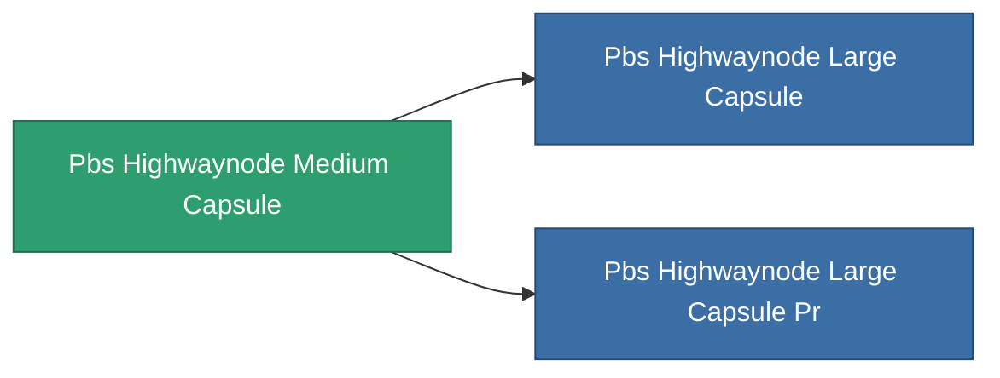

<!-- Generated by tools/generate from the live database (source: entitydefaults definition 5368, aggregatevalues via aggregatefields).
     Do not edit by hand; regenerate instead. -->

# Pbs Highwaynode Medium Capsule

|  |  |
|---|---|
| 定義 | `def_pbs_highwaynode_medium_capsule` |
| ティア | T2 |
| 耐久 | 100 |
| 容量 | 25 |
| 質量 | 225000 |
| カテゴリ | Special & other / Miscellaneous |

## 統計

| フィールド | 値 |
|---|---|
| armor_max | 12.5k |
| core_max | 3.75k |
| core_recharge_time | 345.6k |
| resist_chemical | 225 |
| resist_explosive | 225 |
| resist_kinetic | 225 |
| resist_thermal | 225 |
| signature_radius | 65 |
| stealth_strength | 50 |

<!-- production:generated -->
## 製造

**コンポーネント10個から製造** — コンポーネントを組立てて製造します（全リストは[レシピ](/ja/content/recipes/)を参照）:

**設計図:** [Advanced accelerator strip foundation CT](/ja/content/items/pbs-highwaynode-medium-capsule-cprg/)

<svg class="prod-card-icon" aria-hidden="true"><use href="#mi-grid"/></svg><a class="prod-card-name" href="/ja/content/items/axicol/">Cryoperine</a>

必要: <b>250</b>

<svg class="prod-card-icon" aria-hidden="true"><use href="#mi-grid"/></svg><a class="prod-card-name" href="/ja/content/items/axicoline/">Axicoline</a>

必要: <b>125</b>

<svg class="prod-card-icon" aria-hidden="true"><use href="#mi-grid"/></svg><a class="prod-card-name" href="/ja/content/items/espitium/">Espitium</a>

必要: <b>500</b>

<svg class="prod-card-icon" aria-hidden="true"><use href="#mi-grid"/></svg><a class="prod-card-name" href="/ja/content/items/gamma-buildblock/">Coalimin</a>

必要: <b>125</b>

<svg class="prod-card-icon" aria-hidden="true"><use href="#mi-grid"/></svg><a class="prod-card-name" href="/ja/content/items/gamma-energyblock/">Tiraizin</a>

必要: <b>250</b>

<svg class="prod-card-icon" aria-hidden="true"><use href="#mi-grid"/></svg><a class="prod-card-name" href="/ja/content/items/gamma-offenseblock/">Turilium</a>

必要: <b>125</b>

<svg class="prod-card-icon" aria-hidden="true"><use href="#mi-grid"/></svg><a class="prod-card-name" href="/ja/content/items/hydrobenol/">Hydrobenol</a>

必要: <b>250</b>

<svg class="prod-card-icon" aria-hidden="true"><use href="#mi-home"/></svg><a class="prod-card-name" href="/ja/content/items/pbs-highwaynode-small-capsule/">Pbs Highwaynode Small Capsule</a>

必要: <b>1</b>

<svg class="prod-card-icon" aria-hidden="true"><use href="#mi-grid"/></svg><a class="prod-card-name" href="/ja/content/items/titanium/">Titanium</a>

必要: <b>125</b>

<svg class="prod-card-icon" aria-hidden="true"><use href="#mi-grid"/></svg><a class="prod-card-name" href="/ja/content/items/unimetal/">Briochit</a>

必要: <b>250</b>

## 製造に使用

**2個のアイテムのコンポーネント** — これを使用して生産するすべて:

