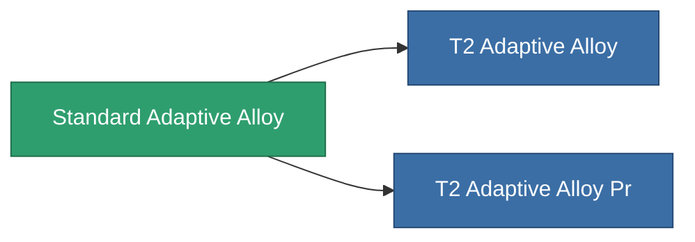

<!-- Generated by tools/generate from the live database (source: entitydefaults definition 8788, aggregatevalues via aggregatefields).
     Do not edit by hand; regenerate instead. -->

# Standard Adaptive Alloy

|  |  |
|---|---|
| 定義 | `def_standard_adaptive_alloy` |
| ティア | T1 |
| 耐久 | 100 |
| 容量 | 1.5 |
| 質量 | 500 |
| カテゴリ | Modules / Enhancements |
| Tier line | **Standard Adaptive Alloy** (T1) → [T2 Adaptive Alloy](/ja/content/items/named1-adaptive-alloy/) (T2) → [T3 Adaptive Alloy](/ja/content/items/named2-adaptive-alloy/) (T3) → [T4 Adaptive Alloy](/ja/content/items/named3-adaptive-alloy/) (T4) |

## 統計

| フィールド | 値 |
|---|---|
| adaptive_resist_points | 60 |
| cpu_usage | 38 |
| powergrid_usage | 12 |

<!-- production:generated -->
## 製造

**コンポーネント9個から製造 、研究レベル 3** — コンポーネントを組立てて製造します（全リストは[レシピ](/ja/content/recipes/)を参照）:

**設計図:** [Standard Adaptive Alloy Cprg](/content/items/standard-adaptive-alloy-cprg/)

<svg class="prod-card-icon" aria-hidden="true"><use href="#mi-grid"/></svg><a class="prod-card-name" href="/ja/content/items/axicol/">Cryoperine</a>

必要: <b>200</b>

<svg class="prod-card-icon" aria-hidden="true"><use href="#mi-grid"/></svg><a class="prod-card-name" href="/ja/content/items/chollonin/">Chollonin</a>

必要: <b>25</b>

<svg class="prod-card-icon" aria-hidden="true"><use href="#mi-grid"/></svg><a class="prod-card-name" href="/ja/content/items/isopropentol/">Isopropentol</a>

必要: <b>65</b>

<svg class="prod-card-icon" aria-hidden="true"><use href="#mi-grid"/></svg><a class="prod-card-name" href="/ja/content/items/metachropin/">Metachropin</a>

必要: <b>65</b>

<svg class="prod-card-icon" aria-hidden="true"><use href="#mi-grid"/></svg><a class="prod-card-name" href="/ja/content/items/plasteosine/">Plasteosine</a>

必要: <b>500</b>

<svg class="prod-card-icon" aria-hidden="true"><use href="#mi-grid"/></svg><a class="prod-card-name" href="/ja/content/items/prilumium/">Prilumium</a>

必要: <b>25</b>

<svg class="prod-card-icon" aria-hidden="true"><use href="#mi-grid"/></svg><a class="prod-card-name" href="/ja/content/items/statichnol/">Statichnol</a>

必要: <b>65</b>

<svg class="prod-card-icon" aria-hidden="true"><use href="#mi-grid"/></svg><a class="prod-card-name" href="/ja/content/items/titanium/">Titanium</a>

必要: <b>200</b>

<svg class="prod-card-icon" aria-hidden="true"><use href="#mi-grid"/></svg><a class="prod-card-name" href="/ja/content/items/vitricyl/">Vitricyl</a>

必要: <b>25</b>

## 製造に使用

**2個のアイテムのコンポーネント** — これを使用して生産するすべて:

