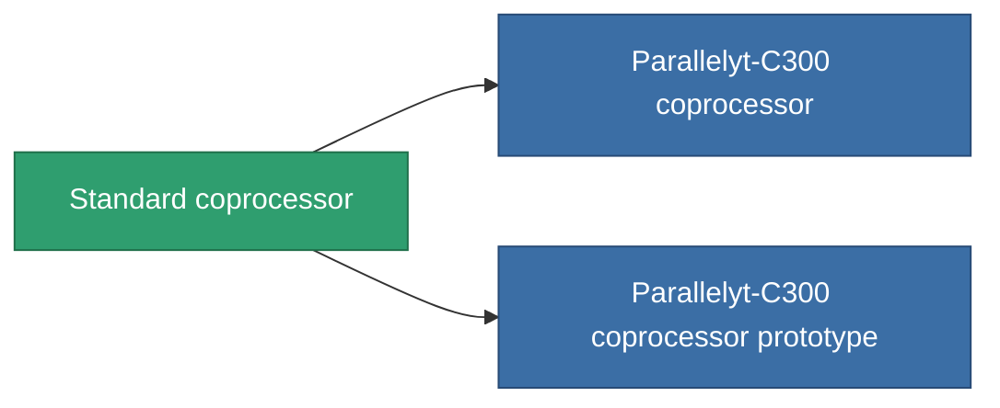

<!-- Generated by tools/generate from the live database (source: entitydefaults definition 48, aggregatevalues via aggregatefields).
     Do not edit by hand; regenerate instead. -->

# Standard coprocessor

|  |  |
|---|---|
| 定義 | `def_standard_cpu_upgrade` |
| ティア | T1 |
| 耐久 | 100 |
| 容量 | 0.01 |
| 質量 | 0.2 |
| カテゴリ | Modules / Enhancements |
| Tier line | **Standard coprocessor** (T1) → [Parallelyt-C300 coprocessor](/ja/content/items/named1-cpu-upgrade/) (T2) → [Cerebellum-1000 coprocessor](/ja/content/items/named2-cpu-upgrade/) (T3) → [Processyt-C1000 coprocessor](/ja/content/items/named3-cpu-upgrade/) (T4) |

## 統計

| フィールド | 値 |
|---|---|
| cpu_max_modifier | 1.1 |
| cpu_usage | 0 |
| powergrid_usage | 3 |

<!-- production:generated -->
## 製造

**コンポーネント2個から製造 、研究レベル 3** — コンポーネントを組立てて製造します（全リストは[レシピ](/ja/content/recipes/)を参照）:

**設計図:** [Standard coprocessor CT](/content/items/standard-cpu-upgrade-cprg/)

<svg class="prod-card-icon" aria-hidden="true"><use href="#mi-grid"/></svg><a class="prod-card-name" href="/ja/content/items/axicol/">Cryoperine</a>

必要: <b>350</b>

<svg class="prod-card-icon" aria-hidden="true"><use href="#mi-grid"/></svg><a class="prod-card-name" href="/ja/content/items/titanium/">Titanium</a>

必要: <b>50</b>

## 製造に使用

**2個のアイテムのコンポーネント** — これを使用して生産するすべて:

