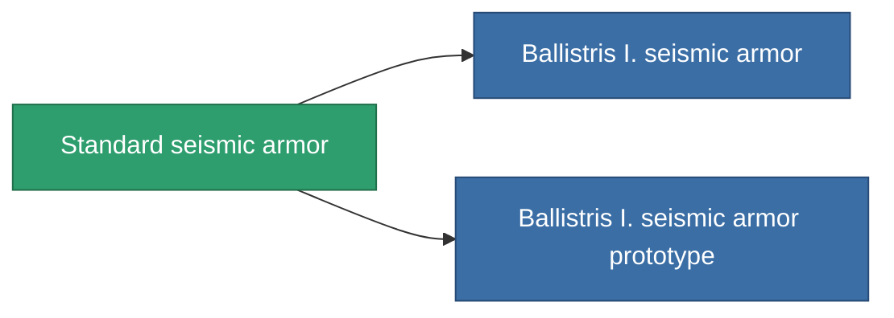

<!-- Generated by tools/generate from the live database (source: entitydefaults definition 27, aggregatevalues via aggregatefields).
     Do not edit by hand; regenerate instead. -->

# Standard seismic armor

|  |  |
|---|---|
| 定義 | `def_standard_exp_armor_hardener` |
| ティア | T1 |
| 耐久 | 100 |
| 容量 | 1 |
| 質量 | 100 |
| カテゴリ | Modules / Armor |
| Tier line | **Standard seismic armor** (T1) → [Ballistris I. seismic armor](/ja/content/items/named1-exp-armor-hardener/) (T2) → [Formantel-DVU seismic armor](/ja/content/items/named2-exp-armor-hardener/) (T3) → [Sheltor seismic armor](/ja/content/items/named3-exp-armor-hardener/) (T4) |

## 統計

| フィールド | 値 |
|---|---|
| core_usage | 13 |
| cpu_usage | 25 |
| cycle_time | 10k |
| effect_resist_explosive | 100 |
| powergrid_usage | 5 |
| resist_explosive | 25 |

<!-- production:generated -->
## 製造

**コンポーネント5個から製造 、研究レベル 3** — コンポーネントを組立てて製造します（全リストは[レシピ](/ja/content/recipes/)を参照）:

**設計図:** [Standard seismic armor CT](/content/items/standard-exp-armor-hardener-cprg/)

<svg class="prod-card-icon" aria-hidden="true"><use href="#mi-grid"/></svg><a class="prod-card-name" href="/ja/content/items/axicol/">Cryoperine</a>

必要: <b>50</b>

<svg class="prod-card-icon" aria-hidden="true"><use href="#mi-grid"/></svg><a class="prod-card-name" href="/ja/content/items/chollonin/">Chollonin</a>

必要: <b>50</b>

<svg class="prod-card-icon" aria-hidden="true"><use href="#mi-grid"/></svg><a class="prod-card-name" href="/ja/content/items/plasteosine/">Plasteosine</a>

必要: <b>125</b>

<svg class="prod-card-icon" aria-hidden="true"><use href="#mi-grid"/></svg><a class="prod-card-name" href="/ja/content/items/statichnol/">Statichnol</a>

必要: <b>125</b>

<svg class="prod-card-icon" aria-hidden="true"><use href="#mi-grid"/></svg><a class="prod-card-name" href="/ja/content/items/titanium/">Titanium</a>

必要: <b>100</b>

## 製造に使用

**2個のアイテムのコンポーネント** — これを使用して生産するすべて:

