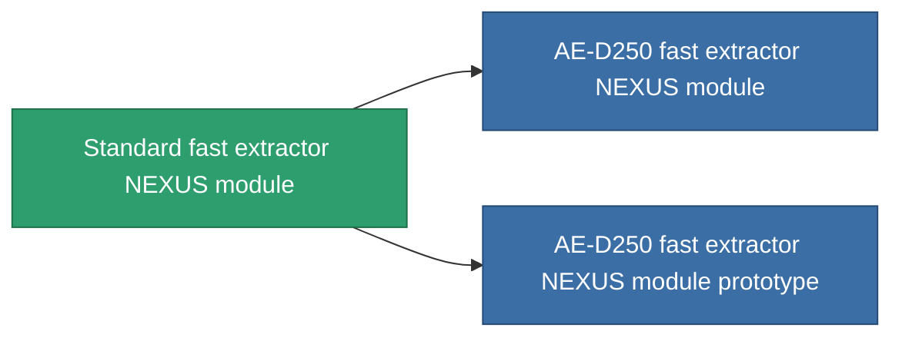

<!-- Generated by tools/generate from the live database (source: entitydefaults definition 2558, aggregatevalues via aggregatefields).
     Do not edit by hand; regenerate instead. -->

# Standard fast extractor NEXUS module

|  |  |
|---|---|
| 定義 | `def_standard_gang_assist_fast_extraction_module` |
| ティア | T1 |
| 耐久 | 100 |
| 容量 | 0.2 |
| 質量 | 50 |
| カテゴリ | Modules / Enhancements |
| Tier line | **Standard fast extractor NEXUS module** (T1) → [AE-D250 fast extractor NEXUS module](/ja/content/items/named1-gang-assist-fast-extraction-module/) (T2) → [Matriot-II fast extractor NEXUS module](/ja/content/items/named2-gang-assist-fast-extraction-module/) (T3) → [Matriot-IV fast extractor NEXUS module](/ja/content/items/named3-gang-assist-fast-extraction-module/) (T4) |
| 備考 | gathering cycletimet csokkent |

## 統計

| フィールド | 値 |
|---|---|
| core_usage | 35 |
| cpu_usage | 85 |
| cycle_time | 10k |
| default_effect_range | 100 |
| effect_gathering_cycle_time_modifier | 0.98 |
| powergrid_usage | 35 |

<!-- production:generated -->
## 製造

**コンポーネント3個から製造 、研究レベル 4** — コンポーネントを組立てて製造します（全リストは[レシピ](/ja/content/recipes/)を参照）:

**設計図:** [Standard fast extractor NEXUS module CT](/content/items/standard-gang-assist-fast-extraction-module-cprg/)

<svg class="prod-card-icon" aria-hidden="true"><use href="#mi-grid"/></svg><a class="prod-card-name" href="/ja/content/items/axicol/">Cryoperine</a>

必要: <b>500</b>

<svg class="prod-card-icon" aria-hidden="true"><use href="#mi-grid"/></svg><a class="prod-card-name" href="/ja/content/items/plasteosine/">Plasteosine</a>

必要: <b>50</b>

<svg class="prod-card-icon" aria-hidden="true"><use href="#mi-grid"/></svg><a class="prod-card-name" href="/ja/content/items/titanium/">Titanium</a>

必要: <b>50</b>

## 製造に使用

**2個のアイテムのコンポーネント** — これを使用して生産するすべて:

