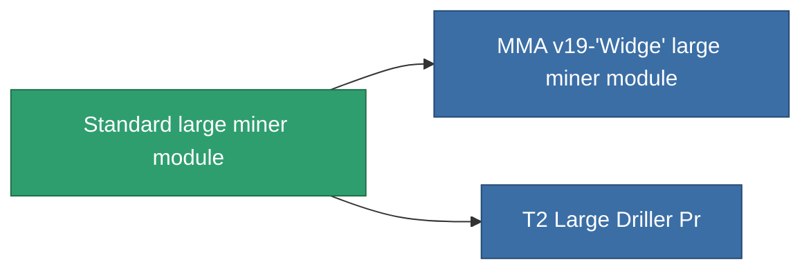

<!-- Generated by tools/generate from the live database (source: entitydefaults definition 8678, aggregatevalues via aggregatefields).
     Do not edit by hand; regenerate instead. -->

# Standard large miner module

|  |  |
|---|---|
| 定義 | `def_standard_large_driller` |
| ティア | T1 |
| 耐久 | 100 |
| 容量 | 2.5 |
| 質量 | 2000 |
| カテゴリ | Modules / Enhancements |
| Tier line | **Standard large miner module** (T1) → [MMA v19-'Widge' large miner module](/ja/content/items/named1-large-driller/) (T2) → [Sublimator Hi-D large miner module](/ja/content/items/named2-large-driller/) (T3) → [Pellex large miner module](/ja/content/items/named3-large-driller/) (T4) |

## 統計

| フィールド | 値 |
|---|---|
| core_usage | 165 |
| cpu_usage | 450 |
| cycle_time | 12k |
| powergrid_usage | 1.35k |

<!-- production:generated -->
## 製造

**コンポーネント2個から製造 、研究レベル 5** — コンポーネントを組立てて製造します（全リストは[レシピ](/ja/content/recipes/)を参照）:

**設計図:** [Standard Large Driller Cprg](/ja/content/items/standard-large-driller-cprg/)

<svg class="prod-card-icon" aria-hidden="true"><use href="#mi-grid"/></svg><a class="prod-card-name" href="/ja/content/items/axicol/">Cryoperine</a>

必要: <b>1.6k</b>

<svg class="prod-card-icon" aria-hidden="true"><use href="#mi-grid"/></svg><a class="prod-card-name" href="/ja/content/items/titanium/">Titanium</a>

必要: <b>2.4k</b>

## 製造に使用

**2個のアイテムのコンポーネント** — これを使用して生産するすべて:

