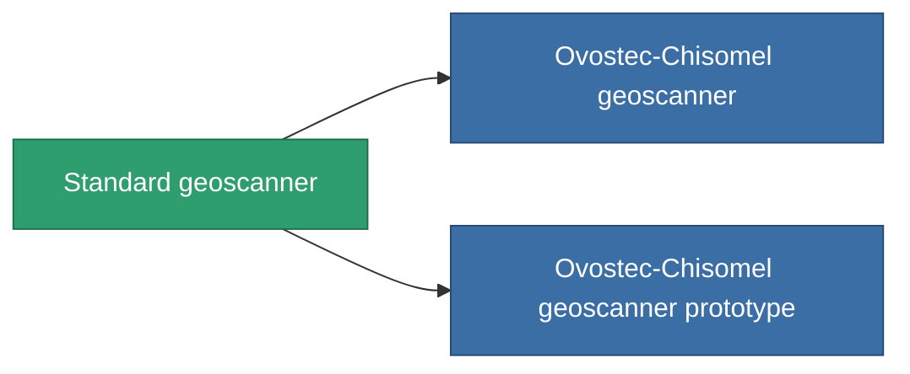

<!-- Generated by tools/generate from the live database (source: entitydefaults definition 228, aggregatevalues via aggregatefields).
     Do not edit by hand; regenerate instead. -->

# Standard geoscanner

|  |  |
|---|---|
| 定義 | `def_standard_mining_probe_module` |
| ティア | T1 |
| 耐久 | 100 |
| 容量 | 1 |
| 質量 | 200 |
| カテゴリ | Modules / Enhancements |
| Tier line | **Standard geoscanner** (T1) → [Ovostec-Chisomel geoscanner](/ja/content/items/named1-mining-probe-module/) (T2) → [Syverz geoscanner](/ja/content/items/named2-mining-probe-module/) (T3) → [Eksplor-q3000 geoscanner](/ja/content/items/named3-mining-probe-module/) (T4) |

## 統計

| フィールド | 値 |
|---|---|
| core_usage | 60 |
| cpu_usage | 45 |
| cycle_time | 15k |
| mining_probe_accuracy | 0.5 |
| powergrid_usage | 50 |

<!-- production:generated -->
## 製造

**コンポーネント2個から製造 、研究レベル 1** — コンポーネントを組立てて製造します（全リストは[レシピ](/ja/content/recipes/)を参照）:

**設計図:** [Standard geoscanner CT](/content/items/standard-mining-probe-module-cprg/)

<svg class="prod-card-icon" aria-hidden="true"><use href="#mi-grid"/></svg><a class="prod-card-name" href="/ja/content/items/axicol/">Cryoperine</a>

必要: <b>350</b>

<svg class="prod-card-icon" aria-hidden="true"><use href="#mi-grid"/></svg><a class="prod-card-name" href="/ja/content/items/titanium/">Titanium</a>

必要: <b>50</b>

## 製造に使用

**2個のアイテムのコンポーネント** — これを使用して生産するすべて:

