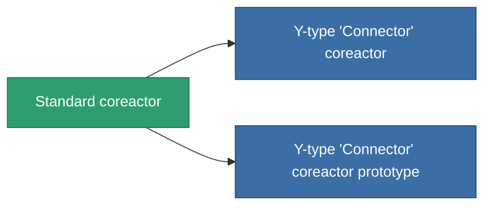

<!-- Generated by tools/generate from the live database (source: entitydefaults definition 42, aggregatevalues via aggregatefields).
     Do not edit by hand; regenerate instead. -->

# Standard coreactor

|  |  |
|---|---|
| 定義 | `def_standard_powergrid_upgrades` |
| ティア | T1 |
| 耐久 | 100 |
| 容量 | 0.5 |
| 質量 | 100 |
| カテゴリ | Modules / Power |
| Tier line | **Standard coreactor** (T1) → [Y-type 'Connector' coreactor](/ja/content/items/named1-powergrid-upgrades/) (T2) → [Palp coreactor](/ja/content/items/named2-powergrid-upgrades/) (T3) → [E-set 15VaW coreactor](/ja/content/items/named3-powergrid-upgrades/) (T4) |

## 統計

| フィールド | 値 |
|---|---|
| cpu_usage | 35 |
| powergrid_max_modifier | 1.1 |

<!-- production:generated -->
## 製造

**コンポーネント2個から製造 、研究レベル 3** — コンポーネントを組立てて製造します（全リストは[レシピ](/ja/content/recipes/)を参照）:

**設計図:** [Standard coreactor CT](/ja/content/items/standard-powergrid-upgrades-cprg/)

<svg class="prod-card-icon" aria-hidden="true"><use href="#mi-grid"/></svg><a class="prod-card-name" href="/ja/content/items/axicol/">Cryoperine</a>

必要: <b>300</b>

<svg class="prod-card-icon" aria-hidden="true"><use href="#mi-grid"/></svg><a class="prod-card-name" href="/ja/content/items/titanium/">Titanium</a>

必要: <b>200</b>

## 製造に使用

**2個のアイテムのコンポーネント** — これを使用して生産するすべて:

