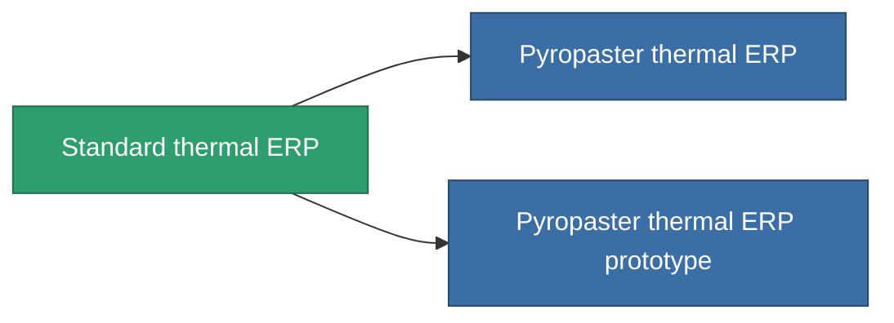

<!-- Generated by tools/generate from the live database (source: entitydefaults definition 3297, aggregatevalues via aggregatefields).
     Do not edit by hand; regenerate instead. -->

# Standard thermal ERP

|  |  |
|---|---|
| 定義 | `def_standard_thermal_kers` |
| ティア | T1 |
| 耐久 | 100 |
| 容量 | 1 |
| 質量 | 500 |
| カテゴリ | Modules / Enhancements |
| Tier line | **Standard thermal ERP** (T1) → [Pyropaster thermal ERP](/ja/content/items/named1-thermal-kers/) (T2) → [DE-melt thermal ERP](/ja/content/items/named2-thermal-kers/) (T3) → [Dyoriva thermal ERP](/ja/content/items/named3-thermal-kers/) (T4) |

## 統計

| フィールド | 値 |
|---|---|
| chemical_damage_to_core_modifier | 0.2 |
| cpu_usage | 50 |
| explosive_damage_to_core_modifier | 0.1 |
| kinetic_damage_to_core_modifier | 0.1 |
| powergrid_usage | 15 |
| thermal_damage_to_core_modifier | 0.5 |

<!-- production:generated -->
## 製造

**コンポーネント5個から製造 、研究レベル 5** — コンポーネントを組立てて製造します（全リストは[レシピ](/ja/content/recipes/)を参照）:

**設計図:** [Standard thermal ERP CT](/ja/content/items/standard-thermal-kers-cprg/)

<svg class="prod-card-icon" aria-hidden="true"><use href="#mi-grid"/></svg><a class="prod-card-name" href="/ja/content/items/axicol/">Cryoperine</a>

必要: <b>200</b>

<svg class="prod-card-icon" aria-hidden="true"><use href="#mi-grid"/></svg><a class="prod-card-name" href="/ja/content/items/isopropentol/">Isopropentol</a>

必要: <b>100</b>

<svg class="prod-card-icon" aria-hidden="true"><use href="#mi-grid"/></svg><a class="prod-card-name" href="/ja/content/items/plasteosine/">Plasteosine</a>

必要: <b>100</b>

<svg class="prod-card-icon" aria-hidden="true"><use href="#mi-grid"/></svg><a class="prod-card-name" href="/ja/content/items/titanium/">Titanium</a>

必要: <b>200</b>

<svg class="prod-card-icon" aria-hidden="true"><use href="#mi-grid"/></svg><a class="prod-card-name" href="/ja/content/items/vitricyl/">Vitricyl</a>

必要: <b>200</b>

## 製造に使用

**2個のアイテムのコンポーネント** — これを使用して生産するすべて:

