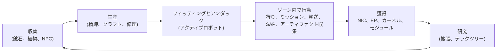

# ゲームでできること

すべてのプレイヤーアクションをシステム別に整理しています。コマンド名はサーバー側の識別子であり、クライアントはこれらのアクションを独自のUIで表示します。アクションごとの詳細な説明は、各システムのページにあります。

ゲームの1つのループ：稼いで使い、ティアラダーを登っていく。

## システム

| システム | ページ | 対象内容 |
|---|---|---|
| 入門 | [入門](/ja/features/getting-started/) | キャラクターの作成/選択、最初のロボット、アカウントの基礎 |
| 移動 | [移動](/ja/features/movement/) | ゾーン、ドッキング、キュー、テレポート、スパークジャンプ、ゲート |
| 収集 | [収集](/ja/features/gathering/) | スキャン、収穫、資源の収集 |
| 戦闘 | [戦闘](/ja/features/combat/) | 戦闘、ダメージタイプ、妨害、アラーム、キルレポート、SOS |
| NPCとPVE狩り | [NPCとPVE狩り](/ja/features/npcs/) | NPCのランクと陣営、弱点、スポーンタイプ、TAP、戦術 |
| 探索 | [探索](/ja/features/exploration/) | アーティファクトとレリック |
| ロボットとフィッティング | [ロボットとフィッティング](/ja/features/robots/) | ロボットの選択、モジュール、弾薬、プリセット、ティント |
| モジュールとフィッティング | [モジュールとフィッティング](/ja/features/modules/) | モジュールファミリーとフィッティングの目安 |
| スパーク | [スパーク](/ja/features/sparks/) | スパークの認可、切り替え、能力ボーナス |
| 研究 | [研究](/ja/features/research/) | 拡張（スキルツリー）、EP、テックツリー |
| キャラクター | [キャラクター](/ja/features/character/) | キャラクターウィンドウ：拡張タブ（スキルツリー）とスパーク |
| 生産 | [生産](/ja/features/production/) | 生産ライン、精錬、修理、再加工、プロトタイプ、CPRG |
| 市場と取引 | [市場と取引](/ja/features/market/) | 市場注文、直接取引、アイテムショップ、クレジット |
| グループ | [グループ](/ja/features/groups/) | 企業、アライアンス、ギャング（フリート） |
| PBS | [PBS](/ja/features/pbs/) | PBS構造、領土、接続 |
| ミッション | [ミッション](/ja/features/missions/) | フィールドミッション、エージェント、ターミナル |
| 輸送 | [輸送](/ja/features/transport/) | ベース間のアイテム輸送 |
| アイテムとインベントリ | [アイテムとインベントリ](/ja/features/items/) | コンテナ、スタック、アイテム名、交換可能アイテム、グッディパック |
| ソーシャル | [ソーシャル](/ja/features/social/) | メール、チャネル、フレンド、評価、イエローページ、ニュース、投票 |
| イントルージョン | [イントルージョン](/ja/features/intrusion/) | NPCサイト襲撃モード |
| アウトポストとSAP | [アウトポストとSAP](/ja/features/outposts/) | アウトポストの所有、安定性、4つのSAPタイプ |
| 近接プローブ | [近接プローブ](/ja/features/probes/) | ゾーン監視プローブ |
| サーバーと参照 | [サーバーと参照](/ja/features/server/) | サーバー情報、ハイアースコア、参照データ、購入 |
| FAQ | [FAQ](/ja/features/faq/) | チュートリアル、陣営選択、最初のステップ、用語 |
| 世界観 | [世界観](/ja/features/lore/) | 設定：ニア、ニアン、シンジケート |
| クライアントとPC設定 | [クライアントとPC設定](/ja/features/client-setup/) | クライアントの実行、マルチボクシング、UIスケーリング |

### 参照

| ページ | 対象内容 |
|---|---|
| [クライアントUI概要](/ja/features/ui/) | EVE風のインターフェース：トップバー、Deploy/Dockボタン、アクションカテゴリ、アンダック状態パネル、このWiki全体で使われる規約 |

エンティティのステータス表は、生成された[コンテンツ](/content/)セクションにあります。

## 完全なアクション一覧

### 入門とアカウント

| アクション | コマンド |
|---|---|
| キャラクターを作成 | `characterCreate` |
| キャラクターを選択（プレイ） | `characterSelect` |
| キャラクターを削除 | `characterDelete` |
| キャラクターの名前を変更 | `characterRename` |
| 名前が利用可能か確認 | `characterCheckNick` |
| スターターロボットをリクエスト | `requestStarterRobot` |
| スターターボックスをリクエスト | `requestInfiniteBox` |
| 新規キャラクター設定データ | `characterWizardData` |
| 自分のプロフィールを表示 | `characterGetMyProfile` |
| 他のキャラクターのプロフィールを表示 | `characterGetProfiles` |
| キャラクターを検索 | `characterSearch` |
| キャラクターを一覧表示 | `characterList` |
| キャラクター設定の取得/設定 | `characterSettingsGet`, `characterSettingsSet` |
| アバターを設定 | `characterSetAvatar` |
| ムードメッセージを設定 | `characterSetMoodmessage` |
| キャラクターにプライベートメモを設定 | `characterSetNote` / `characterGetNote` |
| ホームベースを設定/解除 | `characterSetHomeBase`, `characterClearHomeBase` |
| 自分のキャラクター間でクレジットを転送 | `characterTransferCredit` |
| キャラクターでの取引をブロック/許可 | `characterSetBlockTrades` |
| アカウントのメールアドレス/パスワードを変更 | `changeSessionEmail`, `changeSessionPassword` |
| 活動によるEP履歴を表示 | `accountEpForActivityHistory` |
| アカウントの取引履歴を表示 | `accountGetTransactionHistory` |
| サインアウト/接続の管理 | `signOut`, `connectionStart`, `connectionEnd`, `ping`, `quit`, `isOnline`, `transferData`, `welcome` |
| オンライン中のユーザー | `getCharactersOnline`, `getAccountsWithCharacters` |
| キャラクターの履歴 | `characterNickHistory`, `characterCorporationHistory`, `characterTransactionHistory`, `characterListNpcDeath` |

### 移動とゾーン

| アクション | コマンド |
|---|---|
| ベース/PBSにドッキング | `dock` |
| アンダック | `undock` |
| 強制ドッキング（緊急） | `forceDock` |
| ゾーン入場キューを確認 | `zoneGetQueueInfo` |
| キュー長の優先設定 | `zoneSetQueueLength` |
| キューでの待機をキャンセル | `zoneCancelEnterQueue` |
| ゾーン情報を取得 | `getZoneInfo` |
| ゾーンのセクターを一覧表示 | `zoneSectorList` |
| ゾーンの建造物を一覧表示 | `zoneGetBuildings` |
| SOSを送信（救助要請） | `zoneSOS` |
| 利用可能なテレポートを一覧表示 | `teleportList` |
| テレポートを使用 | `teleportUse` |
| ゾーンオブジェクトへテレポート | `teleportToZoneObject` |
| テレポートチャネルを一覧表示 | `teleportGetChannelList` |
| ワールド全体のテレポートチャネルを照会 | `teleportQueryWorldChannels` |
| スパークチャージを一覧表示 | `sparkList` |
| アクティブなスパークを変更 | `sparkChange` |
| スパークを削除 | `sparkRemove` |
| スパークをアンロック | `sparkUnlock` |
| スパークテレポートの一覧/設定/使用/削除 | `sparkTeleportList`, `sparkTeleportSet`, `sparkTeleportUse`, `sparkTeleportDelete` |
| ゲートの名前を変更 | `gateSetName` |
| ベース情報/所有権/施設/ベース内の自分のアイテム | `baseGetInfo`, `baseGetOwnershipInfo`, `baseListFacilities`, `baseGetMyItems` |
| ベースのドッキング権限を設定 | `baseSetDockingRights` |

### 収集とスキャン

| アクション | コマンド |
|---|---|
| ゾーンをスキャン（鉱石/植物/デプロイ可能スキャン） | `zoneUploadScanResult` |
| 自分の鉱物スキャン結果を一覧表示 | `mineralScanResultList` |
| スキャン結果からアイテムを作成 | `mineralScanResultCreateItem` |
| スキャン結果を削除 | `mineralScanResultDelete` |
| スキャン結果をコンテナ間で移動 | `mineralScanResultMove` |
| アイテムからスキャンデータをアップロード | `mineralScanResultUploadFromItem` |
| ゾーン内のアイテム数をカウント（可視性チェック） | `itemCountOnZone`, `itemCount` |
| キオスク：アイテムの表示/提出 | `kioskInfo`, `kioskSubmitItem` |
| アイテムを使用（汎用 — 収穫可能アイテムを含む） | `useItem` |

### 戦闘

| アクション | コマンド |
|---|---|
| 戦闘アラームの開始/解除（アラーム終了はサーバー駆動） | `alarmStart` |
| 自分のキルレポートを表示 | `getMyKillReports` |
| 自分のハイアースコアを表示 | `getMyHighScores` |
| サーバーのハイアースコアを表示 | `getHighScores` |

### ロボットとフィッティング

| アクション | コマンド |
|---|---|
| アクティブなロボットを選択 | `selectActiveRobot` |
| ロボットを空にする（すべてアンロード） | `robotEmpty` |
| ロボット情報を取得 | `getRobotInfo` |
| ロボットのフィッティング情報を取得 | `getRobotFittingInfo` |
| モジュールを装備 | `equipModule` |
| モジュールを削除 | `removeModule` |
| モジュールを交換 | `changeModule` |
| 弾薬を装備 | `equipAmmo` |
| 弾薬を交換 | `changeAmmo` |
| 弾薬を装備解除 | `unEquipAmmo` |
| ロボットのティントを設定 | `setRobotTint` |
| フィッティングプリセットの保存/一覧/適用/削除 | `fittingPresetSave`, `fittingPresetList`, `fittingPresetApply`, `fittingPresetDelete` |

### 研究（拡張とテックツリー）

| アクション | コマンド |
|---|---|
| 拡張カテゴリを一覧表示 | `extensionCategoryList` |
| すべての拡張を取得 | `extensionGetAll` |
| 習得した拡張を一覧表示 | `extensionLearntList` |
| 前提条件を一覧表示 | `extensionPrerequireList` |
| ポイントで拡張を購入 | `extensionBuyForPoints` |
| EPブーストを購入 | `extensionBuyEpBoost` |
| 利用可能なポイントを取得 | `extensionGetAvailablePoints` |
| ポイントパラメータを取得 | `extensionGetPointParameters` |
| 拡張の履歴 | `extensionHistory` |
| 拡張レベルを1つ削除 | `extensionRemoveLevel` |
| キャラクターの拡張をリセット | `extensionResetCharacter` |
| ロックされたEPを解放 | `extensionFreeLockedEp` |
| 活動によるEPのデイリーログを表示 | `epForActivityDailyLog` |
| 研究レベルを取得 | `getResearchLevels` |
| テックツリー：ノードを研究 | `techTreeResearch` |
| テックツリー：ノードをアンロック | `techTreeUnlock` |
| テックツリー：寄付 | `techTreeDonate` |
| テックツリー：情報/ログ | `techTreeInfo`, `techTreeGetLogs` |

### 生産

| アクション | コマンド |
|---|---|
| 生産ラインを一覧表示 | `productionLineList` |
| ラインを開始 | `productionLineStart` |
| ラインをキャリブレーション | `productionLineCalibrate` |
| ラインのラウンドを設定 | `productionLineSetRounds` |
| ラインを削除 | `productionLineDelete` |
| ラインの次のラウンドを照会 | `productionQueryLineNextRound` |
| 生産をキャンセル | `productionCancel` |
| 精錬（照会 + 実行） | `productionRefine`, `productionRefineQuery` |
| 修理（照会 + 実行） | `productionRepair`, `productionRepairQuery` |
| 再加工（照会 + 実行） | `productionReprocess`, `productionReprocessQuery` |
| コンポーネントの研究（照会 + 実行） | `productionResearch`, `productionResearchQuery` |
| プロトタイプ（開始 + 照会） | `productionPrototypeStart`, `productionPrototypeQuery` |
| 研究キットのマージ（実行 + 照会） | `productionMergeResearchKitsMulti`, `productionMergeResearchKitsMultiQuery` |
| CPRGの鍛造（実行 + 照会） | `productionCPRGForge`, `productionCPRGForgeQuery` |
| CPRG情報 | `productionCPRGInfo` |
| ラインからCPRGを取得（取得 + 照会） | `productionGetCPRGFromLine`, `productionGetCPRGFromLineQuery` |
| 生産保険：購入/一覧/照会/削除 | `productionInsuranceBuy`, `productionInsuranceList`, `productionInsuranceQuery`, `productionInsuranceDelete` |
| 生産コンポーネントを一覧表示 | `productionComponentsList` |
| 施設情報/説明 | `productionFacilityInfo`, `productionFacilityDescription` |
| 進行中のもの（自分/企業） | `productionInProgress`, `productionInProgressCorporation` |
| 生産履歴 | `productionHistory` |
| 生産サーバー情報 | `productionServerInfo` |

### 市場と取引

| アクション | コマンド |
|---|---|
| 売注文を作成 | `marketCreateSellOrder` |
| 買注文を作成 | `marketCreateBuyOrder` |
| 注文を変更 | `marketModifyOrder` |
| アイテム/注文をキャンセル | `marketCancelItem` |
| アイテムを直接購入 | `marketBuyItem` |
| 市場のアイテムを一覧表示 | `marketItemList` |
| 自分が利用可能なアイテムを一覧表示 | `marketAvailableItems` |
| 範囲内のアイテムを一覧表示 | `marketItemsInRange` |
| 自分の市場アイテムを一覧表示 | `marketGetMyItems` |
| 市場情報 | `marketGetInfo` |
| 平均価格（市場/定義/グローバル） | `marketGetAveragePrices`, `marketGetDefinitionAveragePrice`, `marketGlobalAveragePrices` |
| 市場税を変更/税ログを表示 | `marketTaxChange`, `marketTaxLogList` |
| 取引を開始 | `tradeBegin` |
| 自分のオファーを設定/撤回 | `tradeSetOffer`, `tradeRetractOffer` |
| 取引を受諾 | `tradeAccept` |
| 取引をキャンセル | `tradeCancel` |
| 取引完了/状態 | `tradeFinished`, `tradeState` |
| アイテムショップ：一覧/購入 | `itemShopList`, `itemShopBuy` |
| 他のキャラクターにクレジットを転送 | `characterTransferCredit` |

### グループ（企業、アライアンス、ギャング）

| アクション | コマンド |
|---|---|
| 企業を作成 | `corporationCreate` |
| 企業への応募/招待 | `corporationApply`, `corporationCharacterInvite` |
| 応募の承認/応募一覧 | `corporationAcceptApplication`, `corporationListApplications` |
| 自分の応募：一覧/削除 | `corporationListMyApplications`, `corporationDeleteMyApplication` |
| 応募を削除（役員） | `corporationDeleteApplication` |
| 招待に返信 | `corporationInviteReply` |
| 退会/退会キャンセル | `corporationLeave`, `corporationCancelLeave` |
| メンバーを削除/メンバーのロールを設定 | `corporationRemoveMember`, `corporationSetMemberRole` |
| 自分のすべてのロールを解除 | `corporationDropRoles` |
| メンバーを中立に設定 | `corporationSetMembersNeutral` |
| 企業情報/自分の情報/検索 | `corporationInfo`, `corporationGetMyInfo`, `corporationSearch` |
| 企業評価/評判 | `corporationGetMyStandings`, `corporationGetReputation` |
| 企業への寄付/企業からの支払い | `corporationDonate`, `corporationPayOut` |
| 企業クレジットを転送 | `corporationTransfer` |
| 名前を変更/色を設定/情報を設定 | `corporationRename`, `corporationSetColor`, `corporationSetInfo` |
| 代理人を取得 | `corporationGetDelegates` |
| CEO引き継ぎ状況/CEO志願 | `corporationCEOTakeOverStatus`, `corporationVolunteerForCEO` |
| 企業投票：開始/議題設定/一覧/投票/削除 | `corporationVoteStart`, `corporationVoteSetTopic`, `corporationVoteList`, `corporationVoteCast`, `corporationVoteDelete` |
| 掲示板：開始/一覧/新着/投稿/モデレーション/削除 | `corporationBulletinStart`, `corporationBulletinList`, `corporationBulletinNewEntries`, `corporationBulletinEntry`, `corporationBulletinModerate`, `corporationBulletinDelete`, `corporationBulletinEntryDelete`, `corporationBulletinDetails` |
| ハンガー：賃貸/家賃支払い/家賃価格/閉鎖 | `corporationRentHangar`, `corporationHangarPayRent`, `corporationHangarRentPrice`, `corporationHangarClose` |
| ハンガー：一覧（すべて/ベース内） | `corporationHangarListAll`, `corporationHangarListOnBase` |
| ハンガー：フォルダー（作成/削除） | `corporationHangarFolderCreate`, `corporationHangarFolderDelete` |
| ハンガー：アクセス設定/名前設定 | `corporationHangarSetAccess`, `corporationHangarSetName` |
| ハンガーログ：一覧/設定/クリア | `corporationHangarLogList`, `corporationHangarLogSet`, `corporationHangarLogClear` |
| 企業文書：設定/作成/一覧/開く/削除/転送/賃貸/監視/監視解除/本文更新/登録一覧/登録設定 | `corporationDocumentConfig`, `corporationDocumentCreate`, `corporationDocumentList`, `corporationDocumentOpen`, `corporationDocumentDelete`, `corporationDocumentTransfer`, `corporationDocumentRent`, `corporationDocumentMonitor`, `corporationDocumentUnmonitor`, `corporationDocumentUpdateBody`, `corporationDocumentRegisterList`, `corporationDocumentRegisterSet` |
| 履歴：ログ/メンバーロール/企業ロール/ロール/名前/取引 | `corporationLogHistory`, `corporationMemberRoleHistory`, `corporationRoleHistory`, `corporationNameHistory`, `corporationTransactionHistory` |
| アライアンス情報/デフォルト/ロール履歴 | `allianceGetMyInfo`, `allianceGetDefaults`, `allianceRoleHistory` |
| ギャング（フリート）：作成/削除/情報 | `gangCreate`, `gangDelete`, `gangInfo` |
| ギャング：招待/返信/キック/退会 | `gangInvite`, `gangInviteReply`, `gangKick`, `gangLeave` |
| ギャング：リーダー設定/ロール設定 | `gangSetLeader`, `gangSetRole` |

### 電力ベースステーション（PBS）と領土

| アクション | コマンド |
|---|---|
| PBSネットワークを取得 | `PBSGetNetwork` |
| PBSノード情報 | `PBSNodeInfo` |
| PBSノードの名前を変更 | `PBSRenameNode` |
| PBS接続の作成/切断 | `PBSMakeConnection`, `PBSBreakConnection` |
| 接続の重みを設定 | `PBSSetConnectionWeight` |
| PBSのオンライン状態を設定 | `PBSSetOnline` |
| PBS効果を設定 | `PBSSetEffect` |
| デプロイ可能か確認（ここでデプロイできるか？） | `PBSCheckDeployment` |
| 自分の領土を一覧表示 | `PBSGetTerritories` |
| 領土の可視性を設定 | `PBSSetTerritoryVisibility` |
| 評価制限を設定 | `PBSSetStandingLimit` |
| 補強オフセットを設定 | `PBSSetReinforceOffset` |
| 補填情報を取得/設定 | `PBSGetReimburseInfo`, `PBSSetReimburseInfo` |
| PBSにアイテムを供給 | `PBSFeedableInfo`, `PBSFeedItems` |
| ベース解体を設定 | `PBSSetBaseDeconstruct` |
| PBSログ | `PBSGetLog` |

### ミッション

| アクション | コマンド |
|---|---|
| ミッションを開始 | `missionStart` |
| ゾーンからミッションを開始 | `missionStartFromZone` |
| ミッションを中断 | `missionAbort` |
| 納品（ミッション納品） | `missionDeliver` |
| ミッションデータ/オプション/供給 | `missionData`, `missionGetOptions`, `missionGetSupply` |
| ミッションエージェントを一覧表示 | `missionListAgents` |
| 自分の進行中ミッションを一覧表示 | `missionListRunning` |
| ミッションログ | `missionLogList` |
| ミッションに参加者を追加 | `missionPlayerAddsParticipant` |
| フィールドターミナル情報 | `fieldTerminalInfo` |

### 輸送（アイテム配送）

| アクション | コマンド |
|---|---|
| 輸送を提出 | `transportAssignmentSubmit` |
| 輸送を引き受ける（運搬者として） | `transportAssignmentTake` |
| 輸送を一覧表示 | `transportAssignmentList` |
| 輸送内容を一覧表示 | `transportAssignmentListContent` |
| 輸送のコンテナ情報 | `transportAssignmentContainerInfo` |
| 輸送を納品 | `transportAssignmentDeliver` |
| 自分の輸送を取り戻す | `transportAssignmentRetrieve` |
| 輸送をキャンセル/放棄 | `transportAssignmentCancel`, `transportAssignmentGiveUp` |
| 輸送は進行中か？ | `transportAssignmentRunning` |
| 輸送ログ | `transportAssignmentLog` |

### アイテムとインベントリ

| アクション | コマンド |
|---|---|
| コンテナを一覧表示 | `listContainer` |
| アイテムを梱包（バッグ/ボックスに） | `packItems` |
| アイテムを開梱 | `unpackItems` |
| アイテムをスタック | `stackItems`, `stackTo`, `stackSelection` |
| 数量をアンスタック | `unStackAmount` |
| アイテムをコンテナ間で移動 | `relocateItems` |
| アイテムを廃棄 | `trashItems` |
| アイテムの名前を変更 | `setItemName` |
| アイテムを使用 | `useItem` |
| ロトアイテムを使用 | `useLotteryItem` |
| 交換可能アイテム：一覧/交換/有効化 | `redeemableItemList`, `redeemableItemRedeem`, `redeemableItemActivate` |
| グッディパック：一覧/交換 | `goodiePackList`, `goodiePackRedeem` |
| ギフトを開ける | `giftOpen` |
| アイテムを補填 | `ReimburseItem` |

### ソーシャル

| アクション | コマンド |
|---|---|
| メール：一覧/開く/送信/削除/新着数/使用済みフォルダー/フォルダーへ移動/フォルダー削除 | `mailList`, `mailOpen`, `mailSend`, `mailDelete`, `mailNewCount`, `mailUsedFolders`, `mailMoveToFolder`, `mailDeleteFolder` |
| 一斉メール（企業）：送信/一覧/開く/削除/新着数 | `massMailSend`, `massMailList`, `massMailOpen`, `massMailDelete`, `massMailNewCount` |
| フレンド：送信/返信/確認/削除/ブロック/一覧 | `socialFriendRequest`, `socialFriendRequestReply`, `socialConfirmPendingFriendRequest`, `socialDeleteFriend`, `socialBlockFriend`, `socialGetMyList` |
| チャットチャネル：作成/参加/退出/発言 | `channelCreate`, `channelJoin`, `channelLeave`, `channelTalk` |
| チャネル：一覧（すべて/自分の） | `channelList`, `channelMyList`, `channelListAll` |
| チャネル：キック/BAN/解除/ロール/ミュート/パスワード/トピック/通知 | `channelKick`, `channelBan`, `channelRemoveBan`, `channelModifyMemberRole`, `channelGlobalMute`, `channelGetMutedCharacters`, `channelGetBannedMembers`, `channelSetPassword`, `channelSetTopic`, `channelNotification` |
| 直接チャット | `chat` |
| 評価：一覧/履歴 | `standingList`, `standingHistory` |
| 評価を設定（許可されている場合） | `setStanding` |
| デフォルト評価（アライアンス/企業） | `getStandingForDefaultAlliances`, `getStandingForDefaultCorporations` |
| イエローページ：取得/提出/削除/検索 | `yellowPagesGet`, `yellowPagesSubmit`, `yellowPagesDelete`, `yellowPagesSearch` |
| ニュース：カテゴリ/一覧/新着数 | `newsCategory`, `getNews`, `freshNewsCount` |
| 投票：表示/回答 | `pollGet`, `pollAnswer` |

### イントルージョン

| アクション | コマンド |
|---|---|
| SAPアイテムを提出 | `intrusionSAPSubmitItem` |
| SAPアイテム情報を取得 | `intrusionSAPGetItemInfo`, `intrusionSAPItemInfo` |
| 防御しきい値を設定 | `intrusionSetDefenseThreshold` |
| サイト効果ボーナスを設定 | `intrusionSiteSetEffectBonus` |
| 施設をアップグレード | `intrusionUpgradeFacility` |
| サイト情報 | `getIntrusionSiteInfo` |
| ログ：自分の/公開/自分のサイト/安定性 | `getIntrusionLog`, `getIntrusionPublicLog`, `getIntrusionMySitesLog`, `getIntrusionStabilityLog` |
| 安定性ボーナスしきい値 | `getStabilityBonusThresholds` |
| サイトメッセージを設定 | `setIntrusionSiteMessage` |

### 近接プローブ

| アクション | コマンド |
|---|---|
| 自分のプローブを一覧表示 | `proximityProbeList` |
| プローブ登録情報 | `proximityProbeGetRegistrationInfo` |
| プローブの登録を設定 | `proximityProbeRegisterSet` |
| プローブ登録を削除 | `proximityProbeRemove` |
| プローブに名前を付ける | `proximityProbeSetName` |

### サーバーと参照

| アクション | コマンド |
|---|---|
| サーバー情報 | `serverInfoGet`, `systemInfo` |
| ハイアースコア（サーバー/自分の） | `getHighScores`, `getMyHighScores` |
| リフト一覧 | `getRifts` |
| 参照データ：効果/列挙型/エンティティデフォルト/集計フィールド/定義設定/距離 | `getEffects`, `getEnums`, `getEntityDefaults`, `getAggregateFields`, `getDefinitionConfigUnits`, `getDistances` |
| アイテム概要（クライアント参照データ） | `getItemSummary` |
| サーバーコマンドを一覧表示（クライアント側参照） | `getCommands` |
| ストア：製品一覧/取引開始/取引完了 | `steamGetProducts`, `steamStartTransaction`, `steamFinishTransaction` |