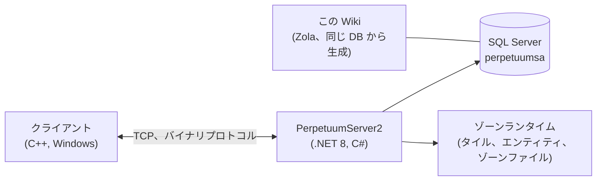

# 開発者向けホーム

開発者／DevOps の視点から見た、ゲームの仕組みをハイレベルで示したマップです。
専用の詳細解説ページは準備中です。当面は、このページで全体像を把握してください。

## 構成要素

- **クライアント** — Perpetuum のゲームクライアント（Windows。実行方法については [クライアントと PC のセットアップ](/ja/features/client-setup/) を参照。Linux 含む）。サーバーとはバイナリ TCP プロトコルで通信し、プレイヤーのすべての操作は名前付きの *コマンド* として扱われます（この Wiki の [アクション一覧](/ja/features/#wan-quan-naakusiyonyi-lan) でも同じ名称を使用しています）。
- **サーバー（PerpetuumServer2）** — C#/.NET 8 で構成されたコードベースです。1 つのプロセスでサーバー全体を動作させます。接続レイヤー、ゲームロジック（ロボット、ゾーン、ミッション、マーケット、生産、研究）、そして各ゾーンのタイル世界（地形、エンティティ、テレポート）をティックするゾーンランタイムです。
- **データベース** — SQL Server、データベース `perpetuumsa`。静的なゲームコンテンツ（エンティティのデフォルト値、レシピ、拡張、テックツリー、ショップ、テレポートの説明）と、すべての動的状態（キャラクター、ロボット、コンテナ、マーケット、ゾーン状態）を格納します。
- **ゾーンファイル** — ゾーンはタイルグリッド（高度レイヤー＋制御レイヤー、1 タイルあたり 2 バイト）で、`.gbf` アーカイブとして配布され、ゾーンごとに編集できます。[ゾーンファイル形式](/ja/formats/zone-files/) を参照してください。
- **参照データ** — クライアントは起動時にサーバーからステータステーブルをダウンロードします（[サーバーと参照データ](/ja/features/server/) を参照）。

## 実行方法

- サーバーは SQL Server と一緒に Docker Compose で実行されます（`perpetuumserver2` プロジェクト）。この Wiki のジェネレーターは、その DB コンテナを読み取ります。
- 静的コンテンツは **plantrules** のルールファイルに対して検証されます。この Wiki の C# ジェネレーター（`make generate`）は同じエコシステムで動作し、同じデータベースを読み取るため、このサイトのすべての生成テーブルは稼働サーバーのデータを反映しています。
- この Wiki のゾーンテレポートマップは、ゲーム本体が使用するのと同じ高度レイヤーからレンダリングされています。

## 次のステップ

- **[フォーマット](/ja/formats/)** — 開発者向けフィールドリファレンス。すべてのステータスフィールドがどのように保存されるか（DB カラム、ルールファイルのキー、バイナリレイヤーのバイト）と、どのように使用されるかを、具体例とともに説明します。
- **[サーバーと参照データ](/ja/features/server/)** — メタシステム。サーバー情報、ハイスコア、クライアントがダウンロードする参照データ、ゲーム内ストアです。

> さらに多くの開発者向けページ（プロトコル、ゾーンライフサイクル、デプロイ）を計画しています。このページはそれらの入り口です。