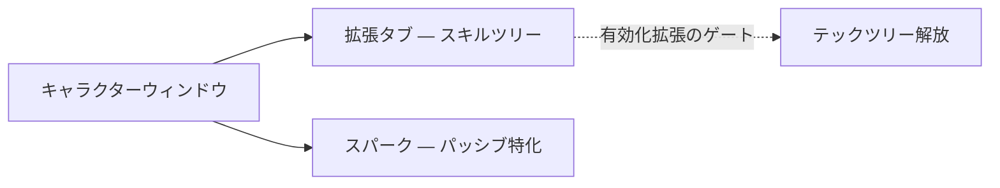

# キャラクター

**キャラクターウィンドウ**（上部バー → **キャラクター**、左上）は、キャラクターの
成長情報が集約される場所です：プロフィール、クレジット、**拡張**（スキル）、設定。
このページの内容はすべてキャラクターごとに管理されます。アカウントには複数の
キャラクターを保持でき、それぞれに独自のツリーがあります。UI の場所は
[クライアント UI 概要](/ja/features/ui/)を参照してください。

## 拡張

**拡張タブ**はキャラクターのスキルツリーです：キャラクターごとにスキルレベル
が管理され、ゲームプレイの解放と属性の調整を行います。特に重要なのは、
ロボットクラスのパイロットに必要な**有効化拡張**です。レベル 1 はクレジット
を消費し、それ以降のレベルは Extension Points（EP）を消費し、前提条件が
進行を制限します。

- [メインカテゴリ](/content/extensions/#categories) — 15 のカテゴリを一目で確認：
  どのカテゴリがどのカテゴリを解放するか（ボックスをクリックするとそのカードにジャンプ）
- [カテゴリ別の拡張](/content/extensions/#table) — すべての拡張：ランク、
  価格、ボーナス、前提条件
- EP とテックツリーの仕組み：[研究](/ja/features/research/)

## スパーク

あなたの**スパーク**は、キャラクターにインストールされたナノボット特化です —
アクティブの間、そのボーナスはあなたがパイロットするすべてのロボットに適用されます。
スパークの切り替えにはコストが発生し、上位ラインは認可によって解放が制御されます。
詳細は [スパーク](/ja/features/sparks/)を参照してください。