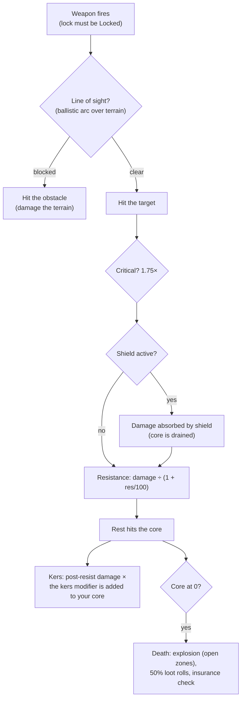

# 戦闘

戦闘はアクティブなロボットを使用して**ゾーン内**で行われます。他のプレイヤー（PvP）、NPC、および敵対的な構造物と戦うことになります。このページでは、サーバー側で確認されているメカニクスを扱います。詳細なダメージ計算やフィッティングの相互作用については、[ロボットとフィッティング](/ja/features/robots/)を参照してください。

> UIの配置は[クライアントUIの概要](/ja/features/ui/)に準拠しています。ロボットの**シールド / アーマー / ハル、およびエネルギー**は、出撃中（undocked）のステータスパネルに表示されます。戦闘中のターゲティングおよび武器操作の詳細は、現時点では記載されていません。

## 戦闘への突入

- 戦闘は**出撃中（undocked）**にのみ可能です。この状態ではプレイヤー自身がアクティブなロボットそのものとなります。
- オープン（PvP）ゾーンで他のプレイヤーに向けて攻撃用兵器を発射すると、攻撃者に**PvPフラグ**が付与されます。反撃を行うか、すでにフラグが付与されているプレイヤーに対して支援モジュールを使用した場合も、自身にフラグが付与されます。フラグの持続時間は**5分間**（`effect_pvp`の定義では300,000ミリ秒）で、新たな敵対行動を取るたびに更新されます。
- フラグが有効な間は以下の制限がかかります：
  - **テレポートを使用できない**（携帯テレポートを含む）。
  - **通常のドック（帰還）ができない** — 唯一の脱出手段は**フォースドック（強制ドック）**であり、これはフラグによって意図的にブロックされない仕様となっています。

## 戦闘対象

- **他のプレイヤーのロボット**（PvP）。
- **NPC** — ゾーン内のNPCは**フロック（群れ）**（共通の行動パターンを持つグループ）として編成されています。
- ゾーン内の**敵対的な構造物 / 設置型オブジェクト（deployables）**。

## ロボットが破壊された場合

ロボットは**破壊**され、撃破された場所に**ルートコンテナ（残骸）**が出現します。戦利品（ルート）はアイテムごとに判定され、それぞれ50%の確率でドロップします：

| 対象 | 結果 |
|---|---|
| 装備されていた各**モジュール** | 50%の確率で**破損（要修理）**状態でドロップ。それ以外は消滅 |
| 各モジュールに装填されていた**弾薬** | 50%の確率でドロップ（モジュール自体がドロップした場合のみ） |
| **カーゴ**（パック / ボックス） | 中身がルートとしてドロップし、パック自体は破壊 |
| カーゴ内のその他の**スタック可能アイテム** | 50%の確率でドロップ（数量はランダムに減少、残りは消滅） |
| 適用されていた**ペイント / ティント** | 50%の確率でペイントアイテムとしてドロップ |
| **ロボット本体** | 破壊 — 有効な**保険**に加入していた場合を除き消滅。保険があった場合は補償金がクレジットで支払われます（ロボット自体は失われます） |

**保険**（基地の保険施設にドックして加入 — [生産 → 保険](/ja/features/production/)を参照）の有効期間は**15日間**（拡張ボーナス日数が加算）です。各ロボットにはコンテンツ定義に基づいた**保険料**と**補償額**が設定されています（`insuranceprices`テーブル — 67種類のロボット定義）。保険料は拡張ボーナスによって減額可能で、コーポレーションウォレットからの支払いも可能です。スターターロボットには保険を掛けられません。保険は1 +（拡張ボーナス）機まで加入可能です。

撃破された後は、**アクティブなロボットが存在しない**状態になります。ゲームに復帰するには以下の方法があります：

- 必要なイネーブラー拡張を満たしている、所有中の**別のロボットを選択する**。
- ドック中に**スターターロボットを要請する** — ただし撃破直後は短いロック時間が発生します：**プレイヤーに撃破された場合は3分間、NPCの場合は1分間**。**NPC**に撃破された場合は、基地へ帰還した際に自動的に**無料のスターターロボット**が支給されます。

## 戦線離脱（脱出）

戦闘が不利になった場合の選択肢：

- **フォースドック（強制ドック）** — 緊急脱出手段。戦闘中であっても、ゾーンから直ちに離脱してメイン基地（TMA）へ即座にドックします。
- **SOS** — もう1つの脱出手段。通常の出撃待機時間（7秒）が経過した後、現在の基地へドックします。

どちらも命綱となる手段ですが、フォースドックはいわば「絶体絶命」の緊急ボタンです。

## ターゲットロック、射程、および命中判定

- **まずはロック。** 武器は*ロック完了*したターゲットに対してのみ発射でき、ロックゲージが満たされる必要があります。ターゲットのロックにはロボットの**ロック時間（locking time）**（ミリ秒単位のステータス）を要し、ロック処理中の発射は拒否されます。同時に複数のターゲットをロックできますが（**最大ロック数**ステータスによって制限）、*プライマリ*に指定できるのは1つのみであり、一部の武器はプライマリターゲットにのみ発射可能です。
- **最適射程 + 減衰距離（falloff）。** 武器の**最適射程（optimal range）**内では全ダメージを与えられます。それを超えると、**減衰距離（falloff）**に応じてダメージが滑らかに減少していきます。減衰距離の中間点では約半分、端ではゼロになります。最適射程 + 減衰距離を超えた範囲では、ダメージは一切与えられません。
- **爆発範囲 vs. ターゲットサイズ。** 射撃武器（ガン）に「ミス」はありません。ガンの**精度（accuracy）**ステータスは爆発半径として機能し、その値よりもターゲットの**シグネチャ**が小さい場合、ダメージは比例して減少します。ミサイルは完全に外れる（ミスする）可能性があり（ミス確率はロボットのミサイル精度ステータスに依存）、命中した場合は**爆発半径**にわたってダメージを与えます。ガンと同様に、ターゲットが小さいほど受ける爆風ダメージは少なくなります。
- **クリティカルヒット。** 各射撃ごとに**クリティカル率**が判定されます。クリティカルが発生するとヒット全体のダメージが1.75倍になり、さらに全ヒットのダメージには±10%のランダムなブレが発生します。
- **射線（Line of Sight）。** 弾道は直線を描くため、地形、障害物、植物によって遮られます。ミサイルは放物線を描いて飛翔するため低い遮蔽物を越えられますが、仰角には限界があるため高台の地形には遮られます。
- **自身のシールドによる射撃制限。** 自身のシールドがアクティブになっている間は、武器を発射することができません。

### ダメージ属性

ダメージは弾薬に依存します。すべての弾薬には1つ以上のダメージ属性値が設定されており、通常は1つの主属性と、それより小さい副属性で構成されます（ミサイル弾は爆発＋キネティックまたはケミカル、レーザークリスタルは熱＋ケミカル、レールガン弾はキネティック＋熱）。属性の種類：

| 属性 | 備考 |
|---|---|
| **ケミカル（化学）** | ガンおよびレーザー弾薬の一般的な構成要素 |
| **キネティック（運動）** | レールガン、実弾投射武器、ミサイル弾薬 |
| **サーマル（熱）** | レーザー、一部の実弾投射武器の弾薬 |
| **エクスプロシブ（爆発）** | ミサイル |
| **トキシック（毒）** | 一部のガン弾薬。植物および地形にのみダメージを与える |
| **エレクトリック（電撃）** | 特殊効果（スコーチャーなど） — **シールドを貫通** |

受けるダメージは、その属性に対するターゲットの**耐性（レジスタンス）**によって軽減されます。耐性50%の場合、ダメージは 50 / (50 + 100) ≈ 33% 軽減されます。耐性はシールドを*通過した*ダメージにのみ適用されます。シールドが最初にダメージを吸収し、そのコストはシールドのエネルギーから消費されます（被弾が大きいほど消費エネルギーも増大します）。**カーズ（Kers）**モジュールを装備すると、耐性適用後であっても、特定属性ダメージの一部をシールドエネルギーに直接還元させることができます。[アダプティブアロイ](/ja/features/modules/#moziyuruxi-tong)は、実際に被弾している属性に合わせて耐性を自動再配分します。

## 探知、マスキング、および速度

- **探知 vs. マスキング。** ユニットを視認できる距離は、自身の**探知（detection）**ステータスに比例して伸び、ターゲットの**マスキング（masking）**ステータスに比例して縮みます（概算でおよそ 100 m × 探知 ÷ マスキング）。自身をロックしているユニットは、そのマスキング値にかかわらず常に視認可能です。ステルスモジュールは自身のマスキングを一時的に上昇させます（[モジュール](/ja/features/modules/)を参照）。なお、マイン（地雷）は専用の探知範囲を使用します。
- **ブロブ（Blob）。** 一部のユニットや構造物は*ブロブ*フィールドを放出しています。エミッターの有効半径内に留まっている間、ユニットのブロブレベルが上昇します。2つのブロブ閾値の間では、**ロック時間が増加し**（基礎値の最大6倍まで）、**ロック射程およびセンサ強度が低下します**（最大で半分まで）。
- **速度。** 最高速度は質量に応じて低下します：速度 = 基礎速度 × (設計質量 ÷ 実際の質量)。追加のモジュール、アーマー、カーゴを1トン装備するごとに速度は低下します。
- **デモビライゼーション（Demobilization / "demob"）。** ウェバー効果はターゲットの最高速度を低下させます。その減速効果の強さはターゲットの**質量感（massiveness）**に比例します。重量級のユニットほど強い減速効果を受けるため、大型で鈍重なターゲットほど影響を大きく受けます。

## アラーム

**アラーム**は、ゾーン内の**アラームスイッチ**（ミッション関連の構造物）によって起動されます。起動すると：

- 設定された一定の**アラーム期間**（ミッションによって設定され、通常は短時間）作動します。
- 期間中、プレイヤーは**スイッチの有効範囲内に留まり続ける**必要があります。数秒ごとに位置判定が行われ、範囲外へ離脱するとアラームはキャンセルされます。
- 同時に起動できるアラームは**1つのみ**です。

アラームはミッションコンテンツに紐づいています — [ミッション](/ja/features/missions/)を参照してください。

## キルレポート

戦闘履歴は**キルレポート**として確認できます：

- **期間**でフィルタリング。
- **役割**でフィルタリング：**被害者（victim）**、**攻撃者（attacker）**、または**撃破者（killer）**。

自身の撃破された経緯や、破壊した相手を確認するために利用できます。

## ハイスコア

- **サーバーハイスコア** — サーバー全体の上位記録。
- **マイハイスコア** — プレイヤー個人の自己ベスト記録。

## 実践的なアドバイス

- **油断して撃破されないこと** — ロボットを破壊されると、再艤装や再要請の間ダウンタイムが発生します。
- **フォースドックは即座に発動する** — 敵に敵わないと判断したら、すぐにTMAへ退避しましょう。再艤装は後からでも可能です。
- **PvP中はテレポートが制限される** — 脱出経路は事前に計画しておきましょう。戦闘中にワープして逃げることはできません。
- **アラームは予兆のシグナル** — アラームが作動している場所は、そのエリアでミッションイベントが進行中であることを意味します。

<!--
Developer notes: rewritten 2026 from backend sources; no community-wiki text reused.
Verified against:
- Locking: Zones/Locking/LockHandler.cs (locking time in ms from
  AggregateField.locking_time; MaxLockedTargetsProperty; one primary lock;
  lock states Inprogress -> Locked), Zones/Locking/Locks/Lock.cs,
  Zones/Locking/LockValidator.cs (dead/not-lockable/out-of-range validation);
  ZoneSession.cs (weapons take an existing lock id; firing a weapon whose lock is
  not fully Locked raises LockIsInProgress — there is NO auto-lock on fire).
- Damage: Modules/Weapons/Damage.cs (CalculateDamages: crit = attacker.
  CriticalHitChance, CRITICALHIT_MOD 1.75, random 0.9-1.1; falloff =
  cos(x*PI)/2+0.5 with x=(distance-optimal)/falloff; zero beyond optimal+falloff;
  explosion modifier = target.SignatureRadius/explosionRadius clamped 0..1;
  toxic excluded from unit damage), Modules/Weapons/WeaponAmmo.cs (damage values
  per type live on the ammo: damage_chemical/thermal/kinetic/explosive/toxic;
  firearm adds damage_toxic to plants).
- Weapons: Modules/Weapons/FirearmWeaponModule.cs (CheckAccuracy always false —
  firearms never miss; WithExplosionRadius(Accuracy) — accuracy IS the blast
  radius), Modules/Weapons/MissileWeaponModule.cs (miss when rnd >
  robot.MissileHitChance; missile_miss property), WeaponModule.cs (shield active
  => ShieldIsActive error; LOS check before firing).
- Resistances: Units/Unit.cs GetResistByDamageType = resist/(resist+100);
  Zones/DamageProcessors/DamageProcessor.cs (shield absorbs first, paid from
  core: coreDamage = damage * AbsorbtionModifier; Electric damage penetrates as
  coreDamage; kers = damage * type kers modifier, scaled by
  (sin(core/coreMax*PI)/2)+0.5, added to target core);
  EffectModules/ShieldGeneratorModule.cs (AbsorbtionModifier =
  max(SigRadius/shieldRadius,1)/shieldAbsorbtion).
- Damage types: Modules/Weapons/DamageType.cs — Chemical, Kinetic, Thermal,
  Explosive, Toxic, Electric (no "seismic"; missile damage is Explosive).
  Electric is only produced by ScorcherModule.cs in this backend.
- Detection: Units/Unit.Visibility.cs (IsDetected: range = 100/max(1,
  target.StealthStrength)*max(1, DetectionStrength); locked-on-you always
  visible; mine detection range separate); stealth_strength property includes
  effect_stealth_strength_modifier (stealth modules raise masking).
- Speed: Units/UnitProperties/SpeedMaxProperty.cs (speed_max * Mass/ActualMass;
  dreadnought => 0.05; massiveness/drone/highway effect modifiers).
- Demob: Modules/EffectModules/WebberModule.cs (effect_demobilizer; effect
  property = module value + target.Massiveness, clamped at 1.0 — heavier targets
  get the full effect; longrange webbers additionally require LOS; accuracy
  check via optimal-range modifier).
- Blob: Zones/Blobs/BlobHandler.cs (emitters raise blob level inside
  BlobEmissionRadius; between blob_level_low/high the multiplier scales:
  locking_time modifier -5, i.e. lock time x(1+5*m) — up to 6x base at full blob, max_targeting_range *0.5,
  sensor_strength *0.5).
- LOS: Zones/LineOfSight.cs (raycast vs terrain blocks incl. Plant flag;
  ballistic arc for missiles: max amplitude 16 m over 40 m);
  Zones/Terrains/BlockingFlags.cs (Obstacle/Plant/Decor/Island block).
Corrections vs ingested page: "seismic" damage type does not exist (explosive
does); "firearms lose damage instead of missing" verified (accuracy = explosion
radius); auto-lock on fire NOT in backend (lock must be created and completed
first); "interference" (emission/minimum/peak, emitters, anomaly degradation)
has NO equivalent in this backend — only a comment in Services/RiftSystem/Rift.cs
— section removed; shield "absorbs" is core-energy based, and Electric damage
penetrates it.
Developer files: Zones/Locking/*; Zones/Locks via Zones/Locking/Locks/*;
Modules/Weapons/*.cs; Zones/DamageProcessors/*.cs; Units/Unit.Visibility.cs;
Units/Unit.cs; Units/UnitProperties/SpeedMaxProperty.cs;
Modules/EffectModules/ShieldGeneratorModule.cs, WebberModule.cs,
StealthModule.cs; Modules/ScorcherModule.cs; Zones/Blobs/*.cs;
Zones/LineOfSight.cs; Zones/ZoneSession.cs (lock/fire packet handling).
Previously verified (kept as-is): PvP flag = effect_pvp 300000 ms
(effect_pvp definition), raised by attack/aggro/support (Player.cs
ApplyPvPEffect); blocks teleport + normal dock (CantDockThisState), ForceDock.cs
has no PvP check; death loot 50% rolls (Player.cs OnUnitDeath,
Services/Looting/LootHelper.cs DROP_CHANCE 0.5); insurance (InsuraceFacility.cs,
InsuranceHelper.cs, insuranceprices 67 defs); starter-robot lock 3 min PvP /
1 min NPC; alarms (Zone/AlarmStart.cs, AlarmSwitch.cs); kill reports
(GetMyKillReports.cs); high scores (GetHighScores.cs / GetMyHighScores.cs).
-->