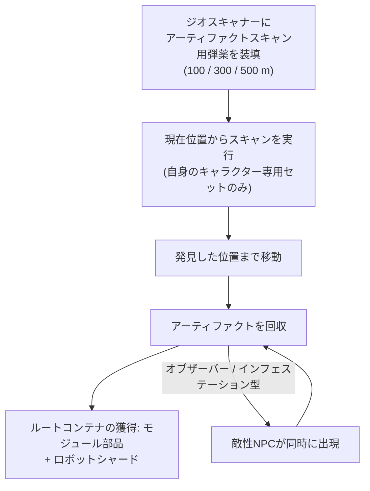

# 探査（アーティファクトとレリック）

探査（Exploration）とは、地形に隠された価値ある資源を発見する活動であり、あらゆるレベルにおいて優れたソロ向けアクティビティです。これには、個人向けで不可視の**アーティファクト（Artifacts）**と、全体に公開され争奪戦となる**レリック（Relics）**の2種類が存在します。

## アーティファクト探索

アーティファクトは**キャラクターごと**に存在するポイントです。サーバーは各島のキャラクターごとに個別のアーティファクトセットを管理しているため、発見したものは完全に自分だけのものとなります。スキャンを行うまでは視認できません。

1. ジオスキャナーモジュールに**アーティファクトスキャン用弾薬（artifact scan charges）**を装填します。弾薬にはスキャン範囲の異なる3つのグレード（100 / 300 / 500 m）があります。
2. ロボットの現在位置からスキャンを実行します。スキャナーは範囲内にあるアーティファクトの位置を返します（ジオスキャナーの精度ステータスが高いほど、報告される位置のブレが小さくなります）。
3. 発見された位置まで移動してアーティファクトを回収します。その場に**ルートコンテナ（loot container）**が出現します。

アーティファクト探索は、収集活動であると同時に戦闘アクティビティでもある理由として、以下の2点が挙げられます。

- 一部のアーティファクトタイプは**敵NPCを同時に出現させます**。「オブザーバー（observer）」および「インフェステーション（infestation）」バリアントは、アーティファクト発見と同時に敵性NPCを引き寄せるため、戦闘可能な機体で挑む必要があります。
- ドロップ内容はアーティファクトのタイプごとにランダムです。モジュール部品（装甲プレート、ハードナー、ジェネレーター、リペアラーなど）や、勢力固有の研究・製造材料となる**ロボットシャード（robot shards）**が手に入ります。このロボットシャードこそが、アーティファクト探索を主要な産業系キャリアたらしめている要因です。

アーティファクトのタイプにはティア（レベル1～3、レベルが高いほどドロップ量が増加）があり、中立型および各勢力専用のバリアントが存在します。

## レリック探索

レリックは**オープンワールド**上に存在します。ゾーン内のランダムな位置に出現し（ランダムなブレ幅を伴う約90分のリスポーンサイクル）、光柱（ビーム）を放つオブジェクトとして視認でき、最初に回収したプレイヤーが報酬を獲得します。報酬はNICの抽選と**ロボットシャード**で構成され、レリックのレベルと島の価値ティアに応じてスケールします（シャードはアーティファクト探索で得られるものと同じです）。

レリックのタイプは島ごとにティア分けされており（レベル1～3、レベルによってEP値が異なる）、中立型、勢力専用型、産業型のバリアントが存在します。一部のレリックは[前哨基地（outposts）](/ja/features/outposts/)に関連付けられています。SAPアクティビティでは最大12時間持続する独自のレリックが出現し、オープンPvPの島ではスポーン地点が係争地帯となるため、他の探索者との遭遇を想定しておく必要があります。

## ミッションによる報酬

[ミッション](/ja/features/missions/)経由でアーティファクト関連の業務を請け負うことも可能です。この場合、報酬は直接支払われ、回収した物資はプレイヤーのインベントリではなく雇用主に納品されます。

<!--
Written from scratch against the server backend, 2026-09-27:
Zones/Artifacts/Repositories/ZoneArtifactRepository.cs (per-character artifact
rows), Zones/Scanning/Scanners/Scanner.Artifact.cs (scan range + accuracy),
Zones/Artifacts/Generators/Loot/ (random loot per type),
Services/Relics/RelicManagers/ZoneRelicManager.cs (~1.5 h respawn + random
window) and SAPRelic.cs (12 h lifespan),
artifacttypes/artifactloot/relictypes/relicloot tables,
ammo_artifact_scan_a/b/c (scan ranges 100/300/500).
An earlier version of this page was adapted from the Open Perpetuum
community wiki (perpetuum.miraheze.org) and has been fully rewritten from
backend sources; no text was reused.
-->