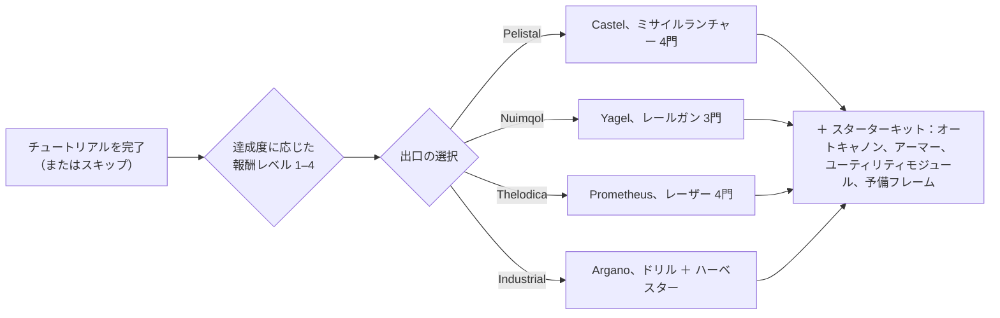

# FAQ

## チュートリアルはスキップできますか？

訓練ゾーンを途中で離れることは可能ですが、完了時に得られる報酬を放棄することになります。
キャラクターがチュートリアルを終了すると、サーバーは次の処理を実行します：

- **初期NIC**およびチュートリアルでの達成度に応じた**報酬レベルごとのボーナス**を支給（報酬レベルは4段階あります）。
- 選択した種族とスクールに応じた**デフォルトのコーポレーション**に配属。
- **初期エクステンション（スキル）**および**スパーク**を付与。
- **スターターロボット**を生成し、New Virginiaドッキング基地にドックさせ、そこを**ホーム基地（home base）**として設定 — ロボットが撃破された際にリスポーンする場所となります。
- そのドッキング基地のパブリックコンテナに**報酬アイテム**を配置し、歓迎メールを送信。

## チュートリアルはどのように完了しますか？

目標を順番に進めてください。クライアントの**ルーキーチェックリスト（Rookie Checklist）**（上部バーのヘルプメニュー）で進行状況を確認でき、下部バーに固定することも可能です。どこまで進んだかによって報酬レベルが決まり、退出時に受け取れる報酬ティアが決定されます — レベル1での退出は第1ティアのみですが、完全クリアすれば4つのティアすべてを受け取れます。

## 各出口では何が得られますか？

選択によって3つの要素が決定されます：操縦する**スターターロボット**、受け取る**報酬アイテム**、そして配属される**デフォルトコーポレーションと初期スキル**です。それ以外のすべて — どのスキル、どのロボット、どの勢力の装備であっても — 後からEPとNICで習得・購入できるため、この選択は初期キットの決定であり、将来を縛るものではありません。

| 出口 | スターターロボット（装備済み） | 報酬テーマ |
|---|---|---|
| **Pelistal** | Castel — ミサイルランチャー 4門 | ミサイル ＋ オートキャノン |
| **Nuimqol** | Yagel — レールガン 3門 | レールガン弾薬 ＋ オートキャノン |
| **Thelodica** | Prometheus — レーザー 4門 | レーザークリスタル ＋ オートキャノン |
| **Industrial** | Argano — ドリル 2基、ハーベスター、採掘プローブ | 採掘、収穫、およびアーティファクトスキャン弾薬 |

すべての出口には、弾薬付きの小型オートキャノンセット、アーマーおよびユーティリティモジュール（アーマーリペアラ、センサーブースターまたは質量削減器、コアリチャージャー、ダメージ修正器）、2つ目の（空の）フレーム、そして最高報酬レベルでは壁爆弾（wall-bomb）カプセルが含まれます。

## 外に出たら何をすればよいですか？

ほぼすべてのアクティビティでスキル用のEPと装備用のNICを稼ぐことができます：

- 採掘、収穫、アーティファクト探査を行い、得た資源を[マーケット](/ja/features/market/)で売却する。
- NPCを撃破し、[戦利品](/ja/features/npcs/)を売却する。
- 材料を集めるか購入してアイテムを[製造](/ja/features/production/)する。
- [ミッション](/ja/features/missions/)を遂行する — ターミナルや前哨基地で提示されるものはすべて、単独で完遂可能です。

オープンワールドPvPが初めての方は、まず[はじめにのサバイバル指針](/ja/features/getting-started/#survival)をお読みください。

## 訓練ゾーンに再入場できますか？

いいえ。訓練ゾーンは新規キャラクター専用であり、一度退出すると再入場はできません。目標を再確認したい場合、ヘルプメニューのルーキーチェックリストは引き続き利用可能です。また、いつでも新しいキャラクターを作成してテスト用サンドボックスとしてチュートリアルに残しておくこともできます。

## 略語一覧

チャット、マーケット出品、フィッティングでよく使われる略語です。ほとんどの用語には専用のページがあります（適宜リンクされています） — アイテム名はサイト検索で調べることができます。

| 用語 | 意味 |
|---|---|
| **EP** | [エクステンションポイント（Extension Points）](/ja/features/research/#ep-sources) — [エクステンション](/ja/features/character/#extensions)のアップグレードに使用されるアカウント共通のスキル通貨（獲得ルールは[研究ページ](/ja/features/research/#ep-sources)を参照）。 |
| **NIC** | ニアンクレジット（Nian Credit） — ゲーム内通貨（キャラクターの`credit`残高）。 |
| **CT** | [CPRG — キャリブレーションプログラム](/ja/features/production/#cprg-calibration-programs) — 生産ライン（ミル）が製造前に調整されるプログラム（アイテムごとに1つ、材料/時間効率を持つ）。 |
| **Proto** | プロトタイプアイテム — [プロトタイプ施設](/ja/features/production/#the-item-lifecycle-the-circular-process)で製造されるモジュール/ロボットの上位ティア派生型（前ティアの個体を消費；[ティア進行](/ja/features/production/#tier-progression)を参照）。 |
| **LWF** | 軽量化フレーム（Lightweight frame） — 質量を軽減するアーマーモジュール（クライアント内表記は「… lightweight frame」、例：*Niani lightweight frame*）。アーマー値を犠牲にしてロボットを軽量化します。 |
| **TP / tele** | [テレポート](/ja/features/movement/) — 固定地点間、または展開されたモバイルテレポート装置への高速移動。 |
| **SAP** | サービスアクセスポイント（Service Access Point） — 前哨基地の[安定度](/ja/features/outposts/)アクティビティ。 |
| **Stab** | 武器スタビライザー（Weapon Stabilizer） — 武器の命中精度を向上させるモジュール。 |
| **Demob** | デモビライザー（Demobilizer） — 敵ロボット（およびそのモジュール）の速度を低下させるモジュール。 |
| **EWar** | 電子戦（Electronic Warfare）モジュール（ジャミング、センサー抑制、ステルス）。 |
| **EnWar** | エネルギー戦（Energy Warfare）モジュール（コアイジェクター、ドレイン、ニュートラライザー、トランスファー）。 |
| **Tuning** | チューニング — 他のモジュールを強化するアップグレードモジュールの呼称 — 武器ダメージ修正器、採掘機・収穫機用の*産業チューニング*、アーマーリペアラチューニングなど。 |
| **MK2** | ロボットの改良型（`_mk2`フレーム） — より高い性能と独自の個別研究ラインを持ちます。 |

ロボットクラスはクライアント内のグループ分類に準拠しています — [ロボットクラス](/content/robots/#robot-classes)の注記を参照してください。

<!--
Written from scratch against the server backend, 2026-09-27:
Zones/Teleporting/Strategies/TrainingExitStrategy.cs (exit rewards, NIC,
corporation, extensions, spark, starter robot, home base, reward items),
Zones/Training/Reward/TrainingReward*.cs + trainingrewards/robottemplates
(reward levels 1-4, per-race starter packs and items),
Robots/Robot.Properties.cs (race ids 1=Pelistal, 2=Nuimqol, 3=Thelodica, 5=industrial).
An earlier version of this page was adapted from the Open Perpetuum
community wiki (perpetuum.miraheze.org) and has been fully rewritten from
backend sources; no text was reused.
-->