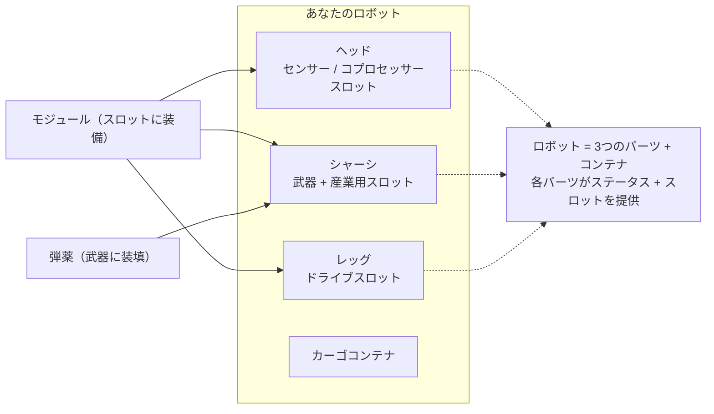

# フィッティング

フィッティングとは、ロボットのコンポーネントスロットに**モジュール**を装備し、武器に**弾薬**を装填することを指します。すべてのフィッティングは**ドック内限定**であり、ゾーン（フィールド）内で行うことはできません。

> UIの配置は[クライアントUI概要](/ja/features/ui/)（トップバーの**Equip**カテゴリー）に準拠しています。以下の仕様・挙動はサーバー側で確認済みです。

## モジュールの装備（フィッティング）

ロボットには複数の**コンポーネント**（武器、シールド、アーマー、ドライブ、センサーなど）があり、それぞれに複数の**スロット**が備わっています。

- **モジュールを装備する** — コンテナからモジュールを取り出し、特定のコンポーネントスロットに装備します。モジュールのタイプは、そのロボットクラスの該当スロットに対応している必要があります。スロットにすでにモジュールが装備されている場合、既存のモジュールはコンテナへ返却されます。
- **モジュールを入れ替える** — 同じコンポーネントの2つのスロット間でモジュールを移動・入れ替えます。
- **モジュールを取り外す** — スロットからモジュールを取り外し、コンテナに戻します。

サーバーは変更が行われるたびにロボットのステータスを再計算します（モジュールはアンドック時のステータスパネルに表示される数値に影響します。詳細は[戦闘](/ja/features/combat/)を参照してください）。

## 弾薬の装填

- **弾薬を装填する** — 互換性のある弾薬アイテムをアクティブ（武器）モジュールに装填します。モジュールはその**弾薬タイプに対応している**必要があり、モジュールの**弾薬許容量（ammo capacity）**まで装填されます。事前に装填されていた弾薬がある場合は、まずコンテナに返却されます。
- **弾薬を変更する** — 装填済みの弾薬を、互換性のある別のタイプに入れ替えます。
- **弾薬を取り出す** — 装填されている弾薬をコンテナに戻します。

## フィッティングプリセット

**プリセット**とは、保存して素早く再適用できるフィッティング構成のことです：

- **保存（Save）** — ロボットの現在のフィッティング構成に名前を付けて保存します。
- **一覧表示（List）** — 保存済みのプリセットを確認します。
- **適用（Apply）** — コンテナ内のアイテムを使用して、プリセットを（別の）ロボットに適用・装備します。
- **削除（Delete）** — 保存したプリセットを削除します。

プリセットは、戦闘後の再装備時や役割（ロール）を変更する際に便利です。

## 実践的な注意事項

- **ゾーン内ではフィッティング不可** — ここで説明するすべての操作はドック内で行う必要があります。
- **前提エクステンションの習得が先** — 該当するロボットクラスの研究が完了していない場合、そのロボットを選択したり操縦したりすることはできません。
- **弾薬は武器と一致させる必要がある** — 互換性のない弾薬の定義は拒否されます。
- **再梱包（リパッケージ）されたロボットは使用不可** — ロボットを選択またはフィッティングする前に、開梱（アンパック）してください。
- **プリセットを活用して迅速に再装備** — 実績のある有効な構成を保存しておけば、機体を喪失した後の再配備をスムーズに行えます。

## スロットカテゴリー

ロボットのコンポーネント（ヘッド、シャーシ、レッグ）には**スロット**が用意されており、各スロットにはカテゴリーフラグが設定されています。モジュールの持つフラグがスロットのフラグの**サブセット（部分集合）**である場合のみ、そのスロットにモジュールを装備できます。フラグのカテゴリーは以下の通りです：

`small`、`medium`、`large`、`turret`、`missile`、`melee`、`industrial`、`ew_and_engineering`、`specialized`（特化スロットは特化モジュールのみを受け入れます）、および構造的な `head` / `chassis` / `leg` スロット。

モジュールによっては特定のロボットに限定されている場合や、同時に1つしか装備できない**unique**（固有）フラグが付いている場合もあります。モジュールごとのステータスへの影響については、自動生成された[ロボット一覧表](/content/robots/)に記載されています。