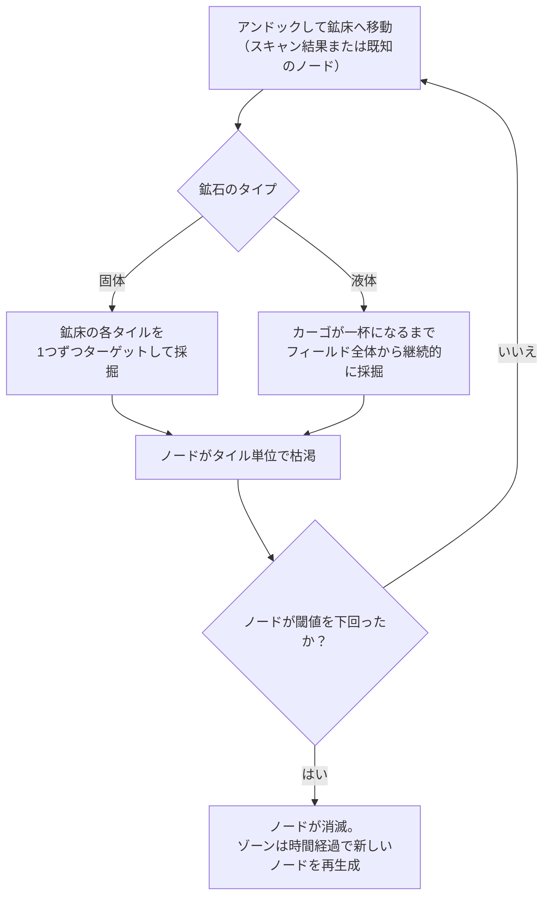
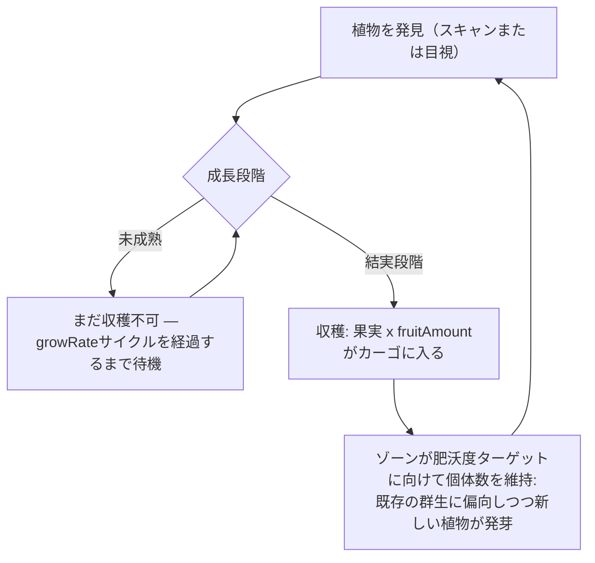
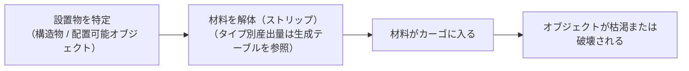

# 採取とスキャン

ゲーム内の資源は、ゾーン内の3つの供給源から得られます。**鉱脈（鉱床）**、**植物**、そして**設置物（デプロイヤブル）**です。このページでは、それぞれの仕組みと収集サイクルの流れについて解説します。

> UIの配置については [クライアントUIの概要](/ja/features/ui/) を参照してください。スキャンおよび収穫アクションは、**アンドック時アクション**リスト（ゾーン滞在時の画面右上）にあります。資源タイプごとの産出量は、生成されたテーブルを参照してください：[コンテンツ → 鉱石](/content/ores/) および [コンテンツ → 植物](/content/plants/)。以下のメカニクスはサーバーの実装に基づいて確認されています。

## 基本的なサイクル

1. **アンドック**してゾーンに移動します（[移動](/ja/features/movement/) を参照）。
2. ロボットのスキャナーモジュールでエリアを**スキャン**します。
3. **採取** — 鉱石を採掘する、植物の実を摘む、または設置物を解体（ストリップ）します。
4. **ドック**して、カーゴの内容物を基地のコンテナに納入します。

## 鉱脈

- 鉱石は、ゾーン全体に点在する**鉱床（ノード）**として地中に存在します。
- これらを発見・記録するには、現在搭乗しているロボットに**ジオスキャナーモジュール**を装備している必要があります。スキャンを実行すると**スキャン結果**が生成されます。その後、それを**アップロード**することで個人の鉱物スキャンリストに保存されます。
- 保存されたスキャン結果は、**一覧表示、移動、削除、またはアイテムへの変換**が可能です（加工/生産に使用される「鉱物スキャン」アイテム）。

- 鉱床は**有限**です。各ノードが保持する総量には上限があります。ノードの採掘量が閾値を下回るとそのノードは消滅し、ゾーンは設定された上限まで時間をかけて**新しいノードを再生成**します。ノードの配置方法や植物の個体数維持の仕組み（実際のゾーンを例にした解説）については、[ゾーン → 生成](/zones/generation/) を参照してください。
- **固体鉱石 vs 液体鉱石。** 固体鉱石はタイル単位で枯渇します。フィールドの各タイルが空になるまで1つずつターゲットして採掘する必要があります。液体鉱石はフィールド全体から汲み上げるため、カーゴに空きがある限り採掘機を連続稼働させることができます。その手軽さゆえに、液体鉱石は価値が低くなる傾向があります（採掘に必要なスキルや集中力が少なくて済むため）。

### 植物と鉱石のステータス一覧

鉱石と植物の挙動は、タイプごとのルールデータによって制御されています。プレイヤーにとって重要な項目は以下の通りです：

| 項目 | ゲーム内での意味 |
|---|---|
| `fertility` | そのタイプの希少度/豊富度 — 値が高いほど、ゾーンはその個体数を多く維持しようとします |
| `growRate` | 植物が次の段階に進むまでに各段階に留まる必要がある成長サイクル数（値が大きいほど遅い） |
| `spreading` | 群生（グループ）して育つか、散在して育つか |
| `killDistance` | 同種の植物同士の最小間隔 |
| `slope` / `minSlope` | 植物が生育可能な地形の傾斜度 |
| `allowedAltitudeLow/High` | 植物が生育可能な高度帯 |
| `allowedWaterLevelLow/High` | 海岸線からの距離帯（沿岸植物の形成に使用） |
| `fruitingState` | 生産可能（収穫可能）になるまでに到達すべき成長段階 |
| `fruitDefinition` / `fruitAmount` | 植物から収穫できる産出物と基本量 |
| `maxAmount` | 処理エリア内に存在できる同タイプの最大数上限 |
| `health` | 成長段階ごとのヒットポイント（成長が進むほど頑丈になる場合があります） |
| `damageScale` | 植物のダメージ耐性 |
| `playerSeeded` | プレイヤーが植えた場所にのみ存在する植物かどうか |
| `onlyOnUnprotectedZone` | 非保護ゾーン（ベータ/ガンマクラス）にのみ自生するかどうか |

項目ごとの完全なリファレンス（タイプ、デフォルト値、ストレージ、ゾーンティックでの使用方法）については、[フォーマット → 植物の項目](/ja/formats/plant-fields/) を参照してください。

## 植物

- 植物は複数の段階を経て**時間経過とともに成長**します。各段階で一定の成長サイクル（`growRate`）を消費した後、ランダムなタイミングで次の段階へ移行します。
- 植物は**結実段階に達して初めて果実（資源）を生産**します。未成熟の植物は収穫できません。
- ゾーンは**肥沃度ターゲット（fertility target）**に向けて植物の個体数を維持します。ある区画の植物が肥沃度レベルに対して不足している場合、新しい植物が芽吹きます。選ばれる種は各植物の `fertility` に応じて重み付けされ、`spreading` により既存の群生地周辺での成長が優先されます。

- 一部の植物は**プレイヤーによる種まき（player-seeded）**が必要であり（プレイヤーの農園にのみ存在）、また一部は**非保護ゾーン限定**です。
- 植物は**ダメージを受けて破壊される**ことがあります。その耐久力は `health` および `damageScale` によって決定されます。

## 設置物（デプロイヤブル）

設置物とは、ゾーン内に配置されたオブジェクトのことです（構造物側の仕様については [パワーベースステーション](/ja/features/pbs/) を参照）。一部の設置物は**解体（ストリップ）**して材料を回収できます。解体のルールおよびタイプごとの産出量は、生成されたテーブルを参照してください：[コンテンツ → 鉱石](/content/ores/) および [コンテンツ → 植物](/content/plants/)。

## キオスク

**キオスク**はミッション関連の構造物です。ミッションの一環として（範囲内で）**アイテムを納入**します。キオスク自体は資源の採取源ではありません。詳細は [ミッション](/ja/features/missions/) を参照してください。

## 実践的なヒント

- **スキャンにはモジュールが必要** — ジオスキャナーを装備していなければ、スキャン結果は得られません。
- **スキャン結果は個人固有** — キャラクターごとに保存され、共有されません。
- **鉱床のリスポーンは緩やか** — 何もないエリアがある場合、鉱床は隠れているのではなく消滅しています。再生成によってノード数は回復しますが、即時ではありません。
- **成熟したものを収穫する** — 結実段階の植物のみが完全な収穫量をもたらします。それより若い段階では何も得られません。

<!-- TODO: only the client UI flow remains (scan screen, harvest interaction, cargo UI) —
     needs a running client. Per-type ore yields are at /content/ores/ and plant fruit
     definitions at /content/plants/ (generated from the live DB).
     Developer notes: Zone/ZoneUploadScanResult.cs (GeoScannerModule required);
     MineralScanResult*.cs (per-character repository);
     Zones/Terrains/Materials/Plants/PlantRule.cs (all plant rule fields);
     Zones/Terrains/NatureCube.cs (GrowPlants, fertility/spreading/killDistance logic);
     Zones/Terrains/Materials/Minerals/MineralLayer.cs (ore node lifecycle);
     Zone/UseItem.cs + UseItemVisitor.cs (IUsableItem harvest path);
     Zone/KioskSubmitItem.cs (mission item submission, range-limited). -->