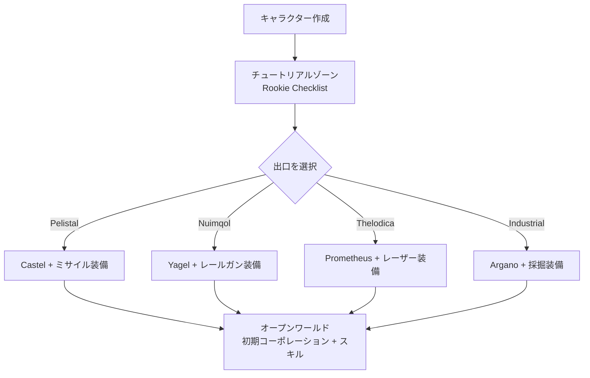

# ゲームの始め方

このページでは、ゲーム開始時の手順を解説します。キャラクターの作成、最初のロボットの入手、そして初期段階で触れることになるキャラクターレベルの設定について説明します。

> UIの配置については[クライアントUI概要](/ja/features/ui/)を参照してください。以下のメカニクスはサーバーの実装に基づいて確認されています。

## ゲームを入手する

Perpetuumは[Steam](https://store.steampowered.com/app/223410/Perpetuum/)で無料でプレイできます。

  <a class="steam-card-link" href="https://store.steampowered.com/app/223410/Perpetuum/" target="_blank" rel="noopener">
    
    Perpetuum on Steam — 基本プレイ無料
  </a>

## 最初に見るべきガイド動画

Open Perpetuum Projectによる公式ガイドです。カードをクリックするとその場で再生されます。

  

    
    &#9654;
    
Perpetuum Online Tutorial Walkthrough. + Extension Advice and lots more.

  

  

    
    &#9654;
    
Syndicate Careers Help — Artifacting

  

  

    
    &#9654;
    
Open Perpetuum Tutorial — How to run multiple clients

  

## キャラクターの作成

- 作成前に**名前が使用可能か確認**できます（`characterCheckNick`）。
- **キャラクターを作成** — キャラクターはアカウントに紐付けられます。1つのアカウントで複数のキャラクターを所持できますが、同時にプレイできるのは1体のみです。
- **キャラクターを選択**してプレイを開始します。キャラクターを切り替えると、現在選択中のキャラクターは選択解除されます。
- 作成後でもキャラクター名を**変更**できます（名前が使用可能である必要があります）。
- 不要になったキャラクターは**削除**できます。

## 最初のロボット

- **基地にドックしている間**、**初期ロボットをリクエスト**できます（基地施設機能 — 基地アクションの場所については[クライアントUI概要](/ja/features/ui/)を参照）。
  - 基地に初期ロボットの在庫が残っている必要があります。人気の基地では在庫切れになる場合があり、その場合リクエストは失敗します。
  - 初期ロボットのリクエストには、キャラクターごとに**5分間のクールダウン**があります。
  - 新しいロボットは基地のパブリックコンテナに納品されます。

- ドック中は**「インフィニットボックス（infinite box）」をリクエスト**することもできます。これは**5,000クレジットの手数料**でインベントリに追加される特殊なコンテナです。これは利便性のためのコンテナであり、無料のリソースを提供するものではありません。

## キャラクター設定

- **アバター** — キャラクターの外見。
- **ムードメッセージ** — 他のプレイヤーに表示される短い一言。
- **プライベートノート** — 自分のキャラクター上でのみ自分自身に表示されるメモ。
- **ホーム基地** — ホーム基地を設定または解除します。ゲーム内で安全な場所に移動させる必要がある場合のデフォルトのドック先となります。
- **設定** — キャラクターごとの環境設定（取得/設定）。
- **トレードブロック** — キャラクターのトレード機能のオン/オフを切り替えます。
- **クレジット** — 同一アカウント内の自身のキャラクター間でクレジットを送金したり、取引履歴を確認したりできます。
- **アカウントレベル** — セッションのメールアドレス/パスワードの変更、アカウントの取引履歴、アクティビティに応じたEP獲得履歴を確認できます。

## ログアウトと再ログイン

- **サインアウト**するとセッションが終了し、**キャラクター選択**で再開します。
- サーバーから切断（キック）された場合（強制的に基地へ戻された場合など）、ドックされた状態で再出現します — [移動](/ja/features/movement/)を参照してください。

## チュートリアル

新規キャラクターはトレーニングゾーンで開始し、**ルーキーチェックリスト（Rookie Checklist）**が提示されます。これは必ず完了させてください。基本操作を学べるだけでなく、モジュールや弾薬がセットになった複数のロボットが報酬として手に入ります。スキップ（アンドックして勢力の出口へ向かう）することも可能ですが、報酬は失われ、後からトレーニングゾーンに戻ることはできません。4つの勢力の出口で得られる内容については、[FAQ](/ja/features/faq/)に記載されています。

## 生き残るための心得

Perpetuumは「リスクとリターン」が表裏一体のサンドボックスであり、ロボットが撃破されるとそれを失います。ドック中か否か、プレイヤーかNPCのどちらに撃破されたかを問わず破壊され、[ホーム基地](#kiyarakutashe-ding)で再出現します（手ぶらで到着した場合は、そこで無料の初期ロボットをリクエストできます）。損失を致命傷にしないためのルールは以下のとおりです。

- **失っても買い直せるものだけを持ち出すこと。** アンドックすることは賭けです。ロボットが撃墜されれば、機体も装備していたモジュールも失われます（あるいは残骸として戦利品になります）。発進する前に、その損失に耐えられるかを必ず確認してください。
- **ゾーンの特性を把握すること。** 保護された（PvE）島は他のプレイヤーから攻撃されず安全ですが、オープンPvPの島は何の犯罪・ペナルティシステムもない自由戦闘地帯です。マップについては[ゾーン](/zones/)を参照してください。
- **NPCの挙動を知ること。** オレンジ色のマーカーは攻撃されるまで敵対しませんが、赤色のマーカーは接近するだけで攻撃してきます。距離を取り、射線を切る（障害物に隠れる）ことでヘイト（アグロ）を解除できます。[NPCとPvEハント](/ja/features/npcs/)を参照してください。
- **リスクはただ受け入れるのではなく、軽減すること。** 最高峰のT4装備を積んだメックでオープンPvPの島に向かうのは、みすみす愛機を破壊されに行くようなものです。元を取るのに20往復かかる高価な機体よりも、数回の往復で元が取れる安価で代替可能な装備のほうが優れています。
- **持続可能な経済基盤を築くこと。** ミッション、採取、狩り、生産、輸送など、何をするにしても誰かがそれに対してNICを支払ってくれます。1日調子が悪かったからといって収入がゼロにならないよう、予備の資産を手元に残しておきましょう。

## 次に行うべきこと

1. 初期ロボットを選択し、[ハンガー＆フィッティング](/ja/features/robots/)画面の使い方を学びましょう。
2. アンドックしてゾーンへ移動しましょう — [移動](/ja/features/movement/)を参照してください。
3. 地面をスキャンして資源の採取を始めましょう — [採取](/ja/features/gathering/)を参照してください。
4. 最初の拡張（エクステンション）を研究しましょう — [研究](/ja/features/research/)を参照してください。
5. キャリア（プレイスタイル）を選びましょう — 選択肢の一覧は[FAQ](/ja/features/faq/)にあります。

<!-- TODO(Phase 1): verify client UI flow (account creation screen, character wizard).
     UI model: see features/ui.md (EVE-style, project-provided).
     Developer notes: Perpetuum.RequestHandlers.Characters/* (CharacterCreate,
     CharacterSelect, CharacterRename, CharacterSetHomeBase, ...);
     RequestStarterRobot (5-minute cooldown, base stock), RequestInfiniteBox
     (5000 credits, docked-only). -->