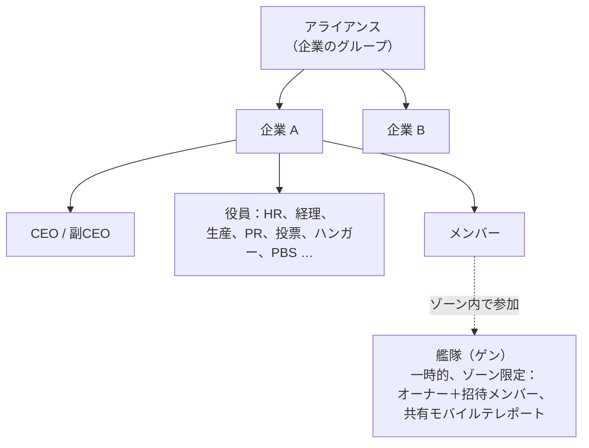

# グループ

3つのグループ化があります：**企業**（主な組織）、**アライアンス**（企業のグループ）、
**艦隊（ゲン）**（ゾーンプレイ用の一時的なグループ）。

> UIの場所は[クライアントUI概要](/ja/features/ui/)に従います（左上の**企業**ボタン；
> **企業ストレージ**カテゴリ；艦隊には専用のウィンドウがある）。以下のメカニクスは
> サーバーで確認済みです。

## 企業

### 参加と退会
- **企業を設立** — 基本的な企業管理拡張
  （レベル1）と設立費用 **250,000 NIC** が必要です。正式名称、
  **ショートID**（最大6文字、地形上に表示され、メンバーを識別する）、
  **税率**（メンバーの収益、特にミッション報酬から自動的に企業アカウントに
  振り込まれる割合）を選択します。
- 企業に**申請**する、またはキャラクターを**招待**する。
- **申請を承認** / **申請一覧を表示**（役員）。
- 受け取った招待に**返信**する。
- **退会**する、または保留中の退会を**取り消す**。
- **メンバーを削除**、**メンバーのロールを設定**、**自分のロールを解除**、またはメンバーを
  中立にする。

### ロール
企業にはロールの階層があります。ロールは実行可能な操作を制限します — 例：企業
テックツリーノードの解除、ハンガーの管理、PBSの編集（[pbs](/ja/features/pbs/)を参照）。
サーバーで定義されたロール（`CorporationRole`）：

- **CEO** — 完全な管理権限。
- **副CEO** — 副長。
- **HRマネージャー** — メンバー管理（申請/招待/削除）。
- **企業代表** / **アライアンス代表** — 組織を代表して行動。
- **経理** — 企業資金。
- **生産マネージャー** — 企業の生産。
- **投票管理者** — 投票。
- **PRマネージャー** — 広報 / 掲示板。
- **ハンガーアクセス（low / medium / high / secure）** — ハンガー権限のティア、対応する
  **ハンガー削除** ティアと **ハンガーオペレーター** ロールがあります。
- **PBS表示 / PBS編集** — 企業のPBS構造を表示または変更。
- **テックツリー一覧 / 解除** — 企業のテックツリーを表示または解除。

典型的な権限ゲートの例：メンバーシップ操作（申請/招待/削除、ロール設定）には
**CEO / 副CEO / HRマネージャー** が必要；掲示板とPRには **CEO / 副CEO / PRマネージャー** が必要；
企業資金と施設アップグレードには **CEO / 副CEO / 経理** が必要（生産には
**生産マネージャー** も必要）；PBSの展開には **CEO / 副CEO / PBS編集** が必要。

自分のロール履歴とメンバーのロール履歴を確認できます。ハンガースペースはレンタル制です
（サーバーのデフォルト設定：7日ごとに50,000クレジット）。

### 情報と検索
- **企業情報 / 自分の情報** — 詳細と自分のメンバーシップ。
- 企業を**検索**する。
- **評価 / 評判** — 自分の企業の評価と評判。
- **代表** — 企業を代表して行動するキャラクター。

### 資金
- 企業ウォレットに**寄付**する。
- そこから**支払い**を行う。
- ウォレット間で**送金**する。

### 外観とプロフィール
- **名前を変更**、**色を設定**、**情報設定**（公開プロフィール）。
- **ロゴ** — 固定のシンボルセットから最大5つを使用でき、それぞれを編集可能
  （サイズ、透明度、レイヤー）。作成または変更できるのは該当する権限を持つメンバーのみ。
- **名前履歴** — 過去の名前。

### CEO
- **CEO志望**する、または**CEO乗っ取り状態**を確認する。
- **実際の乗っ取り**：CEOが**30日間**オフラインになると、副CEOが
  乗っ取りを開始できます — **48時間のカウントダウン**が始まり、企業
  ウィンドウで告知されます。CEOまたは他の副CEOは即座に**拒否権**を行使できます
  （CEOがまだログインしない場合、拒否権は次の試行を止めません）。カウントダウンが
  ゼロになると、その副CEOが完全な権限を持つCEOになります。

### 投票
企業は**投票**を行うことができます：
- 投票を**開始**、**議題を設定**、投票を**一覧表示**、**投票する**、投票を**削除**。

## 掲示板
企業が運営する掲示板：
- **開始**、エントリを**一覧表示**、**新着エントリ**を確認、エントリを**投稿**、**モデレーション**
  （他者のエントリを編集/削除）、**詳細**を表示。

## 企業ハンガー（ストレージ）
ベースにある企業の共有ストレージエリア：
- ハンガー区画を**レンタル**、**家賃を支払う**、**レンタル料金**を確認、**閉鎖**する。
- 中身を**一覧表示**（すべて、または特定のベース）。
- **フォルダ** — サブフォルダを作成/削除。
- **アクセス設定**（使用可能なメンバー）と**名前を設定**。
- **ログ** — ハンガーのアクセスログを表示、設定、クリア。

注：企業ハンガーのロボットをアクティブロボットとして**選択することはできません**
（[ロボット](/ja/features/robots/)を参照）。

## 企業ドキュメント
企業向けの共有テキストドキュメントシステムで、バージョン管理があります。ドキュメント
タイプは2つあります：

- **PBS計画** — 企業のPBSネットワークの計画/設計図。
- **テラフォームプロジェクト** — 地形変更プロジェクトの記録。

操作：**作成**、**一覧表示**、**開く**、**本文を更新**（バージョン管理あり）、**削除**、
所有権を**移転**、**レンタル**（有効期間を延長）、**監視** / **監視解除**
（変更の通知を受け取る）、そしてドキュメントで作業できるメンバーを制御する
**登録リスト**（最大25名）。

## アライアンス

アライアンスは企業をグループ化します：
- **自分のアライアンス情報**、**デフォルトのアライアンス**、**アライアンスロール履歴**。
- 評価はアライアンスを対象にできます（[ソーシャル](/ja/features/social/)を参照）。

## 艦隊（ゲン）

**艦隊（ゲン）**はゾーンプレイ用の一時的なグループです（例：モバイルテレポートを共有したり、
一緒に戦闘したり）：
- **作成**、**削除**、**情報**。
- **招待**、招待への**返信**、**キック**、**退会**。
- **リーダーを設定**、**ロールを設定**。

艦隊のメンバーシップは**モバイルテレポート**に関係します — オーナーまたは艦隊メンバーのみが
使用できます（[移動](/ja/features/movement/)を参照）。

## 実用上の注意

- **ロールが権限を制限します** — ほとんどの役員操作（申請、ハンガー、PBS、投票）には
  適切なロールが必要です。
- **企業テックは共有です** — 企業向けに解除するには共有ポイントと倍率を使用します
  （[研究](/ja/features/research/)を参照）。
- **ハンガーはストレージであり、発射台ではありません** — そこからロボットにアンダックすることはできません。
- **艦隊は一時的です** — 恒久的な組織ではなく、ゾーンセッション用に使用してください。
- **評価は企業に従います** — 企業の評価は、宇宙があなたをどう扱うかに影響します
  （[ソーシャル](/ja/features/social/)を参照）。

<!-- TODO: 残っているのは企業UIのみ（ウィンドウレイアウト、ロールピッカー）。
     確認済み: CorporationRole enum（21ロール、ハンガーアクセス/削除ティア
     low/medium/high/secure、viewPBS/editPBS、TechTreeList/TechTreeUnlock、デリゲートを含む）;
     ハンドラーからサンプリングした権限ゲート（メンバーシップ CEO/Deputy/HRManager;
     掲示板 CEO/Deputy/PRManager; お金＋施設アップグレード CEO/Deputy/Accountant;
     生産 +ProductionManager; PBS CEO/Deputy/editPBS）; ドキュメント = pbsPlan(1) +
     terraformProject(2)（CorporationDocumentType.cs）、バージョン管理あり、rentで有効期間を延長、
     monitorで変更通知、登録リスト最大25（MAX_REGISTERED_MEMBERS）。
     開発者メモ: Corporations/*（apply/invite/accept, roles, leave, info, money,
     votes, bulletin, hangar, documents, histories, CEO）; AllianceGetMyInfo.cs /
     AllianceGetDefaults.cs / AllianceRoleHistory.cs; Gangs/*（create/invite/kick/leave,
     leader/role）。SelectActiveRobot.cs は企業ハンガーのロボットを禁止。 -->