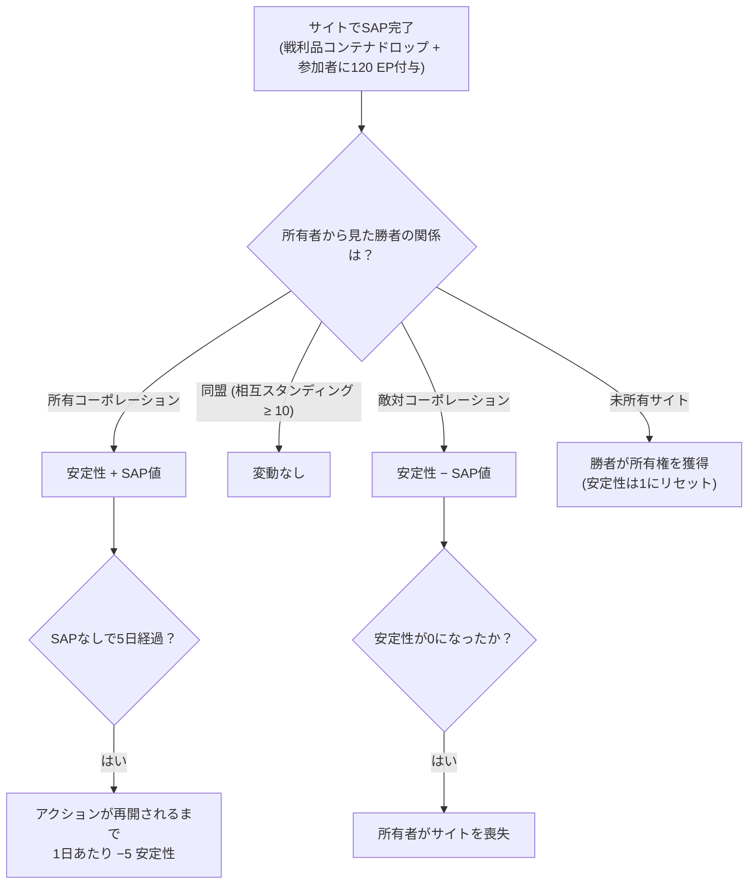

# イントルージョン (Intrusion)

**イントルージョン (Intrusion)** は、**NPCサイト**（プレイヤー管理または争奪可能なサイト）を中心としたゲームモードです。各サイトには**安定性 (Stability)**、**防衛 (Defense)**、**施設 (Facilities)** が存在します。アイテムを投資して防衛力を高め、施設をアップグレードすることでサイトを支配し、利益を得ることができます。

> ※「intrusion」のクライアント内での日本語表記は確認が必要です。UIの位置については[クライアントUI概要](/ja/features/ui/)を参照してください。以下のメカニクスはサーバー仕様に基づいて確認済みです。

## サイトと安定性 (Sites & stability)

- **サイト情報 (Site info)** — イントルージョンサイトの詳細情報。
- **安定性 (Stability)** — サイトの基幹ステータスであり、値は **0〜150** です。新しい所有者は **1** からスタートします。安定性はあらゆる要素に影響します：
  - **ボーナス閾値** (コンテンツ、`intrusionsitestabilitythreshold`): 施設ボーナスは安定性 **20 / 60 / 80** でアンロックされます。オーラ効果のスタック（イントルージョンコア、探知、地質スキャン、ハーベスター、工業、マスキング、採掘、修復、シグナル — 各レベル1〜3、および複合レベル4効果）は、**10、20、40、50、70、80、100** の各ティアで段階的にアンロックされます。**ドッキング権限**は **50** でアンロックされ、防衛ノードの上限は **40** で上昇します。
  - **生産ポイント (Production points)** = `安定性 / 10` (最大15) — 施設をアップグレードするための通貨（1レベルにつき1ポイント消費）。
  - **減衰 (Decay)**: 成功したSAPが **5日間** 発生しなかった場合、再びアクションが起こされるまでサイトの安定性は **1日あたり5低下** し始めます。
  - **喪失 (Loss)**: 安定性が **0** になると、所有者はサイトを失います（未所有状態になります）。
- **安定性ログ (Stability log)** — サイトの安定性の変動履歴を確認できます。

### 安定性を変動させる要因

安定性の変動は、完了した **SAP**（後述）およびシステムの減衰によって引き起こされます。その効果は、現在の所有者に対して *誰* がSAPを制したかによって異なります：

- **所有者が勝利** → 安定性がSAPの値ぶん**増加**。
- **同盟が勝利**（相互スタンディング ≥ 10）→ **変動なし**。
- **敵対コーポが勝利** → 安定性がSAPの値ぶん**減少**。
- **未所有サイト** → 最初に勝利したプレイヤーコーポが**所有権を獲得**（安定性は1にリセット）。

## SAP (サイト攻撃ポイント / Site attack points)

**SAP** は、サイトに出現する一時的な目標（オブジェクティブ）です。これを完了すると、SAPの出現地点に**戦利品コンテナ**がドロップし、安定性が変動し、参加したすべてのキャラクターに **120 EP** が付与されます。**NPCカルト教団もSAPを争奪してきます** — 彼らが先にスコアを満たした場合、SAPは自勢力にとって不利に判定されます。SAPには4つのタイプがあります：

| SAP | 達成方法 | 安定性の値 |
|---|---|---|
| **アクティブハッキング (Active hacking)** | SAPに対してハッキングモジュールを使用（最大120回のモジュール使用） | +15 |
| **パッシブハッキング (Passive hacking)** | SAPの射程5以内に **8分間** 滞在 | +10 |
| **破壊 (Destruction)** | SAPにダメージを与えて破壊（NPCによるダメージもカウント） | +15 |
| **検体処理 (Specimen processing)** | **5〜6個のSAP検体**を納品（2〜3個ずつのバッチ、クールダウン1.5分、射程7） | +15 |

- **SAPアイテムの納品 (Submit a SAP item)** — ゾーン内で、検体処理SAPに検体を納品します。
- **SAPアイテム情報 (SAP item info)** — SAPアイテムのデータ（所持アイテムおよび一般情報）を確認します。

SAP検体はこのモードの消耗品です。また、高いコア値を持っているため、[PBSリアクター燃料](/ja/features/pbs/)としても利用できます。

## 防衛と効果 (Defense & effects)

- **防衛閾値の設定 (Set defense threshold)** — サイトの防衛閾値（サイトの自動防衛システムが作動する基準）を設定します。
- **効果ボーナスの設定 (Set effect bonus)** — サイトのオーラ/効果ボーナスの設定を行います（安定性によってアンロックされたオーラセットから選択）。
- **施設のアップグレード (Upgrade a facility)** — サイトの施設を強化します。費用は **1生産ポイント**（つまり安定性10相当）で、CEO / 副代表 (Deputy) / 会計士 (Accountant) のみ実行可能、最大レベルに上限があります。
- **サイトメッセージの設定 (Set a site message)** — サイトの公開メッセージを設定します。

## ログ (Logs)

- **マイ・イントルージョンログ (My intrusion log)** — プレイヤー自身のイントルージョン活動履歴。
- **パブリックログ (Public log)** — 全体公開のイントルージョンフィード。
- **マイサイトログ (My sites log)** — 自身が所有するサイトでの活動履歴。
- **安定性ログ (Stability log)** — 安定性の変動履歴（上記参照）。

## 実践的なアドバイス

- **安定性が最重要ステータス** — ボーナスティアを解放し、アップグレード用通貨を生み出し、敵対的なSAPによって削られる対象となります。
- **SAPは争奪戦** — NPCカルト教団も介入してきます。SAPで敗北すると安定性を失うことになります。
- **サイトを放置しないこと** — 成功したSAPがないまま5日間経過すると、毎日の減衰が始まります。
- **ログで状況を把握する** — マイログ、パブリックログ、安定性ログを活用して、所有サイトで何が起きているかを追跡しましょう。

<!-- TODO: only the in-client name for "intrusion" and the UI remain.
     Confirmed: stability 0-150, start 1 (Outpost.cs constants); bonus thresholds from
     intrusionsitestabilitythreshold (facility 20/60/80; aura effects 50-74 at tiers
     10/20/40/50/70/80/100; docking rights 50; defense nodes 40); production points =
     stability/10, facility upgrade costs 1 point, CEO/Deputy/Accountant; decay -5/day
     after 5 days idle (OutpostDecay.cs); owner-win +, ally (standing>=10) 0,
     hostile -; unowned -> winner takes it; stability 0 -> ownership lost; 120 EP per
     SAP participant (EP_WINNER, EpForActivityType.Intrusion); 4 SAP types: active
     hacking (120 module uses, +15), passive (8 min in range 5, +10), destruction
     (kill it, +15), specimen processing (5-6 specimens in 2-3 batches, 1.5 min cd,
     range 7, +15; siegeitems table: def_specimen_sap_item 2-3); SAP increase values
     from entitydefaults #increase option; NPC sap guard/invade units contest SAPs.
     Developer notes: Intrusion/IntrusionSAPSubmitItem.cs (SpecimenProcessingSAP,
     zone submit), IntrusionSAPGetItemInfo.cs / IntrusionSapItemInfo.cs,
     IntrusionSetDefenseThreshold.cs, IntrusionSiteSetEffectBonus.cs,
     IntrusionUpgradeFacility.cs, SetIntrusionSiteMessage.cs; GetIntrusionSiteInfo.cs,
     GetIntrusionLog.cs / GetIntrusionPublicLog.cs / GetIntrusionMySitesLog.cs /
     GetIntrusionStabilityLog.cs, GetStabilityBonusThresholds.cs;
     EventProcessors/AffectOutpostStability.cs; Zones/Intrusion/Outpost.cs,
     OutpostDecay.cs, SAP.cs + *SAP.cs subclasses. -->