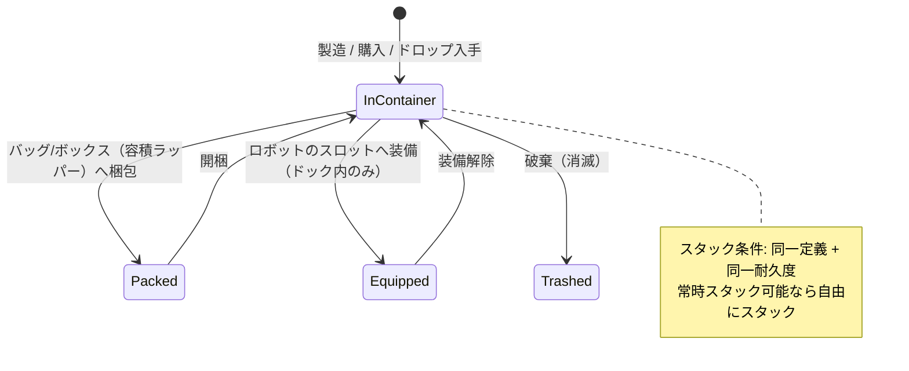

# アイテムとインベントリ

**インベントリ**は**コンテナ**の集合（基地のパブリックコンテナ、ロボットのコンテナ、バッグ／ボックスなど）で構成されています。このページでは、コンテナ内のアイテムの操作について説明します。

> UIの配置については[クライアントUI概要](/ja/features/ui/)を参照してください。以下のメカニクスはサーバーの仕様に基づいて確認されています。

## コンテナ

- **コンテナの一覧表示（List a container）** — コンテナの中身を確認します。
- **アイテムの移動（Relocate items）** — アクセス可能なコンテナ間でアイテムを移動します。

アクセス権のルールが適用されます。一部のコンテナ（コーポハンガー、ロボットインベントリ、システムコンテナなど）には制限があります。詳細は[ロボット](/ja/features/robots/)および[グループ](/ja/features/groups/)を参照してください。

## 梱包と開梱（Packing & unpacking）

- **アイテムの梱包（Pack items）** — アイテムをバッグやボックス（「容積ラッパー」コンテナ）に詰め、コンパクトに持ち運べるようにします。
- **アイテムの開梱（Unpack items）** — バッグやボックスからアイテムを取り出します。

梱包は、保管や輸送のために**ロボット**を小型化する際にも使用されます。サーバーはロボットの動的状態やコンポーネントを取り外し、*再梱包済み（repacked）*としてマークします。ロボットを梱包できるのは、**無傷（ダメージなし）**、**非選択中**、**未保険**、かつ**インベントリが空**の状態に限られます。開梱するとロボットが再構築され、修理されます。コンテンツ側で*梱包可能（repackable）*フラグが設定されているアイテムのみ梱包できます。再梱包されたロボットは、開梱するまで選択や装備を行うことはできません（[ロボット](/ja/features/robots/)を参照）。

## スタック（Stacking）

多くのアイテムはスタック（重ね置き）が可能です。スタック操作には以下があります：

- **アイテムのスタック（Stack items）** / **対象へスタック（stack to）** / **選択アイテムのスタック（stack selection）** — 同じ種類のアイテムを1つのスタックにまとめます（またはスタックを別のスタックに移動します）。
- **指定個数のスタック分離（Unstack an amount）** — スタックから指定した数量を取り分けます。

サーバーは、**同一の定義（definition）かつ同一の耐久度（health）**を持つアイテムのみを統合します。*常時スタック可能（always stackable）*フラグを持つアイテム（鉱石、弾薬、大部分の原材料）は自由にスタックできます。*スタック不可（non-stackable）*フラグを持つアイテムは決してスタックできません。それ以外のアイテムは、**再梱包中（梱包状態）のときのみ**スタック可能です。そのため、開梱された状態の損傷した装備品は個別のまま保持されます。

## 名前の変更と使用

- **アイテム名の変更（Rename an item）** — アイテムにカスタム名を設定します。
- **アイテムの使用（Use an item）** — 使用可能アイテムを発動します（状況依存。ゾーン内ではゾーンオブジェクトへの干渉にも使用可能 — [採集](/ja/features/gathering/)を参照）。
- **抽選アイテムの使用（Use a lottery item）** — ロタリー形式（くじ・ガチャ形式）のアイテムを開封／使用します。

## 破棄と補填

- **アイテムの破棄（Trash items）** — アイテムを廃棄します（削除されます）。
- **アイテムの補填（Reimburse an item）** — スタッフ／管理者向けの補填フローです。アイテムを生成してキャラクターに付与し、トランザクションログに記録します。プレイヤーが直接実行することはありません。

## 特殊アイテム

- **引換可能アイテム（Redeemables）** — 引き換え可能なアイテム（コード／付与アイテム）の一覧表示、**引き換え（redeem）**、または**有効化（activate）**を行います。
- **特典パック（Goodie packs）** — 特典パック（アイテムの詰め合わせ）の一覧表示および**引き換え（redeem）**を行います。
- **ギフトの開封（Open a gift）** — ギフトには、サーバー共通のドロッププール（弾薬、未加工鉱石、プラズマ、研究キット、モジュール、カプセル、塗料、ブースターなど、計221種類の定義があり、それぞれ固有の数量範囲を持つ）から選ばれた**ランダム**なアイテムが1つ含まれています。

## 実践的なヒント

- **アクセスはコンテナ単位** — 自身が所有している、または権限が付与されているコンテナのみ操作可能です。
- **梱包して積載効率を向上** — バッグやボックスを利用することで、かさばるアイテムをコンパクトに運搬できます。
- **スタックで容量を節約** — 同種のアイテムをまとめましょう。必要な分だけ取り出すにはスタック分離を行います。
- **破棄は取り消し不可** — 削除されたアイテムは元に戻りません。
- **引換アイテム／特典パックは使い切り** — 引き換えを行うと、コードや対象アイテムは消費されます。
- **梱包状態のロボットは待機状態** — 選択や装備を行う前に開梱してください。
- **スタックできるのは梱包状態のアイテムのみ** — 同種のアイテムがまとまらない場合は、先に梱包（または修理）を行ってください。

<!-- TODO: only the inventory UI remains.
     Confirmed: stacking rules (Item.cs CanStackTo: same ED + same health; AttributeFlags
     alwaysStackable/nonStackable; others must be repackaged); pack rules (ItemPacker.cs:
     robot must be undamaged, not selected, not insured, empty inventory; repackable
     flag); unpack rebuilds + repairs (ItemUnpacker.cs); gifts = random draw from
     giftloots (221 defs: ammo x1500-2000, epriton/fluxore x600-1000, reactor plasma
     x10-20k, research kits, paints, capsules, named3 modules, boosters, respec tokens);
     goodie packs are campaign-based (GoodiePackRedeem: campaignID + indy selection);
     ReimburseItem = admin tool (opp_reimburselog). AttributeFlags bit positions:
     nonStackable=10, alwaysStackable=11, repackable, consumable=24, deployable=23.
     Developer notes: ListContainer.cs; RelocateItems.cs; PackItems.cs / UnpackItems.cs;
     StackTo.cs / StackSelection.cs / UnstackAmount.cs; SetItemName.cs; UseItem.cs /
     UseLotteryItem.cs; TrashItems.cs; ReimburseItem.cs (PbsReimburseRequestHander.cs);
     RedeemableItemList.cs / RedeemableItemRedeem.cs / RedeemableItemActivate.cs;
     GoodiePackList.cs / GoodiePackRedeem.cs; GiftOpen.cs. Container access:
     ContainerAccess / ContainerAccessChecker.cs. -->