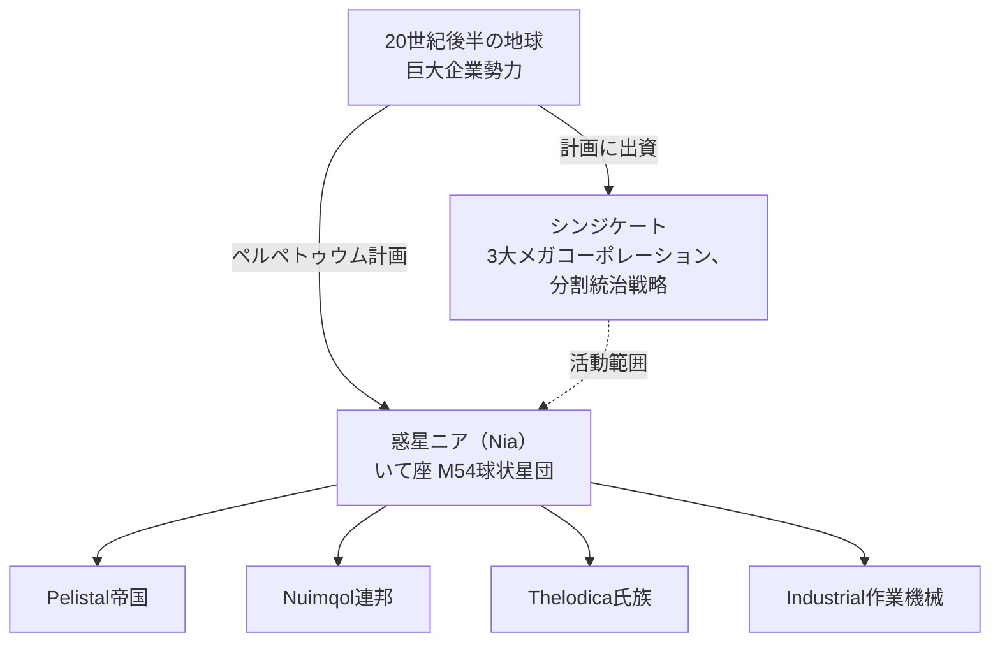

# ロア

## ニアの発見

20世紀後半の地球における技術革新の波 — インターネット、医療ITの融合、宇宙開発 — は、
従来の物理的および精神的な境界を取り払いました。通信と交易はより高速かつ安価になり、
強大な多国籍企業群が各地域の実質的な統治主体へと成長していきました。

そうした世界の中で、いて座M54球状星団（プロジェクトのロゴの由来）に位置する**惑星ニア（Nia）**が
発見されました。ニアは連星の一方の周囲を公転する第4惑星であり、平均地表温度約19 ℃、
地球に近い大気密度を持つなど、驚くほど地球に似た環境を備えています。しかし、2つの特異な性質が
この惑星を決定づけています。その海洋は、惑星の高密度な核と急速な自転によって常に帯電しており、
あらゆる電動機器を遮断する通行不能の障壁となっています。また、地表のわずか約17%しか陸地が存在せず、
活発なプレートテクトニクスによって常に島々へと引き裂かれています。そしてその大地には、生命が繁栄しています。

## ニアン

ニアの住人たちは、通常の「生命体」の定義を覆す存在です。姿形は我々のロボットと似ていますが、
それぞれ独自の産業、軍事、文化を持つ、技術的に高度な**社会**を形成する合成生命体です。
そして、エネルギーを渇望する地球にとって最も重要な成果こそが、彼らの**エネルギー生産技術**でした。

広大な島嶼群にまたがる領土の覇権をめぐり、3つの異星種族 — **Pelistal帝国**、**Nuimqol連邦**、
そして**Thelodica氏族** — が最終的な勝利を求めて戦いを繰り広げており、その狭間に労働機械である
**Industrial**の集団が点在しています（これらはプレイヤーが[NPC](/ja/features/npcs/)として遭遇する
4つの勢力と同じです）。

## シンジケート

ペルペトゥウム計画の主たる出資者は**シンジケート**です — 地球上で最も強大な3つのメガコーポレーションによる
連合体であり、それぞれが惑星地表で独自の活動領域を運営しています：

| コーポレーション | 領域 |
|---|---|
| **Truhold-Markson** | 北米の消費財産業の巨人。衰退しつつある**Pelistal**の領域へと進出中。 |
| **ICS — Institute of Corporate Security** | 欧州・ロシア連合。反乱を起こした**Nuimqol**の領土内で活動。 |
| **Asintec** | アジアの産業覇権企業とハイテク同盟。**Thelodica氏族**に対して全面攻勢を展開中。 |

その戦略は古典的な「分割統治（divide and conquer）」です。3つの領域の均衡を保つことで、
異星勢力が団結するのを防ぎ、互いに争わせ続けることができます。人間の「エージェント」たちは
地表で活動し、ニアンのエネルギー資源を採取し、彼らの技術を研究し、シンジケートが求める平和を
維持・管理しています。

そこに、あなたの役割があります。

<!--
Developer notes: rewritten 2026 in original prose from the canonical setting.
An earlier version was adapted from the Open Perpetuum community wiki
(perpetuum.miraheze.org: Discovery of Nia, Nia, Syndicate); that text was
fully replaced, not reused.
Consistency with backend: the three alien races + Industrial match the NPC
races (see /ja/features/npcs/); the corporation names match the zone abbreviations
(zone_ICS, zone_ASI, zone_TM — the beta-tier zones in /zones/ are named after
their megacorporations).
-->
