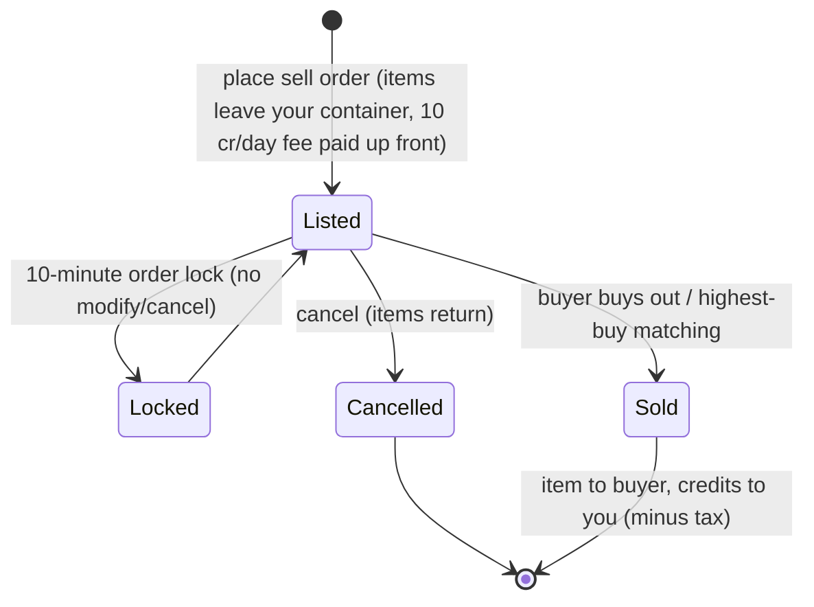

# 市場と取引

**市場（マーケット）**は、基地でアイテムを売買する場所です。市場でのすべての行動は**ドック中限定**です（現在ドックしている基地でのみ取引可能）。

> UIの配置は[クライアントUI概要](/ja/features/ui/)（上部バーの**市場**カテゴリー）に基づいています。以下のメカニクスはサーバー仕様と照合確認済みです。

## 市場オーダー

現在の基地の市場では、2種類のオーダーを出すことができます：

### 売りオーダー（Sell orders）
アイテムを出品して販売します。
- **アイテム**、**数量**、**単価**、および日数単位の**期間**（最低1日）を選択します。
- アイテムはコンテナから差し引かれます（スタックの一部を販売する場合はスタックが分割されます）。
- **出品手数料（Listing fee）** — 前払いで `10クレジット × 期間（日）` を支払います（*market transaction fee* エクステンションで軽減可能）。手数料は基地の中央銀行（ゾーン利益プール）に納められます。
- **価格ガード（Price guard）** — 有効な場合、価格はそのアイテムの**14日間の平均価格**の**±30%以内**に収める必要があります。この範囲外の価格は拒否されます。（*現在、このサーバーではこのガードは**無効化**されています。*）
- **オーダーロック（Order lock）** — オーダーを出してから**10分間**は、変更やキャンセルができません。
- **オーダー数制限** — 保持できる売りオーダー数は、1 + (*market sellorder expert* エクステンション) です（買いオーダーは別カウント）。
- **所属コーポレーション専用（For my corporation）** — 売りオーダーを自身のコーポレーションメンバーのみに限定公開できます（デフォルト以外のコーポレーションのみ）。
- 状況に応じて**個人ウォレット**または**コーポレーションウォレット**から支払います。

### 買いオーダー（Buy orders）
指定した価格でアイテムを購入するための予約注文を出します。
- 条件に一致する売りオーダーが現れると、市場によって自動的に約定されます。

### オーダーの管理
- **オーダーの変更（Modify an order）** — 価格・数量・期間を変更します。
- **アイテム / オーダーのキャンセル（Cancel an item / order）** — 出品を取り下げます（アイテムはコンテナに戻ります）。
- **マイアイテム（My items）** — 出品中のオーダー一覧を確認します。
- **最高値買い取りマッチング（Highest-buy matching）** — 売り注文を既存の買いオーダーに直接マッチングさせることができます。

## 直接購入

- **アイテムの購入（Buy an item）** — 市場に出品されているアイテムを即座に購入します（買いオーダー不要）。

## 市場の閲覧

- **アイテム一覧 / 販売中アイテム / 範囲内アイテム（Item list / available items / items in range）** — 販売されているアイテムを閲覧します。
- **市場情報（Market info）** — その基地の市場に関する詳細情報。
- **平均価格（Average prices）** — 市場平均、定義別平均、および**グローバル**平均。これらは価格ガードの基準として使用されます。

## 市場税（Market tax）

- **市場税の変更（Change market tax）** — 市場の税率を設定します。プレイヤーが管理できるのは**PBS基地の市場**のみで、それ以外の場所では固定のデフォルト税率が適用されます。
- **税率ログ（Tax log）** — 税率の変更履歴を確認します。

税金は市場で売買が成立した際に**販売者**が受け取る金額から差し引かれます。デフォルトの税率は**12%**（販売者は販売価格の88%を受け取る）です。この税率は *market transaction tax* エクステンションによって引き下げることができ、またプレイヤー管理の市場ではPBS所有者がカスタム税率を設定することでも変更されます。

## プレイヤー間直接トレード

**トレード（Trade）**は、ドック中の2人のキャラクター間で行われるP2P取引です：

- **トレードの開始（Begin a trade）** — 別のプレイヤーとの取引セッションを開始します。
- **オファーの設定 / 取り下げ（Set / retract my offer）** — 自分の取引枠にアイテムやクレジットを提示・取り下げします。
- **承諾（Accept）** — 双方が承諾することで、取引が不可分（アトミック）に完了します。
- **キャンセル（Cancel）** — トレードを中止します。
- **トレード完了 / 状態（Trade finished / state）** — 完了通知および現在の進行状態。

キャラクターは自身への**トレード要求をブロック**することも可能です（[はじめに](/ja/features/getting-started/)を参照）。

## アイテムショップ

**アイテムショップ（Item shop）**は基地にある定額販売NPCショップです（プレイヤー駆動ではありません）。完全なカタログ（全アイテム、数量、通貨別価格、スタンディング要件）は[アイテムショップ](/content/shop/)にまとめられています。

- **リスト（List）** — ショップの販売品一覧を確認します。
- **購入（Buy）** — クレジットでアイテムを購入します。

## クレジットの送金

- 自身が所有するキャラクター間で**クレジットを送金**します（[はじめに](/ja/features/getting-started/)を参照）。

## 実践的なヒント

- **すべてドック中限定** — ゾーン（フィールド）内での取引は行えません。
- **12%の税金を考慮して価格設定を行う** — デフォルトでは、販売者は出品価格の88%しか受け取れません（高税率のPBS市場ではさらに減少します）。
- **出品手数料は前払い** — 初日に売れたとしても、長期出品を設定した場合はその分の手数料がかかります。
- **コーポレーション専用オーダー** — 一般に公開することなく、コーポレーション内で物資を移動させる手段として活用できます。
- **トレードはアトミック** — 双方が承諾しない限り、アイテムやクレジットは一切移動しません。
- **税率によって実質コストが変わる** — 価格を設定する際は、その市場の税率を必ず計算に入れてください。

<!-- TODO: only the client UI remains (market and trade screen flows).
     Confirmed: MarketInfoService(0.3, 10, false) registered in
     PerpetuumBootstrapper.cs -> margin +-30% vs 14-day average (MARKET_AVERAGE_DAYSBACK
     14), fee 10 credits/day (Market.MARKET_FEE), CheckAveragePrice=false on this
     server; DEFAULT_MARKET_TAX = 0.12 (seller gets 88%), player-controlled tax only on
     PBSDockingBase markets (MarketTaxHelper); order modify/cancel locked 10 min after
     submit (MARKET_CANCEL_TIME); order count = 1 + expert extension bonus;
     fee paid up front to the base's central bank. -->
     Developer notes: Markets/MarketCreateSellOrder.cs (docked, price guard vs average
     price, corp-only, unstack, corp wallet), MarketCreateBuyOrder.cs,
     MarketModifyOrder.cs, MarketCancelItem.cs, MarketBuyItem.cs, MarketItemList.cs,
     MarketAvailableItems.cs, MarketItemsInRange.cs, MarketGetMyItems.cs,
     MarketGetAveragePrices.cs / MarketGetDefinitionAveragePrice.cs /
     MarketGlobalAveragePrices.cs, MarketTaxChange.cs / MarketTaxLogList.cs;
     Trade*.cs (begin/offer/accept/cancel, atomic); ItemShopList.cs / ItemShopBuy.cs;
     CharacterTransferCredit.cs. -->