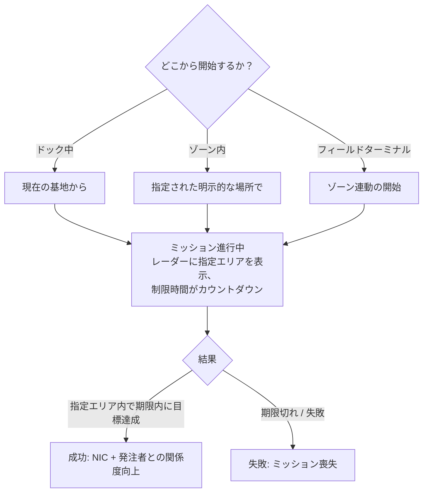

# ミッション

**ミッション**は、ゾーン内で引き受ける構造化された目的です。アイテムの運搬、ターゲットの撃破、建造物の利用などを行います。これらは進行や報酬の獲得手段であり、ゾーン内の多くのコンテンツ（警報、キオスク、一部のPBS/輸送フックなどはミッションに関連しています）を動かす要素でもあります。

> UIの位置については[クライアントUIの概要](/ja/features/ui/)を参照してください。以下のメカニクスはサーバー実装に基づき確認されています。

## ミッションの開始

ミッションは、**場所**において**カテゴリー**と**レベル**（レベルは有効な範囲に制限されます）を選択して開始します：

- **ドック中**の場合、ミッションは現在の基地の場所から開始されます。
- **ゾーン内**の場合、場所を明示的に指定します。
- ミッションは**ゾーンから**直接開始すること（ゾーン連動の開始）や、**フィールドターミナルから**開始することも可能です。

すべてのカテゴリーやレベルがどこでも利用できるわけではありません。利用可否はコンテンツ設定に依存します。ミッションの完全なリスト（タイプ、カテゴリー、レベル、所要時間、報酬額、報酬アイテム）は[ミッション](/content/missions/)で生成されています。

## ミッションの目的

ミッションには同時に2つの目的があります。NICの獲得と、発注元（コントラクター）コーポレーションとの**関係度（Relation）**の構築です。関係度が向上することは、そのコーポレーションのターミナルで**より高い施設利用率（Facility Ratio）**を得るための重要な要素となります。これにより、生産やその他の施設利用がより安く、より速くなります。また、関係度は*低下*することもあります。一部のミッションは他のコーポレーションの利益と相反するため、概要（ブリーフィング）にスタンディングの低下に関する注意が記載されます。

- **トレーニングミッション** — 初心者向けに強調表示される簡単なミッション。報酬は序盤の貴重な資金源となるため、すべてクリアすることをお勧めします。
- **レギュラーミッション** — 主に3つのタイプがあります：
  - *戦闘* — 偵察（敵ロボットのスキャン）、賞金稼ぎ（指定サークル内のターゲット撃破）、破壊・回収（撃破＋回収＋納品）、偵察・回収、特別賞金首（到達困難なターゲット）。
  - *産業* — 地質調査（適切なチャージで鉱物をスキャン）、採取、鉱物開発、高度開発（警備された採掘地点 — 武装した支援が必要）。
  - *ロジスティクス* — 輸送（ターミナル間でのパッケージ配送）および回収（危険地帯を通過する大型パッケージの回収 — 護衛が必要）。
- **「安全なミッション」というものは存在しません**。ルート上に敵が見え、自衛する装備がない場合は、道中ですべてを失う前に救援を求めてください。
- **目標は指定エリア内でのみカウントされます** — ミッションマップのレーダー上には赤い円で表示されます。それ以外の場所での撃破やスキャンは一切カウントされません。期限を過ぎると、ミッションは即座に失敗となります。
- **民間輸送契約** — シンジケートが運営するシステム（ミッションウィンドウの2番目のタブ）です。プレイヤーがターミナル間で他のプレイヤーに運搬してもらうためのコンテナを出品します。設定された報酬と、運搬者が預ける**担保金（Collateral）**（成功時に返金、コンテナ破壊時に没収、途中で中止した場合は半額のみ返金）が設定されます。誰かが実際に積載して運べる程度のサイズにコンテナを抑えるようにしてください。

## ミッションのデータとオプション

- **ミッションデータ** — ミッションの詳細情報。
- **ミッションオプション** — ミッションで選択可能な選択肢／バリアント。
- **ミッションサプライ** — ミッションに関わる補給品・支給品。
- **開始アイテム** — ミッション開始時に所持するアイテム。

## ミッションの実行

- **進行中ミッション一覧** — 現在実行中のミッション。
- **中止（Abort）** — 進行中のミッションをキャンセル。
- **参加者の追加** — 他のキャラクターをミッションに招集（マルチプレイヤーミッション）。
- **ミッションログ** — ミッションのイベントログ。

## 納品（Delivery）

- **納品** — 納品対象を完了します。ミッションに応じて、**ドック中**（基地内）または**ゾーン内**（特定の場所/eid）で行うことができます。

## エージェント

- **エージェント一覧** — 利用可能なミッションエージェント（ミッションを発行するNPC/派閥）。

## フィールドターミナル

- **フィールドターミナル情報** — ゾーン内のフィールドターミナル（ミッションの開始や対応が可能な建造物）を調査します。

## 実践的な注意点

- **ミッションは各要素を結びつける役割を持つ** — 警報、キオスク、一部の建造物はミッションオブジェクトです（[採取](/ja/features/gathering/)および[戦闘](/ja/features/combat/)を参照）。
- **マルチプレイヤー** — 参加者を追加してミッションを協力プレイできます。
- **納品コンテキストの重要性** — 基地にドックする必要がある納品もあれば、ゾーン内の特定の場所にいる必要がある納品もあります。
- **レベルは制限範囲内に調整される** — 範囲外のレベルを要求してもエラーにはならず、適切な範囲に自動調整されます。
- **中止は離脱手段** — ミッションの状況が悪化した場合は、中止（Abort）してください。

## ミッション建造物

ミッションはゾーン内の**建造物（Structures）**に紐付けられています。サーバーでは以下のタイプが実装されています：

| 建造物 | 役割 |
|---|---|
| **Simple switch（簡易スイッチ）** | 即時インタラクション — 近づくだけでミッション目標が完了します |
| **Alarm switch（警報スイッチ）** | 時間制限付きタスク — 一定時間（ミッションのオプションに応じた時間）範囲内に留まる必要があり、2秒ごとに判定されます |
| **Item supply（アイテムサプライ）** | 警報スイッチと同様に時間を要し、完了すると**ロボットのコンテナ内にアイテムがスポーン**します |
| **Kiosk（キオスク）** | **アイテム提出**ポイント — ミッションに必要なアイテムを引き渡します |

<!-- TODO: the full mission list, categories, level ranges and rewards are generated at
     /content/missions/. Verified: mission structure types
     (MissionEngine/MissionStructures: SimpleSwitch, AlarmSwitch, ItemSupply, Kiosk);
     verify the mission UI.
     Developer notes: Missions/MissionStart.cs (category, level clamp, docked vs zone
     location), Missions/MissionDeliver.cs (docked vs zone delivery), MissionAbort.cs,
     MissionData.cs / MissionGetOptions.cs / MissionGetSupply.cs / MissionStartItems.cs,
     MissionListRunning.cs / MissionListAgents.cs / MissionLogList.cs,
     MissionPlayerAddsParticipant.cs, FieldTerminalInfo.cs, MissionStartFromZone.cs;
     Services/MissionEngine/* (MissionProcessor, mission structures incl. AlarmSwitch,
     Kiosk). -->