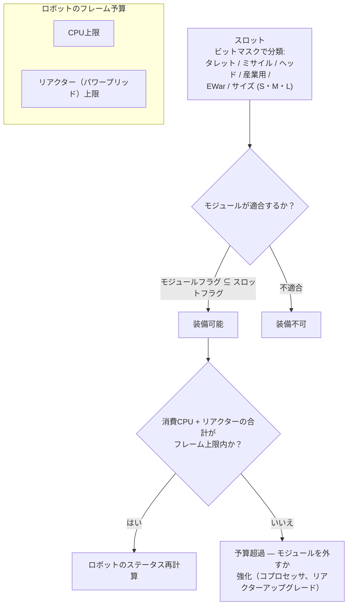

# モジュールとフィッティング

「ロボットを購入しても、手に入るのはシャーシだけです。」モジュールを装備して初めて、ロボットは意図した役割を果たすようになります。*フィッティング（Fitting）*とは、モジュールの構成（「フィッティングを見せて」など）と、それが消費するCPU/リアクターの予算（キャパシティ）の双方を指します。

## スロットとリソース

ロボットのフレームには、シャーシによって定義された固定数の**スロット**があります。各スロットはビットマスクによって型別されており（タレット、ミサイルランチャー、ヘッド、産業用、EWar/エンジニアリング、サイズ［小型 / 中型 / 大型］）、モジュール側のタイプマスクがスロットのマスクのサブセット（部分集合）である場合にのみ装備できます。したがって、キャスターのタレットスロットには小型、中型、*または*大型のタレットモジュールを装備できますが、ミサイルランチャーをタレットスロットに装備することはできません。ヘッドモジュール（コプロセッサ、チューニングモジュール）やシャーシ/レッグモジュール（プレート、フレーム）は、それぞれ専用のスロットを占有します。

すべてのモジュールはフレームから**CPU**と**リアクター**（パワーグリッド）を消費します。装備しているすべての合計値は両方の上限以下に抑える必要があり、一部のモジュールはサイクルごとに**アキュムレータ**（コア）も消費します。残りの容量は、フィッティングウィンドウに*利用可能出力*として表示されます。大まかなシャーシ規模（T1/T2/T3の例）：

| フレームクラス | CPU | リアクター | 例 |
|---|---:|---:|---|
| 小型クローラー | ~250 | ~140 | Castel |
| 軽メック | ~480 | ~300 | Waspish |
| 重メック | ~1 100 | ~1 000 | Tyrannos |
| ウォーカー | ~3 200+ | ~1 100+ | Gropho |

容量が不足した場合：**CPU** — コプロセッサモジュール（例：T3コプロセッサはCPU +20%）またはT2モジュールバリアント（消費量が低い）。**リアクター** — リアクターアップグレード（例：T3はリアクター出力 +20%）またはリアクターシーリング（放射線を低下させ、EnWarからの保護にも役立ちます。詳細は後述）。

## モジュール系統

モデルごとの詳細な数値は[アイテムカタログ](/content/)および[フォーマットリファレンス](/ja/formats/)に記載されています。ここでは各系統の概要を説明します。

### 武器と弾薬

4種類の武器テクノロジーがあり、それぞれ固有の弾薬と射程特性（ディスタンスプロファイル）を持ちます：

| 武器 | 弾薬 | 射程特性 | 備考 |
|---|---|---|---|
| **銃火器（Firearms）** | 弾薬（Bullets） | 短い適正射程、極めて大きな減衰 | *絶対に外れない*弾丸を発射します。ただし「精度」は効果半径として機能するため、小型目標に対しては拡散によりダメージが減少します。 |
| **磁気兵器（レールガン）** | スラグ（Slugs） | 中距離、急激な減衰 | 高い着弾速度。エネルギー消費が大きい。 |
| **レーザー** | エネルギーセル | 長距離 | 最もエネルギー消費が激しい。集中ビーム。 |
| **ミサイル** | ミサイル | 長距離 | 命中判定は距離ではなく*ロボット*の命中率ステータスによって決まります。ダメージは爆発半径に対する目標のサイズに応じてスケーリングされます（小型目標に大型ミサイルを撃つと大幅に威力が低下します）。 |

ダメージは滑らかな余弦曲線（コサインカーブ）を描いて距離に応じて減衰します。適正射程内では100%のダメージ、適正射程＋減衰距離でゼロになります（[ダメージ減衰](/ja/features/combat/#damezishu-xing)を参照）。

弾薬はダメージタイプを調整する要素です。主ダメージ属性＋副ダメージ属性により、ターゲットに合わせた微調整が可能です（[ダメージタイプ](/ja/features/combat/#damezishu-xing)を参照）。ただし、純粋な単一主属性弾薬に比べると合計ダメージはわずかに低下します。

タレットには小型/中型/大型があります。**モジュールのサイズをロボットに適合させてください**（小型ボットには小型モジュール、メックや大型ロボットには中型/大型モジュールを使用します）。

### 防御

- **アーマープレート** — メインのヒットポイントプール。装甲がゼロになるとロボットは爆発します。**LWF**（軽量フレーム）プレートは耐久性を犠牲にして速度を得ます。T2 LWFプレートは装甲を約0.73倍に低下させますが、速度+19%、シグネチャ−0.2、質量−0.2を付与します。
- **シールドジェネレーター** — アキュムレータを消費し、装甲の手前でダメージを吸収するバリア。シールドはダメージ吸収のために*自分自身のコア*を消費します。例えば2倍吸収のシールド展開中に100ダメージを受けた場合、装甲の代わりにコアを50消費します。シールド起動中は自身の武器を発射できません。吸収効率はシグネチャに対するシールド半径に応じてスケーリングされ、小型フレームに大型シールドを組み合わせた場合に最も効果的です。
- **アーマーリペア** — アクティブな修理モジュール（小型/中型/大型）。**リモートアーマーリペア**はロックしたターゲット（味方やPBS）を修理できますが、射程が短くサイクルが長くなります。
- **アーマーハードナー** — ダメージタイプごとのパッシブ耐性ポイント（化学 / キネティック / サーマル / 爆発の各バリアント）。
- **アダプティブアロイ** — 受けるダメージの構成を*学習*し、最も多く受けたダメージタイプに向けて固定の耐性ポイントプールを自動的に再配分するパッシブモジュール。
- **回避 / 機動** — シグネチャ低減モジュールやNEXUS（後述）により、ターゲットサイズを小さくします。範囲攻撃からのダメージを抑え、ロックオンされにくくします。

### エネルギー

- **リアクター** — 持続出力の上限。リアクターアップグレードで増加し、リアクターシーリングで放射線を低下させます（リアクター出力をわずかに犠牲にして、受けるEnWarダメージを軽減）。
- **アキュムレータ（コア）** — モジュールのサイクルを駆動するための瞬間的なエネルギー備蓄。時間とともに自然回復し（シャーシの `core_recharge_time`、T1クローラーで約120ミリ秒）、**アキュムレータ再充電器**で回復速度を上げることができます。
- **エナジーインジェクター（コアブースター）** — チャージを消費してアキュムレータを即座に補給します。
- **エナジートランスファー** — 自機のロボットからロックした味方にコアを転送します（NPCへの転送は不可）。

### 電子機器

- **センサーブースター** — 自己パッシブ：ロック時間を短縮し、ロック可能距離を延長します。
- **リモートセンサーブースター** — ターゲットアクティブ：ロックした味方に約10.5秒間、同様の強化を適用します。
- **コプロセッサ** — フレームのCPU上限を引き上げます（T1: +10% … T3: +20%）。
- **ウェポンスタビライザー** — 武器の精度を向上させ（有効効果半径を縮小）、質量をわずかに削減します。
- **チューニングモジュール**（ヘッドスロット） — 特定系統に対する固定ボーナス：ダメージ調整（T3で各武器系統のダメージ+25%）、採掘アップグレード（T3で採掘・採取+10%）、アーマーリペアアップグレード（T3でリペア量+16%、サイクル−8%）。

### 電子戦（EWar）

敵の視界と聴覚を奪います：

- **センサースプレーナー（減衰器）** — 遠距離デバフ：約5.5秒間、対象のロック時間を延長し、ロック射程を短縮します。自身のECM強度が対象の（ランダム化された）センサー強度を上回った場合にのみ適用されます。
- **センサージャマー** — 即時効果：ECM判定に成功すると、対象の*すべての*ロックオンをリセットします。
- **ECCM** — 20秒間の自己バフ：センサー強度とロック耐性を引き上げ、ECMに対して脆弱なデバフ（ディンプナー、ウェブ）を*解除*します。
- **ニューラライザー** — 約1.65 km以内の**すべての**プレイヤーのロックをリセットします。パニックボタンとして機能します。

対抗策：センサー強度（シャーシ）、ECCM、そして距離を取ること。

### ステルスと探知

- **ステルスモジュール** — 約10.5秒間のステルス状態。消費量はシグネチャ半径に応じてスケーリングされます（フレームが大きいほどコア消費が速い）。
- **ターゲットペインター** — 約10.5秒間、対象のステルス強度を奪うデバフ。
- **探知モジュール** — 自身の探知強度を向上させるパッシブ。

探知強度とステルス強度の比較によって、クローク中のターゲットを視認（およびロック）できるかどうかが決まります（[探知・妨害・速度](/ja/features/combat/#tan-zhi-masukingu-oyobisu-du)を参照）。

### エネルギー戦（EnWar）

敵のエネルギーを枯渇させるか切断します：

- **ドレイナー（エナジーヴァンパイア）** — ロックした対象からコアを吸い取り、自身のアキュムレータに追加します。
- **ニュートラライザー** — 同様に機能しますが、吸い取ったコアはそのまま破壊されます。
- どちらも対象の**リアクター放射線**によって威力が減衰します（シーリングは有効な対抗手段です）。
- **デモビライザー（ウェブ）** — 対象の速度を約5.5秒間低下させます。効果は対象の質量に応じてスケーリングされ（重いフレームほど減速されにくい）、モジュールの適正射程外のターゲットには効果が発揮されません。
- **スコーチャー** — 最大5体のターゲットに*連鎖*し、シールドと装甲の両方に貫通ダメージを与える電撃兵器。

### 産業

- **ドリル**（小型 / 大型）および**ハーベスター**（小型 / 大型） — 採取用モジュール。産出量、サイクル時間、アキュムレータ消費量が重要なステータスとなります。採掘によりEPを獲得できます（デイリー上限およびリキッドペナルティあり）。
- **ジオスキャナー** — プローブの精度で周囲の鉱物フィールドをスキャンします。結果として地下の埋蔵マップが得られます（[採取](/ja/features/gathering/)を参照）。
- **エクスカベーター** — オーラモジュール：ステルスを犠牲にして、周囲の味方ユニットの採掘/採取産出量を向上させます（T3: +50%）。
- **テラフォーミング**（ガンマゾーン） — 地形を隆起、下降、または整地（最大半径5 m）し、壁植物を成長させる地形ロック機能。[ゾーンセクション](/zones/zone-gamma-z106/)を参照。
- **リモートコントローラー** — 制御下のタレットおよびドローン：各コントローラーモジュールには帯域幅（操作可能数）、動作射程、ドローンの持続時間（ティアにより5〜10分）が設定されています。バリアント：タクティカル（ダメージ/サイクル）、アサルト（ダメージ）、サポート（リモート修理）、産業用（採掘/採取ドローン）、ハンター。**リモートコマンドトランスレーター**モジュールは、ドローンのダメージ、装甲、採掘産出量、修理量を増幅し（T3: 各+7.5%）、コントローラーの帯域幅を拡張できます。

### NEXUS

Networked Extension Utilization Systems（ネットワーク拡張活用システム）：**部隊（スクワッド）バフ**。NEXUSモジュールは自機の周囲にオーラを放ち、オーラ半径内の**部隊メンバー（ギャングメンバー）**（およびそのタレット/ドローン）を強化します。基本半径は10 mで、10秒ごとに更新されます。ルール：

- ロボットが展開できるNEXUSオーラは**最大3つ**まで、かつ**各タイプにつき最大1つ**までです。
- オーラは**部隊（ギャング）**内のユニットにのみ効果があり、単なる同盟ユニットには効果がありません。

T3のタイプ一覧（13種）：速度、装甲、シールド、遠距離ロック（ロック射程）、ロックブースター（ロック時間）、クリティカルヒット、アサルト（武器サイクル）、EW（EWar射程）、回避（シグネチャ）、リペアラ、産業（採取時のアキュムレータ消費）、高速抽出（採取サイクル）、リチャージャー（コア回復）。各T3モジュールはそのステータスを約+7.5%向上させます。例えば速度NEXUSは、10 m以内にいる部隊メンバー全員の最高速度を1.075倍にします。

### NOX

カルトグレードの対抗手段：効果範囲内の敵モジュールを*無力化*する**ネゲーター**モジュール群。**シールドネゲーター**（シールド吸収を約90%カット）、**リペアネゲーター**（修理出力をカット）、**テレポートネゲーター**（テレポートをブロック）。起動するたびにカーゴから**プラズマを消費**し、オープン（非トレーニング）ゾーンで使用すると**キャラクターがPvP対象としてフラグ付け**されます。

### 特殊目的

- **シージハックモジュール** — アクティブSAPツール：5秒サイクル、射程3 m（[アウトポスト](/ja/features/outposts/)を参照）。
- **自爆（セルフディストラクト）** — 8秒のカウントダウンを開始します。ビームは600 m先から視認可能です。最後の手段となる自機の処分方法。
- **マインディテクター** — フレームの地雷探知範囲を拡大します。
- **ブロブエミッター** — ブロブフィールドを展開するエミッターを射出します。エミッションモジュレーターモジュールでフィールドを調整します（[戦闘](/ja/features/combat/)を参照）。
- **PBS建造** — ガンマゾーンにPBS建造物を配置するために使用するモジュール。

## 経験則

1. **武器を混用しない。** 1機のロボットに磁気＋レーザー＋ミサイルを混載すると、通常どれも中途半端な性能になります。短距離兵器と長距離兵器の混用がうまくいくことはほとんどありません。
2. **質量に注意する。** 装甲プレートやシールドモジュールはすべて質量とシグネチャを増加させます。防御よりも速度が重要な場面もあります。
3. **何でも屋になろうとしない。** 採掘、スキャン、戦闘をすべてこなそうとするロボットは、特化型に比べてどれも中途半端になります。
4. **モジュールのサイズをロボットに合わせる**。ビルドを真に成立させるチューニングモジュールのために、CPUとリアクターの余裕を少し残しておきましょう。
5. …もちろん、上記の経験則をすべて無視して機能する変則的なニッチフィットも存在します。試行錯誤と工夫が肝心です。

<!--
Developer notes: rewritten 2026 from backend sources; no community-wiki text reused.
Verified against:
- src/Perpetuum/Robots/RobotComponent.cs (slot bitmask fitting: moduleFlagMask & slotFlagMask)
- src/Perpetuum/Modules/SlotFlags.cs (12 slot flag bits)
- src/Perpetuum/Modules/Weapons/WeaponModule.cs + FirearmWeaponModule.cs +
  MissileWeaponModule.cs (accuracy: firearms never miss, explosion radius from
  Accuracy; missiles use ParentRobot.MissileHitChance)
- src/Perpetuum/Modules/Weapons/Damage.cs (cosine falloff, critical 1.75x +/-10%,
  explosion scaling signature/explosionRadius clamped [0,1])
- src/Perpetuum/Units/Unit.cs GetResistByDamageType (resist/(resist+100))
- src/Perpetuum/Zones/DamageProcessors/DamageProcessor.cs (shield draws core,
  electric = penetrating)
- src/Perpetuum/Modules/EffectModules/ShieldGeneratorModule.cs (absorption
  modifier = shieldRadius ratio / shieldAbsorbtion; WeaponModule.cs:112 blocks
  firing while HasShieldEffect)
- src/Perpetuum/Modules/EffectModules/{Webber,SensorDampener,SensorBooster,
  Stealth,TargetPainter,Eccm,Detection,AdaptiveAlloy}.cs (durations from
  effects table: dampener/web 5.5s, stealth/paint/remote-boost 10.5s, ECCM 20s)
- src/Perpetuum/Modules/SensorJammerModule.cs + Neuralyzer.cs (lock reset,
  NEURALYZER_RANGE=1650)
- src/Perpetuum/Modules/{EnergyVampire,EnergyNeutralizer,Scorcher,
  CoreBooster,EnergyTransferer}.cs (EnWar, reactor radiation modifier, chain)
- src/Perpetuum/Modules/GangModule.cs + Zones/Effects/GangEffect.cs +
  EntitiesModule.cs:532-544 (13 aura types, gang-members-only, effects table
  auraradius=10)
- src/Perpetuum/Modules/NoxModule.cs (plasma consumption, PvP flag)
- src/Perpetuum/Modules/RemoteControl/* (bandwidth/range/lifetime, translator
  amplification)
- entitydefaults rows: named1-3 armor plates/hardeners, shield generators
  (absorbtion 2.0-2.3, radius 5-33), LWF (mass_reductor), cpu/powergrid
  upgrades, damage/mining/repairer tuning, NEXUS named3 values, NOX cultist
  values, siege hack (5s/3m), chassis core_max/powergrid_max.
Corrections vs ingested page: NEXUS auras reach gang members only (not "all
friendly units"); no "co-reactor" module exists (reactor upgrades/sealing do
that); demobilizer effect scales with target mass, no "resistance stat";
sensor suppressor = sensor dampener (5.5s debuff).
-->