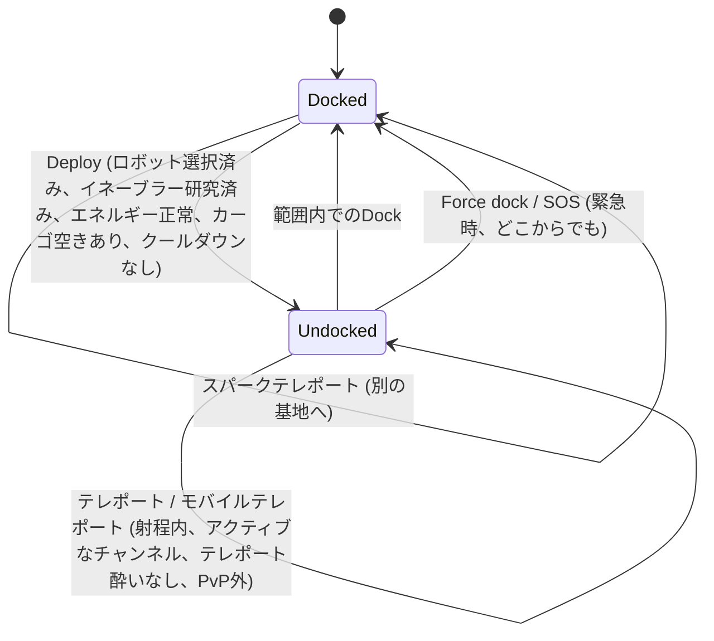

# 移動とゾーン

プレイヤーは常に2つの状態のいずれかにあります。基地に**ドッキング（Docked）**しているか、ゾーンに**アンドッキング（Undocked）**してアクティブなロボットを遠隔操縦しているかです。このページでは、これらの状態間の移動やゾーン間の移動に関するすべてを解説します。

> UIの位置については[クライアントUIの概要](/ja/features/ui/)を参照してください。**Deploy/Dockボタン**はトップバー中央のトグルボタンです。以下のメカニクスはサーバー仕様に基づいて確認されています。

## ドッキングとアンドッキングの比較

- **ドッキング中（Docked）** — 基地内に滞在している状態です。ロボットやアイテムはコンテナ内に保管されます。ロボットの操縦、テレポートの使用、スキャンは行えませんが、生産、取引、研究、基地施設の利用が可能です。
- **アンドッキング中（Undocked）** — ゾーン内に展開し、アクティブなロボットを操縦している状態です。移動、スキャン、戦闘、ゾーン内のオブジェクトとのインタラクトが可能ですが、基地専用のアクティビティの多くは制限されます。

## アンドッキング（出撃）

**Deploy**（トップバー中央）を押します。サーバーは以下の項目をすべて確認します。

1. **アクティブなロボットが選択されている**こと。
2. そのロボットクラスに必要な**イネーブラーエクステンション（enabler extension）**がキャラクターで研究済みであること（[研究](/ja/features/research/)を参照）。
3. ロボットの**エネルギーシステムが正常である**こと。
4. ロボットの**コンテナに空き容量がある**こと。
5. **アンドッキングクールダウン**（特定のイベント後に発生する短いタイマー）中でないこと。

いずれかのチェックに失敗した場合、アンドッキングは拒否されます。

## ドッキング（帰投）

- **Dock** — 基地のドッキング範囲内にいる場合にドッキングします。
- **Force dock** — 緊急アクションです。戦闘中であっても即座にゾーンから離脱し、メイン基地（TMA）にドッキングします。戦闘で敗北しそうな場合に使用します。
- **SOS** — 現在の基地にドッキングし、インシデントをフラグ付けするゾーン救済アクションです。

## ゾーン進入キュー

一部の混雑しているゾーンでは、アンドッキング／進入時に**進入キュー（entry queue）**が使用されます。

- キューの状態を確認する（`zoneGetQueueInfo`）。
- 希望するキューの長さを設定する（`zoneSetQueueLength`）。
- 気が変わった場合は待機をキャンセルする（`zoneCancelEnterQueue`）。

## テレポート

**テレポート（Teleport）**はゾーン内に存在する建造物です。使用するには以下の条件を満たす必要があります。

- **テレポートの有効範囲内**にいること。
- **チャンネル**（行先）が**アクティブ**かつ有効であること。
- **テレポート酔い（teleport sickness）**状態でないこと — テレポート後に発生する短いクールダウンで、この間は再度のテレポートができません。
- 特定の効果（*Nox*の無効化など）を受けていないこと、または**PvP戦闘中でない**こと（テレポートが阻害される場合があります）。

テレポートチャンネルには3種類あります。

| 種類 | 効果 |
|---|---|
| **ゾーン内（Within zone）** | 同一ゾーン内のランダムな地点へ移動 |
| **別ゾーン（Another zone）** | 異なるゾーン内のランダムな地点へ移動 |
| **トレーニング退出（Training exit）** | トレーニングゾーンから退出（報酬レベルのオプションあり） |

**モバイルテレポート（Mobile teleports）**は*所有権のある*テレポートアイテムです（例：モバイルストロングホールド／ワールドテレポート）。追加のルールが適用されます。

- **所有者または所有者のギャングメンバー**のみが使用できます。
- **PvP中は使用できません**。
- 使用するたびに、そのテレポートに**クールダウン**が適用されます。

テレポートとそのチャンネルの一覧表示や、ワールド全体のチャンネルの照会が可能です。

## スパークテレポート

**スパークテレポート（Spark teleports）**は、基地間のファストトラベルシステムです。

- ある基地でスパークの目的地を**設定（set）**し、ドッキング中にそれを**使用（use）**することで、別の基地へ即座に移動します。
- スパークテレポートの**一覧表示、設定、使用、削除**が可能です。
- 移動先の基地があなたに対して**ドッキングを許可**している必要があります。
- 到着時、サーバーはあなたに適したロボット（イネーブラーエクステンション研究済みのもの）を選択します。
- **保持できるスパークテレポートの数**はエクステンションによって制限されており（[研究](/ja/features/research/)を参照）、上限を超えて保持することはできません。

## ゲート

**ゲート（Gates）**はゾーン内の建造物で、どこからでも使用できます（テレポートのように射程制限がありません）。基地の所有者はそのゲートの**名前を変更**できます。

## 基地情報

任意の基地の情報を確認できます。

- **Info** — 基地の概要と所在地。
- **Ownership** — 所有者。
- **Facilities** — 提供している施設（生産、マーケット、ショップなど）。
- **My items** — その基地に保管されている自分のアイテム。
- **Docking rights** — 基地の所有者は、そこにドッキングできる対象を設定できます。

## トラブルシューティング

| 症状 | 考えられる原因 |
|---|---|
| アンドッキングが拒否される | アクティブなロボットが未選択、イネーブラーエクステンションの未習得、エネルギーシステムの損傷、ロボットコンテナの容量不足、アンドッキングクールダウン中 |
| テレポートが拒否される | 範囲外、チャンネルが非アクティブ、テレポート酔い、Nox効果、PvP戦闘中 |
| モバイルテレポートが拒否される | 所有者/ギャングメンバーではない、またはPvP中 |
| スパークテレポートが拒否される | 移動先の基地がドッキングを禁止している、選択可能な有効なロボットがない、またはスパークテレポートの上限に達している |
| ゾーン進入時に進行しない | ゾーンキュー待ち — キューの状態を確認するか、キャンセルしてください |

<!-- TODO(Phase 1): verify client UI flow (dock/undock buttons, teleport screen).
     Developer notes: Dock.cs / Undock.cs / ForceDock.cs (TMA = baseEid 561) /
     ZoneSOS.cs; Zone/TeleportUse.cs (TeleportPlayerValidator, three
     TeleportDescriptionType strategies, mobile-teleport gang/PVP rules);
     Sparks/SparkTeleportUse.cs (docked-only, extension-count limit);
     Zone/ZoneCancelEnterQueue.cs + ZoneEnterQueueService; GateSetName.cs. -->