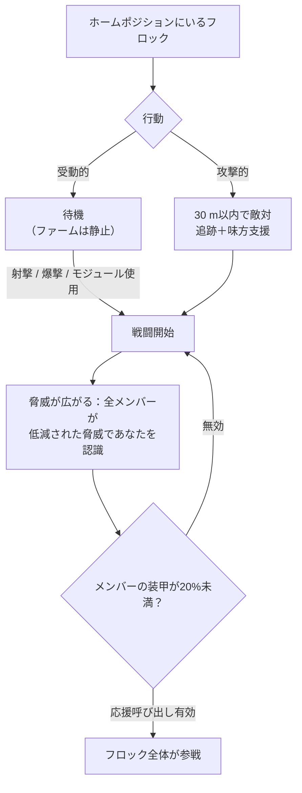

# NPCとPvE狩り

NPCは、[リアクタープラズマ](/content/ores/)、
[カーネル](/ja/features/research/)、モジュールの主な供給源であり、どのレベルでも拡張ポイントを安定して獲得できる手段です。NPCは**フロック**として存在します。これは、ホームポジション、ホームレンジ、リスポーン時間、行動を共有するグループです。

## 誰がいるのか

NPCは4つの種族 — **Nuimqol、Pelistal、Thelodica、Industrial** — に分類され、それぞれ複数のロボットクラス（ランナー、クローラー、メカ、ヘビィメカ）と、ステータスと戦利品が上昇するランク1〜5を持ちます。通常のランク以外には、以下があります：

- **ゴブリン** — 保護島におけるEWarの警備兵。脆いが、ロック修正値が極端に高い（通常より約5倍速く、約2倍遠方からロックされる）：ゴブリンのキャンプ付近では戦闘や採掘が非常に不利になる。
- **エリート** — 通常ランクのNPCの希少バリアントで、基本ステータスが約2倍になり、戦利品も良い。
- **オブザーバー** — 巡回する攻撃的NPC（Arbalest、Baphomet、Waspish、Tyrannos、Artemis、Kain、Gropho、Sequer、Seth、Mesmer…）。島の大部分を巡回し、同じクラスの通常ランクNPCよりもはるかに強力です — 保護島での*グランド*オブザーバーと、そのオープン島版は、存在する最強の通常ハンターです。
- **ボス** — 個別に設定された希少なNPC。決して逃げず、サーバー全体に出現を告知できる場合があります。また、一部のボスは前哨基地に紐づいており（倒すと[前哨基地の安定度](/ja/features/outposts/)に変動する）、倒すとレリック・リフトを出現させるものもいます。弱いボスは保護島でソロ討伐可能ですが、最強クラスは専用のグループが必要です。
- **シンジケートスポーン** — 特殊な勢力（独自の命名NPCを持つシンジケート）が運営する独自の静的ファームで、通常は保護島と浅いオープン島に存在します。

## 受動的と攻撃的

- **受動的フロック**は自発的に攻撃しません — まず射撃、爆撃、またはアクティブモジュールを使用する必要があります。多くの古典的な静的ファームは受動的です。
- **攻撃的フロック**は**30 m**以内に近づくと自発的に敵対し、追跡して、戦闘中の味方を支援します。すべてのオブザーバー、ほとんどの巡回スポーン、前哨基地の守護者／侵入者は攻撃的です。

戦闘が始まると、**脅威がフロック全体に広がります**：全メンバーが低減された脅威であなたを認識し、メンバーの装甲が**20%**未満になると、応援呼び出しが有効なフロックではグループ全体があなたに参戦します。最初のボットが射撃した瞬間から、スポーン全体と戦闘していると考えてください。

## スポーンとリスポーン

- **静的スポーン**は固定のホームポジションとホームレンジを持ち、メンバーは**個別に**独自のタイマーでリスポーンします。強く狩られたフロックはリスポーンが速くなり、未狩猟のフロックはリスポーンが遅くなります。
- **巡回スポーン**は島内を移動します — オブザーバーとコンボイ型フロックで、通常は攻撃的です。
- **採掘場の援軍** — 資源ノードで作業しているIndustrial NPCには、事前設定された援軍ウェーブがあります：戦闘が長引くと、ノードにさらにウェーブが到着します。ボスも被弾すると援軍を呼びます。そのため、「1ロボットのファーム」がグループ戦になる可能性があります。参戦する前に周囲を確認してください。

## 戦利品

戦利品はNPCタイプごとに設定されています：**島の種族のリアクタープラズマ**、**カーネル**（common、hitech、industrial、種族固有）、モジュール部品、そして比較的少ない頻度でパックモジュールです。ランクが高いほど、特殊タイプほど多くドロップします。

すべてのキルで**拡張ポイント**も獲得でき、NPCタイプごとに設定されています — オープン（ベータティア）島では2倍になります。

## ゾーンティア特典

島は3つのティアに分かれます — 保護（アルファ）、オープンPvE（ベータ）、オープンPvP（ガンマ）。奥に進むほど狩りは危険になりますが、報酬も高くなります：

- **死亡爆発** — 保護島では、ロボットの死亡は*爆発しません*。オープン島（ベータとガンマ）では、破壊されたすべてのロボット — プレイヤーでもNPCでも — が爆発し、範囲ダメージを与えます。連鎖爆発はファームを速くし、ガンスポットをより危険にします。
- **EP2倍** — ベータティア島では、すべての活動の基本EP報酬が2倍になります。
- **より良いミッション** — 高レベルのミッションはオープン島に存在し、そのミッションEPも2倍になります。
- **勢力ミッションコイン** — オープン島のミッションでは、汎用コインではなく、その種族のミッションコイン（Nuimqol / Pelistal / Thelodicaコイン）が報酬として支払われます。勢力コインはオープン島の端末で直接販売されており、勢力コインが入手できない場所では汎用コインを購入できます。

## 実践的なポイント

- **参戦前にフロックを確認する** — メンバー数、ランク、スポーンが攻撃的かどうかを確認してください。偶然入った受動的ファームでも、5体のボットが潜んでいる可能性があります。
- **射程で上回る** — 静的スポーンはホームレンジ内に留まります。明確な長距離射撃のために位置取りを整えるのが、通常は最もコストの低い勝利方法です。
- **資源サイトは罠** — 採掘場の援軍は、戦闘が長引くほど敵が増えることを意味します。
- **移動中のオブザーバー** — 探索、アーティファクト収集、長距離輸送を行っている場合、道中の攻撃的オブザーバーは戦闘か迂回を迫られます。

<!--
サーバーバックエンドを基準に2026-09-27に新規作成：
Zones/NpcSystem/Flocks/（Flock.cs、NormalFlock.cs — グループリスポーン、適応型リスポーン倍率）、AI/Behaviors/（受動的と攻撃的；SmartCreature.csでの脅威拡散50%、装甲20%での応援呼び出し）、AI/BodyPullThreatHelper.cs（30 mの敵対範囲、攻撃的のみでボディープル）、Reinforcements/ + npcreinforcements（HP閾値での採掘場とボスのウェーブ）、NpcSpecialType + npcbossinfo（ボスリスポーンのノイズ、前哨基地安定度のリンク、サーバー全体告知）、entitydefaults（rank1-5 + dps/interceptor/scout/miniboss/eliteバリアント、約2倍修正の30のエリート定義；13のdef_npc_roaming_*オブザーバー；5倍ロック時間 / 2倍ロック範囲修正のゴブリンlancer/shark）、npcloot（26k行：種族プラズマ、common/hitech/industrial/種族カーネル、モジュール）、NpcEp.cs + GetNpcKillEp（NPCごとのEP、ベータで2倍）、Unit.DoExplosion（保護ゾーンでは死亡AoEを抑制、ベータ/ガンマで有効；半径はシグネチャから、ダメージは残存コアから）、MissionLocation.cs（種族固有ミッションコイン；保護ゾーンでは汎用コイン）、ZoneConfiguration（IsAlpha/IsBeta/IsGamma）。
このページの以前のバージョンはOpen Perpetuumコミュニティウィキ（perpetuum.miraheze.org）から適応していましたが、バックエンドソースから完全に書き直されました；テキストは再利用していません。
取り込まれた「TAP」セクションは削除しました：このバックエンドにはテレポートアトラクターの概念が存在しません（定義、コード、テーブルのいずれもなし）。
-->