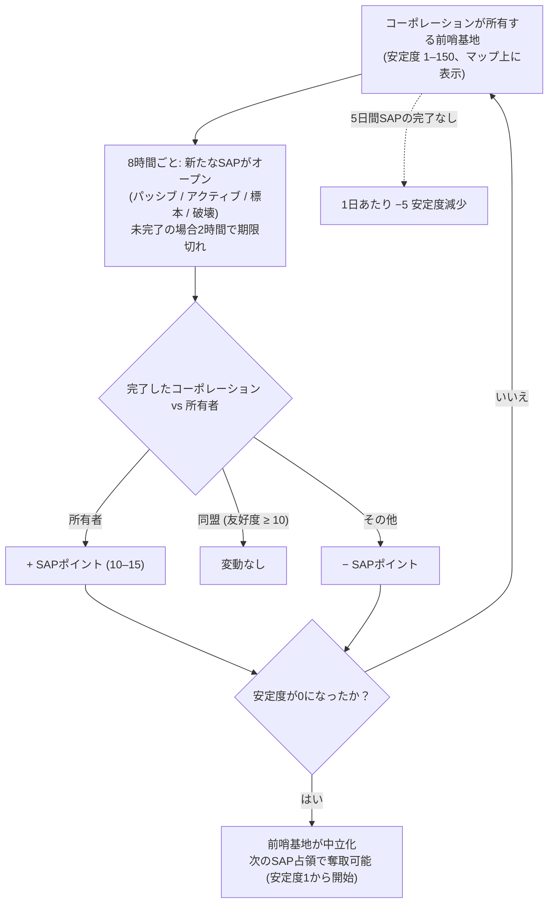

# 前哨基地とSAP

オープンPvPアイランドでは、**前哨基地（アウトポスト）をプレイヤーコーポレーションが所有できます**。
支配状況はマップビューの前哨基地の上に表示される**安定度（stability）**メーター（0–150）で測定されます。このメーターを変動させ、前哨基地の所有権を巡って争う仕組みが**SAP**（Service Access Point）システムです。

## 基本ルール

- **所有コーポレーション**がSAPを完了すると、そのSAPのポイント値分だけ安定度が**上昇**します。
- **所有者と同盟関係にあるコーポレーション**（相互スタンディング/友好度+10以上）が完了した場合、安定度は**変動しません**。
- **それ以外の第三者**が完了した場合、同量のポイント分だけ安定度が**減少**します。
- 安定度が**ゼロ**になると前哨基地の所有権が失われ、中立状態になります。中立の前哨基地でいずれかのSAPを完了すると**占領**（キャプチャー）となり、完了したコーポレーションが新たな所有者になります（安定度1からスタート）。
- **減衰（Decay）**: SAPが**5日間**完了されなかった場合、前哨基地はいずれかのSAPが完了するまで（または所有権を失うまで）、**1日あたり5の安定度**を失い始めます。

## 4種類のSAPタイプ

8時間ごとに前哨基地は4種類のうちいずれかの新しいSAPを展開します。各タイプには固有のポイント値と完了方法があります:

| タイプ | 完了手順 | ポイント | 主な報酬 |
|---|---|---|---|
| **パッシブ (Passive)** | SAPのビーム内に**8分間**留まります。進行度は個人単位（各プレイヤーがビーム内に連続して留まった時間）であり、単独で最も進行度が高いプレイヤーが完了させます。 | +10 | 各勢力のプラズマ（安定度に応じて増加）、研究キット、EPブースター。 |
| **アクティブ (Active)** | SAPをターゲットし、**SAPハッキングモジュール**を稼働させ続けます — 約120モジュールサイクル（各5秒）、つまり約10分間。中断や離脱をしても進行状況は保持されます（個人単位）。 | +15 | プラズマ、カーネル、研究キット、および**リアクターコア**（ロボット製造用）。 |
| **標本 (Specimen)** | **標本アイテム**をSAPの近く（7m以内）に持ち込み、要求される5〜6個のアイテムを納入します。各納入には90秒のクールダウンがあります（個人単位）。 | +15 | プラズマ、カーネル、研究キット。 |
| **破壊 (Destruction)** | 射撃して破壊します: **アーマー30,000**、**4つの属性ダメージすべてに耐性150**（60%軽減）、**シグネチャ半径6m** — 小型兵器が最も効果的です。ダメージ進行度は**個人ではなくコーポレーション単位**であるため、艦隊全体で一斉に削ることができます。破壊された時点で最も多くのダメージを与えていたコーポレーションの結果が適用されます。 | ±15 | 各勢力の**PvP弾薬**、プラズマ、カーネル。 |

4種類のSAPはすべて、近くにいる全員に向けて**現在のスコア上位プレイヤー/コーポレーション（トップ10）をブロードキャスト**し、完了しなかった場合は**2時間で期限切れ**となります。

### 妨害・阻止戦術（Denying the enemy）

破壊タイプの進行度はコーポレーション単位であり、安定度の増減は誰が勝利するかによって決まるため、**「リーダーボードの1位になるのに十分なダメージを与えつつ、あえてトドメを刺さない」**という戦術がよく用いられます。所有者自身の部隊が削り切って破壊を完了させた場合でも、最多ダメージを与えた*あなたの*コーポレーションが勝者となり、所有者側の安定度を減少させることができます。

## 監視と予測

- ジオスキャナー内の**侵入スキャナーチャージ（intrusion scanner charge）**を前哨基地の近くで起動すると、効果範囲内にある前哨基地の**次のSAPまでの時間**を確認できます（オープンPvPアイランドでは、同じチャージで代わりにNPC増援ステータスが表示されます）。
- SAPはオープンする少し前に、周囲のプレイヤーへ通知を発信します。
- SAPのトップスコアラー・ブロードキャスト機能により、競合しているSAPの状況を**リアルタイムで確認**し、奪取・防衛に割り込むかどうかを判断できます。

## 安定度が変動するその他の要因

- **SAPレリック（遺物）** — 前哨基地から90–350mの範囲に出現するレリックオブジェクト（リスポーン4時間、最長生存時間12時間）。これを破壊すると即座に**安定度が±1変動**し（自身のコーポレーションに応じて適用）、PvPフラグが立ち、EPとプラズマコンテナが付与されます。
- **ガーディアンとインベーダー** — 前哨基地のNPCボス:
  - **ガード (Guard)** NPCは前哨基地の近辺（約35m）に留まります。これを撃破すると、誰が倒したかに関わらず**常に安定度が3減少**します（約6時間でリスポーン）。
  - **インベーダー (Invader)** NPCは約300mまで巡回します。これを撃破すると、倒したプレイヤーのコーポレーションの安定度が**2上昇**します（約6時間でリスポーン）。

## 前哨基地が重要な理由

前哨基地を所有することでコーポレーションは様々なボーナス（生産、防衛施設、効果）を獲得でき、オープンPvPにおける領土戦の中核となります。前哨基地を本格的な作戦拠点とするための建造物については、[PBS](/ja/features/pbs/) を参照してください。

<!--
Written from scratch against the server backend, 2026-09-27:
Zones/Intrusion/Outpost.cs (stability 0-150, capture at 1, ally threshold
+10, EP to participants), OutpostDecay.cs (5-day grace, -5/day), SAP.cs +
PassiveHackingSAP.cs / ActiveHackingSAP.cs / SpecimenProcessingSAP.cs /
DestructionSAP.cs (8-min passive, 120x5s active, 5-6 specimen items with 90s
cooldown, corporate destruction score, 2h expiry, top-10 broadcast),
entitydefaults options (#increase=n10/n15), siegeitems (def_specimen_sap_item
2-3 x 5-6), def_sap_destruction stats (30k armor, 150 res all types, 6m
signature), def_siege_hack_module (5s cycle), intrusionsitestabilitythreshold
+ intrusionsaps, intrusionloot (plasma/kernels/research kits/cores/PvP ammo
by stability tier), npcbossinfo + npcflock (guard -3 @ ~35m, invader +2 @
~300m, 6h respawn), OutpostRelicManager.cs + SAPRelic.cs (90-350m spawn,
4h respawn, 12h lifespan, +1 stability, PvP flag), Scanner.Intrusion.cs
(next-SAP-time scan), EntitiesModule.cs (8h SAP interval).
An earlier version of this page was adapted from the Open Perpetuum
community wiki (perpetuum.miraheze.org) and has been fully rewritten from
backend sources; no text was reused.
Note: the ingested text had several numbers this server contradicts (3-day
decay vs 5-day, 10-min passive vs 8-min, "no resistances" vs 150 all types,
3 km invader range vs 300 m).
-->