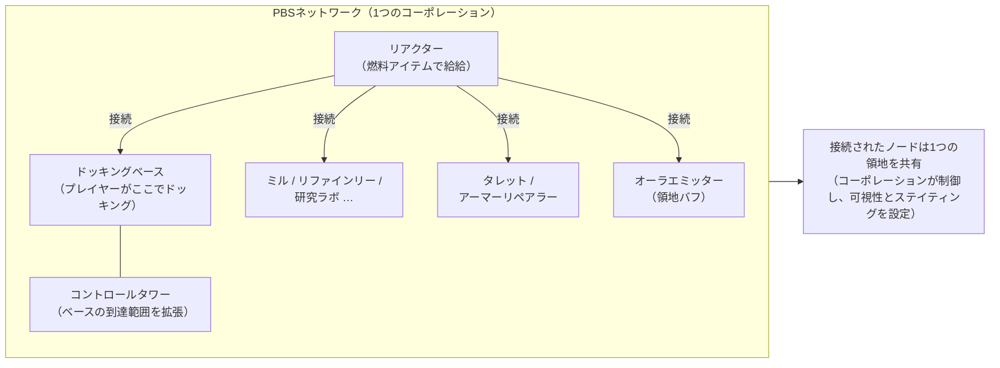
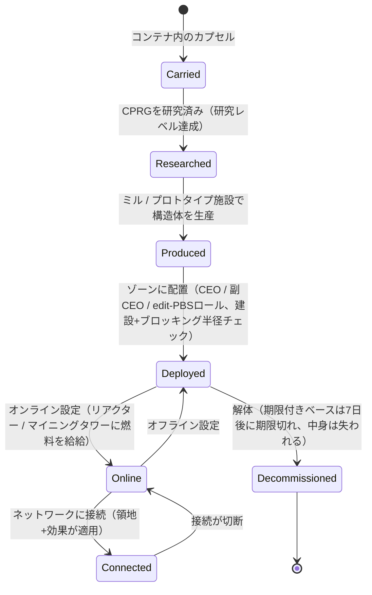

# 電力ベースステーション (PBS)

**PBS**（電力ベースステーション）はゾーン内に配置可能な構造体です。PBSオブジェクトは
**接続**されて**ネットワーク**を形成し、**領地**を定義して**効果**を有効にします。
これはコーポレーション/構造体関連のアクティビティであり、ほとんどの操作には適切なコーポレーション
ロールが必要です。

> UIの場所は[クライアントUI概要](/ja/features/ui/)に従います。クライアント内での「PBS」の名称は確認が必要です。
> 以下のメカニクスはサーバーに対して確認済みです。

## PBSの機能

- PBS**ネットワーク**における**ノード**です。
- 接続されたノードは、所有コーポレーションが制御する共有**領地**を形成します。
- ネットワークは領地に対して**効果**（バフ/制御）を発動できます。
- 一部のPBS構造体は、**給給**（燃料）としてアイテムを投入して動作します。

## 構造体ファミリー

すべてのPBS構造体には**small / medium / large**のティアがあります。**カプセル**を持ち運び、
アイテム（CPRG）を研究して、オブジェクトを**配置**します — 配置には権限が必要です（後述）。
ファミリーは以下の通りです：

| ファミリー | 構造体 | 役割 |
|---|---|---|
| 電力 | リアクター、エネルギーウェル、コアバッテリー、コアトランスミッター | すべてを動作させる**コアエネルギー**を生成、蓄積、分配する |
| ドッキング | ドッキングベース、期限付きドッキングベース、コントロールタワー | プレイヤーがドッキングする場所。コントロールタワーはベースの到達範囲を拡張する |
| 生産 | ミル、リファインリー、リプロセッサー、リペア、プロトタイパー、研究ラボ、キャリブレーション（CPRG）フォージ、リサーチキットフォージ、生産アップグレード | ホームベースではなくゾーン内の[生産](/ja/features/production/)施設 |
| 防御 | タレット（レーザー / レール / ミサイル / 電子戦）、アーマーリペアラー | 領地の自動防御 |
| 効果 | オーラエミッター、エフェクトサプライヤー、maskertower、マイニングタワー | 領地の効果バフを発動。マイニングタワーは鉱石を自動採掘する |
| 輸送 | ハイウェイノード | ゾーンの**ハイウェイ**（高速移動ライン）に接続 |
| 建設 | 建設モジュール | 他の構造体を配置するビルダー |

### オーラエミッターの効果

オーラエミッターは主な領地バフです。各ティアは3つの**レベルスケーリングされた基本バフ**の
いずれかを発動します：

- **small** — センサー lvl1 / エンジニアリング lvl1 / 産業 lvl1
- **medium** — 上記3つを lvl2
- **large** — 上記3つを lvl3

センサーはスキャン/偵察範囲を拡張し、エンジニアリングは建設を高速化、産業は生産を高速化します。

### 期限付きドッキングベース

特別なPBSベースで、固定の**7日間の寿命**（コンテンツ内では168時間）を持ちます。
**解体できません** — **期限切れになるか破壊される**だけです。残り寿命はゲーム内のアナウンサー
（ベースチャネルトピック、メール、MOTD）で通知されます。期限が切れるとベースは消去され、
中身は失われます。これはPBSドッキングの「家賃」モデルです：家賃を支払うのではなく、
タイムボックスが与えられます。

## 配置

- **配置チェック** — 配置前に、PBSがその位置に配置可能かを確認します（傾斜、ブロッキング、
  権限チェック）。これにはコーポレーションロール（**CEO / 副CEO / edit-PBS**）が必要です。
- 配置には構造体の**建設半径**と**ブロッキング半径**が使用されます。

## ネットワークと接続

- **ネットワーク取得** — 自分が所属するPBSネットワークを表示します。
- **ノード情報** — PBSノードの詳細。
- **ノード名の変更**。
- **接続の作成** — 2つのPBSノードをリンクします。（既にドッキングベースを持つネットワークに
  接続すると、特定の所有権移転ケースが発生します。）
- **接続の切断** — 2つのノードをアンリンクします。
- **接続重みの設定** — 接続の強度/優先度を調整します。

## 制御と状態

- **オンライン設定** — ノードをオンライン/オフラインにします。
- **効果の設定** — ノードが発動する効果を設定します。
- **ベース解体の設定** — ベースを解体対象にフラグします。

## 領地

- **領地の取得** — 自分のネットワークが制御する領地のリストを表示します。
- **領地可視性の設定** — 領地を他者に可視にするかを制御します。
- **ステイティング制限の設定** — ステイティングによるアクセスを制限します。
- **リインフォースオフセットの設定** — リインフォースメントの挙動を調整します。

## 給給

- **給給可能情報** — PBSに必要なものと現在の給給状態。
- **アイテムの給給** — PBSを駆動/動作させるためにアイテムを投入します。

給給可能な構造体は**リアクター**と**マイニングタワー**です。給給は、エネルギー値
（1個あたりの `corecalories`）を持つアイテムを、ノードのコアエネルギーバッファに変換します。
最大値まで — 範囲内のプレイヤーは誰でもノードに給給できます。消費できるもの：

| 燃料 | 1個あたりのコア |
|---|---|
| リアクターブースター クラスC | 8,000,000 |
| リアクターブースター クラスB | 4,000,000 |
| リアクターブースター クラスA | 2,000,000 |
| SAP標本（intrusion） | 600,000（fluxバリアント：28,000） |
| ガンマエネルギーブロック | 2,000 |
| コアブースター弾 | 1,000 |
| 原石（espitium） | 400 |
| 原石（vitricyl / prilumium / chollonin） | 300 |
| 原石（axicol） | 40 |

ブースターは効率的な燃料で、原石は安価な代替手段です。

## 償還

- **償還情報の取得 / 設定** — PBS関連のコストの償還を設定します。

## ログ

- **PBSログ** — PBSのアクティビティ（接続、配置など）を確認します。

## 実用上の注意

- **これは役員向けアクティビティです** — 配置とほとんどの制御にはコーポレーションロールが必要です。
- **接続が領地を定義します** — 構築するネットワークが、あなたが制御するものです。
- **先に配置チェックを行う** — コミットする前に、配置が失敗する理由（傾斜、ブロッキング、
  権限）を教えてくれます。
- **給給で稼働を維持します** — リアクターとマイニングタワーは燃料アイテム（ブースターまたは原石）
  を消費してコアバッファを維持します。
- **期限付きベースはタイムボックスです** — 7日間、解体不可。消去を前提に計画してください。
- **領地可視性とステイティング**で、ゾーンを他者に開く/閉くことができます。

## 防御タレット

プレイヤーによる操縦はできません — PBS防御構造体として配置されます。タレットは他のロボットと同様に
パーツから組み立てられますが、PBSパッドに固定され、操縦することはできません。

| タレット | 役割 |
|---|---|
| PBS Turret | 汎用PBS防御 |
| PBS EW Turret | エネルギー戦（シールド/アーマー攪乱） |
| PBS Laser Turret | ビーム兵器防御 |
| PBS Missile Turret | ミサイル防御 |
| PBS Rail Turret | 投射物（EM）防御 |
| Police guard tower | ゾーンNPC警察防御 |

パーツレベルの詳細は[ロボットリファレンス](/content/robots/)を参照してください。

<!-- TODO: 残っているのはPBSのクライアント内名称とUIのみ（構造体リスト、ネットワーク
     エディタ、給給画面）。
     確認済み: 416 def_pbs_* 定義、capsule/cprg/pr/object
     変種を持つ S/M/L ティア; オーラエミッター #effect=N93..101 = pbs sensors/engineering/industry lvl1-3
     (EffectType enum); feedable = reactor + mining tower (IPBSFeedable), fuel =
     definitionconfig.corecalories (boosters A/B/C 2/4/8M, SAP 600k/28k, gamma block
     2k, ore espitium 400 / vitricyl+prilumium+chollonin 300 / axicol 40);
     ExpiringPBSDockingBase: lifetime 168 h from definitionconfig.lifetime, 解体不可、
     アナウンサーチャネルトピック+メール、期限切れで消去。 -->
     開発者メモ: Zone/PBS/PBSCheckDeployment.cs (建設/ブロッキング半径、
     CEO/deputy/editPBS ロール), PBSMakeConnection.cs / PBSBreakConnection.cs,
     PBSSetConnectionWeight.cs, PBSSetOnline.cs, PBSSetEffect.cs, PBSSetBaseDeconstruct.cs,
     PBSGetNetwork.cs, PBSNodeInfo.cs, PBSRenameNode.cs, PBSGetTerritories.cs,
     PBSSetTerritoryVisibility.cs, PBSSetStandingLimit.cs, PBSSetReinforceOffset.cs,
     PBSFeedableInfo.cs / PBSFeedItemsHander.cs, PBSGetReimburseInfo.cs /
     PBSSetReimburseInfo.cs, PbsGetLog.cs; Zones/PBS/* (IPBSObject, ConnectionHandler). -->