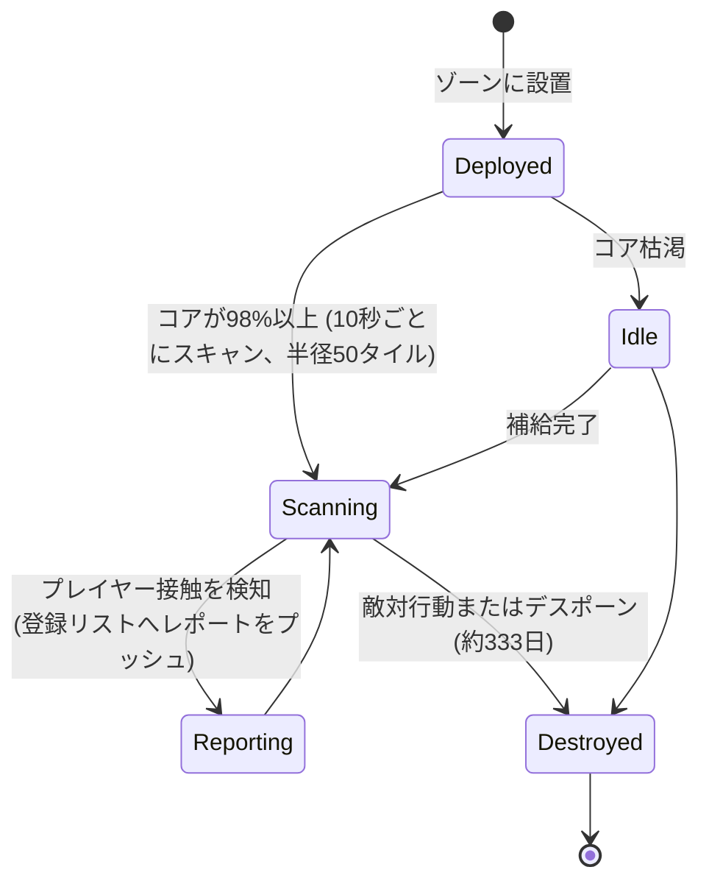

# 近接プローブ

プローブには大きく分けて2つの種類があります：

- **可視（近接）プローブ** — ゾーン内に展開して**特定エリアを監視**するための小型デバイス。給電中は周囲のプレイヤーユニットをスキャンし、登録されたキャラクターへレポートをプッシュ通知します。監視・索敵用のツールです。
- **採掘プローブ** — ロボットに装備する**モジュール**（*noob* から *standard*、*industrial*、*named*、*elite*、そして *artifact* までのティア）と**鉱石別プローブ弾薬**（鉱石ごとにタイル / 方向 / エリアのバリエーションが存在）。発射するとそのエリア内における対象鉱石のスキャン結果が生成され、キャラクターごとに保存されます（[採集 → スキャン](/ja/features/gathering/) を参照）。

> UIの配置場所は [クライアントUIの概要](/ja/features/ui/) に準拠しています。以下のメカニクスはサーバー仕様に基づいて確認されています。

## プローブの管理

- **一覧表示（List）** — 所有しているプローブを確認します。
- **登録情報（Registration info）** — プローブの登録状態・情報を確認します。
- **登録の設定（Set registration）** — プローブのレポート受信リストにキャラクターを紐付けます。
- **名前の設定（Set a name）** — プローブにラベル（名称）を付けます。
- **登録の解除（Remove）**（ゾーン内） — 監視を停止 / 登録をクリアします。

### 可視プローブの仕組み

- **コア駆動**：コアがほぼ満タン（`core_max` の98%以上）のときのみスキャンを行い、空になると待機状態（アイドル）になります。
- 稼働中は**10秒ごと**に**探知半径（50タイル）**内のプレイヤーロボットをスキャンし、登録リストの全員にレポート（各接触対象のキャラクターIDおよび座標）をプッシュ通知します。
- **登録**はコーポレーション単位の機能です：登録できるのは**自身のコーポレーションのメンバー**のみで、**CEOおよび副代表（Deputy）は自動的に常にリストに含まれます**。リストには上限数があります。
- **寿命**：展開されたプローブは、データ定義された `despawn_time`（可視プローブの場合は約333日に設定）が経過するか、破壊されると消滅します。

## ライフサイクルイベント

サーバーはプローブのライフサイクルイベントをリアルタイムに通知します：
- **created**、**updated**、**dead** — プローブの展開、レポート送信、または破壊時。

これらはプッシュ通知として届きます。こちらから送信するのではなく、受信して対応する形式です。

## 実践的なアドバイス

- **確認する前に登録を** — プローブは登録されたキャラクターにのみレポートを送信します。
- **プローブは失われることがある** — 敵対的な行動や有効期限切れによって破壊・消滅する可能性があります。ライフサイクルイベントを注視してください。
- **名前を付ける** — フィールド上に複数のプローブがある場合、ラベルを付けておくと混乱を防げます。
- **戦闘用ではなく偵察用** — プローブは情報を収集するためのものであり、戦闘は行いません。

<!-- TODO: only the UI remains (probe list, registration picker).
     Confirmed: visibility probe (def_visibility_probe): core_max 50, active only at
     core>98%, 10 s scan interval (ProximityDevice.cs _probingInterval), detection via
     blob_emission 10 / blob_emission_radius 50, report = characterID + x/y per contact
     pushed to registered characters (ProximityProbe.OnUnitsFound); registration =
     own-corp members only, CEO+Deputy always included, max count
     (ProximityProbeRegisterSet.cs); despawn_time 28,800,000 s (~333 d) on the capsule;
     stealth_strength 275 / detection_strength 45. Mining probes: tiered modules
     (noob/standard/industrial1-2/named1-3/elite t2-t4/artifact) + per-ore tile/
     direction/area ammo (79 def_*probe* definitions).
     Developer notes: ProximityProbeList.cs / ProximityProbeGetRegistrationInfo.cs /
     ProximityProbeRegisterSet.cs / ProximityProbeSetName.cs; Zone/ProximityProbeRemove.cs;
     Zones/ProximityProbes/ProximityProbe.cs + ProximityProbeDeployer.cs +
     ProximityDevice.cs; Zones/Blobs/* (blob emission/stealth); lifecycle events via
     ProximityProbeCreated/Update/Dead/Info commands. -->
     Developer notes: ProximityProbeList.cs / ProximityProbeGetRegistrationInfo.cs /
     ProximityProbeRegisterSet.cs / ProximityProbeSetName.cs; Zone/ProximityProbeRemove.cs;
     Zones/ProximityProbes/ProximityProbe.cs + ProximityProbeDeployer.cs; lifecycle
     events via ProximityProbeCreated/Update/Dead/Info commands. -->