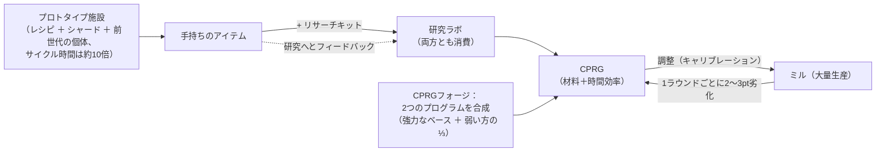

# 生産

生産（Production）とは、原材料やコンポーネントを使用可能なアイテムへと加工するプロセスです。
ドック内の基地にある**生産施設**（「ミル / Mill」）で行われます。ここにあるすべての機能は**ドック内限定**です。

> UIの配置は[クライアントUI概要](/ja/features/ui/)（トップバーの**Refinery / Recycling / Repair / Insurance**カテゴリー）に準拠しています。以下のメカニクスはサーバー仕様に基づいて確認されています。

## 生産ライン

**生産ライン**とは保存されたレシピのことであり、何を何の素材から生産するかを定義します。
作成可能なすべてのアイテムの完全なコンポーネントリスト（研究レベルを含む）は[Recipes](/content/recipes/)で確認できます。ラインは指定した**ラウンド数（rounds）**分実行されます。

- **ライン一覧（List lines）** — 利用可能なラインを確認します。
- **ライン開始（Start a line）** — 施設内で指定したラウンド数（最低1回）ラインを実行します。
  - 支払いは**個人ウォレット**または**コーポレーションウォレット**から選択できます。
  - 素材となるコンポーネントは、**インベントリ**または**ロボット**から検索・供給できます。
- **ライン調整（Calibrate a line）** — ラインの設定を調整します。
- **ラウンド数設定（Set rounds）** — 実行するラウンド数を設定します。
- **次ラウンド確認（Query next round）** — 次のラウンドで消費・生産される内容をプレビューします。
- **キャンセル（Cancel）** — 実行中の生産を停止します。
- **ライン削除（Delete a line）** — 保存されたラインを削除します。

ラインを実行すると、コンポーネント（およびクレジット）を消費し、ラウンドの経過とともに目標アイテムが生産されます。

## 単発オペレーション（ワンショット操作）

複数ラウンドにわたるラインではなく、単発のアクションとして実行される操作です。それぞれ確定前にコストや出力をプレビューできる**Query（確認）**機能が用意されています。

- **精錬（Refine）** — アイテムのレシピ（[Recipes](/content/recipes/)参照）を使用して原材料をコモディティ（一次加工品）に変換します。
  生産する目標アイテムの数量を指定します。レシピの公称投入量はマテリアル乗数 `1 + 50/(bonus + 100)` によってスケーリングされます。ここで *bonus* は精錬スキル（エクステンション＋施設ポイント＋スタンディングポイント）です。ボーナスがない場合は公称レシピの**150%**を消費しますが、最大ボーナスでは**100%**に近づきます。
- **リサイクル / 再処理（Recycle / reprocess）** — アイテムをレシピの構成コンポーネントへと分解（逆レシピ）します。
  回収量は `公称値 × (1 − 75/(bonus + 100)) × アイテムの耐久度比率` となります。スキルボーナスがない場合の基本値は**25%**で、最大100%まで向上します。また、**損傷したアイテムは比率に応じて回収量が減少します**（価値の高いアイテムは先に修理してください）。完全な「バッチ」（規定のデフォルト数量）単位でのみリサイクルされ、端数は残ります。ミッションアイテムはリサイクルされず削除されます。
- **修理（Repair）** — 損傷したアイテムやロボットを最大耐久度まで復元します。
  費用は `(損失耐久度 %) × アイテムの素材価値 × 75/(bonus + 100)` です。「素材価値」は再帰的に計算されます。アイテムのレシピを原材料まで分解し、**ワールドマーケットの平均価格**で算出されるため、修理費用は市場価格に応じて変動します。スキル乗数はボーナスなしの**75%**から始まり、最大ボーナスで0へと近づきます。
- **研究コンポーネント（Research components）** — 研究コンポーネントを生産します（確認＋実行）。

## アイテムのライフサイクル（循環プロセス）

アイテムの作成は、連動する3つの施設による循環ループとなっています。

1. **研究（リバースエンジニアリング）** — 生産したいアイテム1個と、そのアイテムの研究レベルを満たす**リサーチキット**（キットのレベルは0〜10）を研究ラボに投入します。投入した両方の素材は**消費**され、そのアイテム用の**CPRG**が1つ生成されます。生成されるプログラムの効率は、アイテムごとの基本値（多くのアイテムは50、弾薬はそれ以上、タレットは最大90）から始まり、*必要レベルを超過した分のキットレベル × 5* と研究スキルボーナス（最大+50）が加算されます。そのため、アイテムより数レベル高いキットと適切な生産エクステンションを揃えることで、初期値50/50のプログラムを実用的な数値へと引き上げることができます。こうして新たなアイテムが生産レパートリーに加わります。
2. **ミル（大量生産）** — プログラムからアイテムを大量生産します。生産ラウンドごとにラインの効率は**劣化**します（アイテムカテゴリーごとに1ラウンドあたり2〜3ポイント。[CPRG](#cprg-kiyariburesiyonpuroguramu)を参照）。素材のロスが大きくなりすぎた場合は、新たなプログラムをラインに調整（キャリブレーション）し直します。また、プロトタイプアイテムの生産には**前世代の現物個体**もコンポーネントとして必要となり（T2プロトタイプの作成には標準モジュール1個、T3にはT2が1個）、プロセス内で消費されます。
3. **プロトタイプ施設** — アイテムの**プロトタイプ**を直接生産します。レシピの素材に加えてロボットシャード、*そして*前世代の現物個体を使用し、**ミルの約10倍のサイクル時間**（および通常の時間乗数）を要します。テックツリーでアンロック済みのアイテムのみプロトタイプ化できます。プロトタイプは標準アイテムに比べてコストが大幅に高くなります。その主な目的は**研究して高品質なプログラムを作成すること**（プロトタイプアイテムを研究することで次のティアが解放されます）や、ドロップ率が極めて低く市場でも高価すぎるアイテムをロボットに装備することです。

## ティアの進行

ほとんどのモジュールやロボットには**ティア T1 → T4**が存在します（クライアントのティアバッジ、`standard → named1 → named2 → named3` という定義ライン、さらに `elitet4`/`artifact` の特殊ライン）。ルールは以下の通りです。

- **各ティアはそれぞれ独自のテックツリーノードを持つ独立したアイテムです。** ノードのアンロックには研究ポイント（カーネルから研究）が必要で、前提となる**親ノード**の解放が必須となります。そのため、ティアは順番にアンロックしていく必要があります。ノードがすでにアンロックされているアイテムのみ**プロトタイプ作成**（または大量生産）が可能です。研究なしで上位ティアを作成する方法はありません。
- **上位ティアを作成するごとに、前ティアの現物個体1個**がコンポーネントとして消費されます（素材やロボットシャードに加えて）。したがって、T1アイテムをそのままT3に「引き換える」ことはできません。T3プロトタイプには**T2**アイテムが必要であり、その個体は変換されるのではなく**消費**され、完全に新しいアイテムが出力されます。
- 各アイテムページにはその**ティアライン**（`T1 → T2 → T3 → T4` のチェーン全体）がリンクとして表示され、[テックツリーノードページ](/content/techtree/)には各ティアの親ノード/次ノードおよび必要ポイントが記載されています。

例（スモールマイナーモジュールの場合）：[スタンダードスモールマイナー (T1)](/content/items/standard-small-driller/) →
[Biroter 5050 スモールマイナーモジュール (T2)](/content/items/named1-small-driller/) →
[Sublimator Low-D スモールマイナーモジュール (T3)](/content/items/named2-small-driller/) →
[Scraper-990 スモールマイナーモジュール (T4)](/content/items/named3-small-driller/) —
すべてのモジュールおよびロボットファミリーにおいて同様のパターンが適用されます。

## プロトタイプとリサーチキット

- **プロトタイプ（Prototype）** — プロトタイプアイテムを生産します（開始＋確認）。1スロットにつき1つのプロトタイプを作成できます。並行して行えるプロトタイプ作業の枠数は生産エクステンションによって増加します。
- **リサーチキットの合成（Merge research kits）** — 複数のリサーチキットを合成して上位のキットを作成します（実行＋確認）。上位のキットを使用することで、研究時間の短縮と生成されるプログラムの効率向上の両方が得られます。

## CPRG（キャリブレーションプログラム）

**CPRG**（キャリブレーションプログラム）とは、生産ラインを稼働させるための基準データであり、アイテムごとに**材料効率（material efficiency）**と**時間効率（time efficiency）**のポイント（各0〜100）が設定されています。研究ラボで**アイテムを研究する**（どのアイテムを生産可能かは研究レベルによって制限されます）か、**キャリブレーションカプセル**を使用することで入手できます。

- 新規に研究されたCPRGは初期値**50/50**ポイントから始まります。
- キャリブレーションプログラムフォージで**CPRGの合成（Forge CPRGs）**が可能です。同じアイテムのCPRGを2つ組み合わせると、強力な方のプログラムの数値をベースとして維持し、弱い方の数値の3分の1が加算されます。合成には時間とクレジット（時間 × 施設の秒あたり価格）がかかります。
- CPRGを用いて**ラインを調整（Calibrate a line）**し、効率を設定します。生産ラウンドごとにラインの効率は**低下**（アイテム固有の脱キャリブレーション値）するため、ライン性能は徐々に低下します。長期稼働の前には再計算を行ってください。

効率ポイントはミルの計算式（生産サイクルごと）に反映されます：

- **消費素材** = レシピ × `1 + 50/(材料ポイント + スキル + 100 + ミルボーナス)`
  — スキルおよびテックツリーの大量生産ボーナスがない初期状態の50ポイントCPRGの場合、公称レシピの約**133%**を消費します。
- **生産時間** = 施設の基本時間（ミルの場合は1サイクルあたり3,600秒） ×
  `1 + 100/(時間ポイント + スキル + 100)` × アイテムの所要時間補正 — スキルがない初期CPRGの場合、アイテム1個あたり約**1時間40分**かかります。
- **価格** = 生産時間 × 施設の秒あたり価格（PBSミルの場合は7クレジット/秒、大型/中型PBS研究ラボの場合は3クレジット/秒） × アイテムの価格補正（1〜10）。
- ミッション関連のCPRGは費用無料、固定で10秒となります。

## 保険

保険施設では、生産物ではなく**所有するロボット**に保険をかけます：

- ロボットに対して保険プランの**加入（Buy）**（損傷がなく、組み立て済みで、初期配布ボットでないことが条件）、加入中プランの**一覧表示（list）**、プランの**確認（query）**、プランの**解約（delete）**が行えます。
- 保証期間は**15日間**（＋エクステンションによるボーナス日数）です。保険は1 ＋（エクステンションボーナス）機のロボットに対して掛けることができます。
- 各ロボットにはコンテンツ定義された**保険料（fee）**と**支払額（payout）**が設定されています（`insuranceprices` テーブル、67種類のロボット定義）。保険料は手数料割引エクステンションによって軽減され、コーポレーションウォレットから支払うことも可能です。
- 保険対象のロボットが破壊された場合、**保険金はクレジットで支払われます**（ロボット自体は失われます）— 詳細は[戦闘](/ja/features/combat/)を参照してください。

## 施設とステータス

- **施設情報 / 説明（Facility info / description）** — 生産施設が提供する機能。
- **進行中（自分 / コーポレーション）（In progress (mine / corporation)）** — 現在生産されているアイテム。
- **生産履歴（Production history）** — 過去の生産ログ。
- **コンポーネント一覧（Components list）** — 利用可能な生産コンポーネント。
- **サーバー情報（Server info）** — 生産サーバーの稼働ステータス。

## 実践的なヒント

- **生産施設のある基地にドックしている必要があります。**
- **実行する前に確認（Query）を行う** — 確認機能でコストと出力を事前にチェックし、誤操作で貴重なコンポーネントを無駄遣いしないようにしましょう。
- **コーポレーションウォレット** — 権限が付与されている場合、生産にコーポレーションの資金を使用できます。
- **ロボットからもコンポーネントを調達可能** — ラインはインベントリだけでなく、装備中のロボットからも素材となるコンポーネントを取り出すことができます。
- **耐久度最大でリサイクルする** — 損傷したアイテムは回収量が低下します。高価なアイテムは再処理する前に修理してください。
- **スキル乗数こそが真の経済的レバレッジ** — 精錬、リサイクル、修理、ミルのボーナスはすべて同様にスケールします。生産エクステンションへの投資は、毎回の実行における材料節約という形で確実に利益をもたらします。
- **保険はロボットのセーフティネット** — 深宇宙（PvPエリア）に向かう前に、高価な装備のロボットには保険をかけておきましょう。
- **リサーチキットが成否を分ける鍵** — アイテムの研究レベル（1〜9）によって解読可能なキットが決まります。アイテムより数レベル高いキットを使用することが、結果として得られるプログラムの効率を引き上げる最も低コストな方法です。

<!--
Developer notes: rewritten 2026 from backend sources; no community-wiki text reused.
Verified against:
- refine = 1 output per unit, input = nominal x (1+50/(bonus+100)) (Refinery.cs);
- recycle = reverse recipe x (1-75/(bonus+100)) x healthRatio, whole batches only,
  mission items deleted (ReprocessSessionMember.cs);
- repair price = (1-healthRatio) x PriceCalculator world-market value x
  75/(bonus+100) (Repair.cs + PriceCalculator.cs);
- ResearchLab.cs (StartResearch/EndResearch: source item + research kit both
  consumed; kit level must be >= itemresearchlevels.researchlevel (1-9);
  efficiency = per-item base + levelDifference*5 + (1-100/(100+skill))*50);
- itemresearchlevels (1101 rows, levels 1-9), research kits def_research_kit_0..10
  (#level option), RandomResearchKit (mission kits, fake 100/100);
- calibrationdefaults (per-CPRG base efficiencies 50-90; default fallback 50/50;
  CalibrationProgram.OnInsertToDb sets 50/50);
- PBSFacilities.cs CalculateResultingPoints (forge = better base + weak/3 +
  (1-100/(100+skill))*25);
- productiondecalibration (2-3 points decrease per round per category,
  distorsion 0.5-1%);
- Prototyper.cs (StartPrototype: components include previous-gen specimen via the
  components table — e.g. T2 NEXUS consumes 1x standard module, T3 consumes 1x T2;
  time = 10x cycle x multiplier; tech-tree unlock check in
  ProductionPrototypeStart.cs);
- prototypes table (339 rows, standard->prototype mapping);
- Mill.cs (CalculateFinalMaterialMultiplier 1+50/(pts+skill+100+millBonus) with
  tech-tree mass-production bonus; CalculateFinalTimeMultiplier;
  productionduration table);
- Insurance: InsuraceFacility.cs (15d + time-extension bonus, 1+slot-extension
  policies, noob bot excluded, must be single+unpacked), InsuranceDescription.cs
  (payout in credits via central bank), insuranceprices (67 robot definitions,
  payout = 80x fee except noob/arkhe2 at 4x).
- Facility options (entitydefaults): def_pbs_facility_mill #perSecondPrice=7
  #productionTime=3600; refinery #materialEfficiency=0.95;
  calibration_program_forge #perSecondPrice=7; def_production_public_factory
  #materialEfficiency=0.6 #manufactureTime=3600 #perSecondPrice=3.
Developer files: Production/ProductionLineStart.cs (PrepareProductionForPublicContainer,
LineStartInMill, corp wallet, search-in-robots, rounds); Production/ProductionLine*.cs;
Production/ProductionRefine*.cs, ProductionReprocess*.cs, ProductionRepair*.cs,
ProductionResearch*.cs (query+run pairs); Production/ProductionPrototype*.cs,
ProductionMergeResearchKitsMulti*.cs; Production/ProductionCPRG*.cs,
ProductionGetCPRGFromLine*.cs; Production/ProductionInsurance*.cs;
Production/ProductionFacility*.cs, ProductionInProgress*.cs, ProductionHistory.cs;
Services/ProductionEngine/Facilities/*.cs; Services/ProductionEngine/PBSFacilities.cs;
Services/ProductionEngine/ResearchKits/*.cs; Services/ProductionEngine/CalibrationPrograms/*;
Services/Insurance/InsuranceHelper.cs; Items/PriceCalculator.cs.
Corrections vs ingested page: no "decoder" item exists (research kits are the
level-gated inputs); the "researched to 100%" claim is wrong (tech-tree unlock is
the gate; research levels run 1-9); prototype time is 10x the mill cycle; specimen
consumption verified from the components table; insurance payout is 80x the fee.
-->