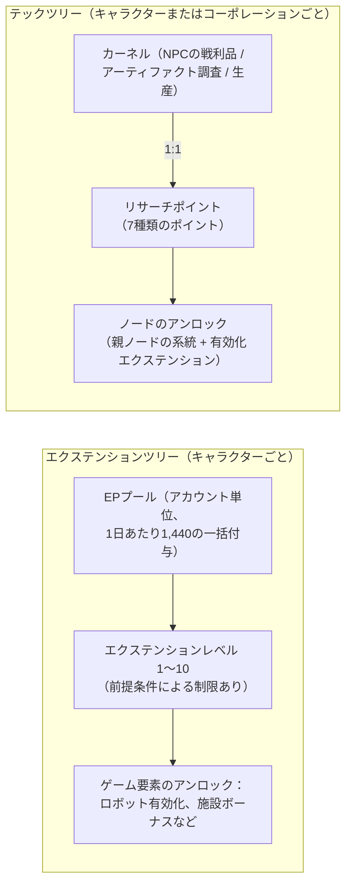

# リサーチ

ゲーム内には**2つの独立した進行システム**が存在します。どちらもドック内でのみ利用可能です。

> UIの配置は[クライアントUIの概要](/ja/features/ui/)に従います（キャラクターウィンドウ → エクステンション、テックツリーには専用ウィンドウがあります）。以下のメカニクスはサーバー側の仕様に準拠しています。

## エクステンションツリー（キャラクタースキル）

エクステンションはキャラクターごとのスキルレベルであり、ゲーム内の様々な要素を解放します。最も重要なのは、特定のロボットクラスの操縦を可能にする**有効化エクステンション（enabler extensions）**です（ロボットを選択して出港するために必須です。[移動](/ja/features/movement/)および[ロボット](/ja/features/robots/)を参照）。

### 習得の仕組み

- 習得するには**ドックに滞在**している必要があります。
- 各エクステンションは**レベル1〜10**まで上げることができます（レベル10が上限）。
- **レベル1にはクレジットが必要**（エクステンションの`price`）で、ウォレットから支払われます。
- **すべてのレベルでエクステンションポイント（EP）が必要**となります。コストは固定の「ランク × レベル」テーブルに従い、レベル1〜5のコストは`60 × ランク × レベル`、レベル6〜10は`ランク × (1440, 2520, 3840, 5400, 12000)`へと跳ね上がります。ランク1のエクステンションの場合、10段階のレベルで60 → 6,000 EP（合計13,500 EP）が必要となり、ランク10の場合は各レベルでその10倍のコストがかかります。
- エクステンションを習得する前に、**前提条件**を満たしておく必要があります（「prerequire」リスト）。
- EPは**アカウントレベルのプール**です。同一アカウント内のキャラクター間で共有され、時間経過によって獲得できます（下記の「EPの獲得源」を参照）。

### エクステンションの管理

- **カテゴリリスト / すべて取得 / 習得済みリスト / 前提条件リスト** — ツリーの内容や現在の習得状況を確認できます。
- **利用可能ポイント** — 現在のEPプールを確認できます。
- **1レベル削除** — エクステンションのレベルを1段階下げます。
- **キャラクターのエクステンションをリセット** — キャラクターのツリー全体をリセットします。
- **ロックされたEPの解放** — ロックされているEPを解放します（レベル削除後など）。
- **EPブーストの購入** — EPの獲得量を増加させる有料の加速アイテムです。
- **アクティビティによるEPの日次ログ** — プレイを通じて獲得したEPの量を確認できます。

### EPの獲得源

EPは直接購入する消費通貨ではなく、**1日ごとのバッチ処理**で蓄積されます：

- すべてのアカウントは**1日あたり1,440 EP**を受け取ります（サーバー時間の08:00から11:00の間に、`extensionPointsAdd`プロシージャによって1日1回付与されます）。コード上には有料サブスクリプションアカウント向けに2倍となる**2,880 EP**の定義も存在しますが、現在のプロシージャでは全アカウントに基本バッチが付与されます。
- **有料ブースト**（EPブーストの購入）は追加で加算されます。
- **利用可能なEP** = 受け取ったすべてのデイリーバッチ − ペナルティ − ゲーム内で消費したEP（アクティビティによるEPのログで、日ごとの獲得内訳を確認できます）。

**完全なカタログ** — すべてのエクステンション（ランク、レベル1の価格、ボーナス、前提条件）は[Extensions](/content/extensions/)に、すべてのテックツリーノード（アンロックされるアイテム、有効化エクステンション、ポイント価格）は[Tech tree](/content/techtree/)に記載されています。

## テックツリー（アンロック）

テックツリーは、**リサーチポイント**を消費してアンロックしていく**ノード**のグラフ構造です。EP（アカウントプール）とは異なり、テックツリーのポイントはリサーチ後に提出するアイテムである**「カーネル」を消費することで獲得**します。

### 仕組み

- **カーネルのリサーチ** — コンテナからカーネルアイテムを提出します。各カーネルは対応する**ポイントタイプ**のリサーチポイントへと**1:1**で変換され、カーネル自体は消費されます。ポイントタイプに対応して、セオディカ（Theodica）、ペリスタル（Pelistal）、ニュイムコル（Nüimqol）、インダストリアル（Industrial）、コモン（Common）、ハイテク（HiTech）、ニューテック（NewTech）の7種類のカーネルが存在します。
- **ノードのアンロック** — 必要なリサーチポイントを消費します。ノードをアンロックするには以下の条件を満たす必要があります：
  - すべての**親ノード**がすでにアンロックされていること
  - そのノードの**有効化エクステンション**をキャラクターが習得していること
- **コーポレーションによるアンロック** — 適切なコーポレーション権限があれば、ノードを**コーポレーション用**（共有）としてアンロックできます。コーポレーションでのアンロックはコストが高くなり（コーポレーション価格倍率が適用されます）、コーポレーションのポイントから支払われます。
- **寄付** — リサーチポイントを寄付します（例：所属コーポレーションへ）。
- **情報 / ログ** — ノードの詳細情報や、アンロックおよびリサーチの履歴を確認できます。

### なぜ重要なのか

アンロックされたテックツリーのノードは、上位ティアのコンテンツや機能へのアクセスを解放します。ポイントを消費する前に、ノードの前提条件（親ノードの系統 + 有効化エクステンション）を確認してください。

## 実践的な注意点

- **有効化エクステンションがロボットの搭乗を制限** — リサーチしていないロボットクラスを操縦することはできません（出港や選択をブロックするのと同じ判定です）。
- **エクステンションツリーでクレジットが必要なのはレベル1のみ** — それ以降のレベルアップはすべてEPのみを消費します。
- **テックツリーは不可逆** — アンロックに消費したポイントは戻りません。計画的に進めてください。
- **コーポレーションテックはチームでの取り組み** — 共有ポイントを使用し、価格倍率が適用されます。

<!-- TODO: only the research UI remains (window layout, point display).
     Confirmed: EP earn = 1440/day flat via dbo.extensionPointsAdd (08:00-11:00 window,
     once per day; 2880 bonus constant exists in GiveExtensionPointsService for paid
     subscriptions but the current SP pays base to all); available = batches -
     penalties - spent (extensionPointsAvailable fn); EP cost table in
     Services/ExtensionService/ExtensionPoints.cs (60*rank*level for levels 1-5, then
     rank*(1440,2520,3840,5400,12000)); kernels convert 1:1 (TechTreeResearch.cs), 7
     kernel definitions -> point types n1..n7 (Theodica/Pelistal/Nuimqol/Industrial/
     Common/HiTech/NewTech).
     Developer notes: Extensions/ExtensionBuyForPoints.cs (docked, prereq, level cap 10,
     level-1 credit price, EP by rank/level, account pool, training-char free);
     Extensions/ExtensionGetAvailablePoints.cs; Extensions/ExtensionBuyEpBoost.cs,
     ExtensionFreeLockedEp.cs, ExtensionRemoveLevel.cs, ExtensionResetCharacter.cs;
     EpForActivityDailyLog.cs; TechTree/TechTreeResearch.cs (kernels → points);
     TechTree/TechTreeUnlock.cs (parent chain + enabler extension, corp multiplier);
     TechTree/TechTreeDonate.cs; Services/ExtensionService/GiveExtensionPointsService.cs;
     Services/ExtensionService/ExtensionPoints.cs. -->
     Developer notes: Extensions/ExtensionBuyForPoints.cs (docked, prereq, level cap 10,
     level-1 credit price, EP by rank/level, account pool, training-char free);
     Extensions/ExtensionGetAvailablePoints.cs; Extensions/ExtensionBuyEpBoost.cs,
     ExtensionFreeLockedEp.cs, ExtensionRemoveLevel.cs, ExtensionResetCharacter.cs;
     EpForActivityDailyLog.cs; TechTree/TechTreeResearch.cs (kernels → points);
     TechTree/TechTreeUnlock.cs (parent chain + enabler extension, corp multiplier);
     TechTree/TechTreeDonate.cs. -->