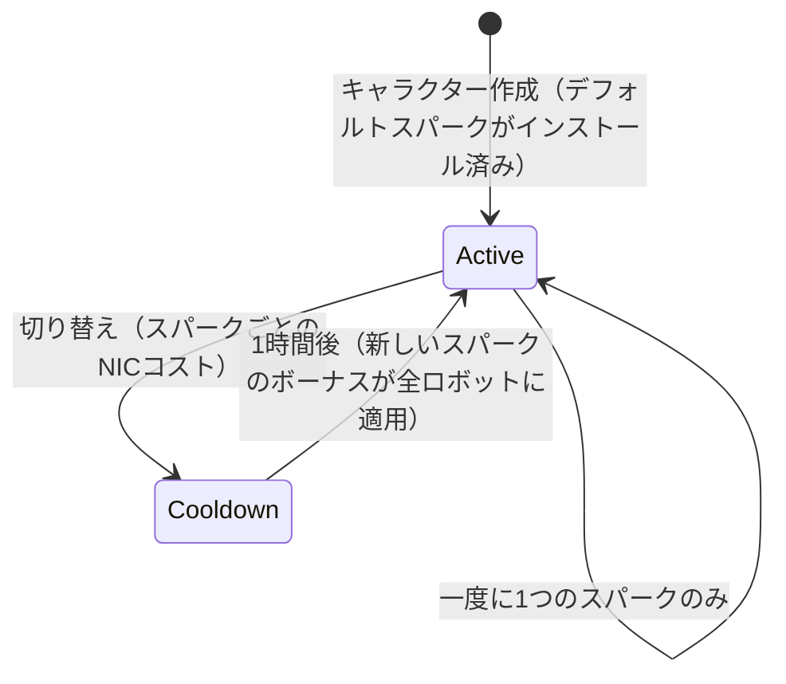

# スパーク

**スパーク（Spark）**は、キャラクターにインストールされるナノボットの専門化プログラムです。スパークがアクティブな間、そのボーナスは操縦するすべてのロボットに適用されます。例えば、勢力の戦闘ライン向けスパークはレベルごとに武器ダメージとクリティカル率を向上させ、産業ライン向けスパークはコア容量や採掘量を増加させます。

各キャラクターには、作成時に付与される**デフォルトスパーク**が存在します。さらにスパークは系統（ファミリー）に分かれており、基本的なデフォルト系統、勢力別の戦闘／産業／ソーシャル系統（それぞれ3つのレベル）、有償のシンジケート系統、および特別限定系統があります。スパークの正確なボーナスは、[拡張（Extension）ページ](/content/extensions/)で確認できる固定スキルレベルのセットです。[以下の系統概要](#supakuxi-tong)から、各系統のスパークへ直接ジャンプできます。

## スパークのアンロック（認可）

まだ所有していないスパークをインストールするには、まず**アンロック**する必要があります（ドック停泊中のみ可能）。スパークの種類に応じて、サーバーは以下の条件をチェックします：

- NICによる**価格**（有償ライン — シンジケートのユーティリティスパークや限定スペシャルスパークなど）
- 開発メガコーポレーションとの**スタンディング**（勢力別ラインでは、その勢力のメガコーポレーションとの一定以上のスタンディングが必要であり、[ミッション](/ja/features/missions/)を完了することで獲得できます）
- またはインベントリから消費される**アイテム**（一部の特別スパークはキーアイテムによってアンロックされます）

アンロックは1回のみ有効です。一度アンロックすれば、そのスパークはコレクションに残り続けます。

## スパークの切り替え

- 一度に**アクティブにできるスパークは1つ**だけです。別のスパークをインストールすると交換されます。
- 切り替えごとに**NICのコスト**が発生します。金額はスパークごとに異なります（一般的なラインは1万NIC、有償の特別ラインは最大100万NIC）。
- 切り替えの間には**1時間のクールダウン**があります。サーバーは現在のスパークがアクティブ化された時刻を記録しており、時間が経過するまで新しいスパークへの切り替えを拒否します。

切り替えには常にNICが必要で1時間かかるため、最も多くの時間を費やすアクティビティに合ったスパークを選択し、再特化はセッションごとではなく、たまに行う決定事項として捉えてください。
<!-- sparkfamilies:generated -->

## スパーク系統

6系統、全47種のスパークの概要：系統ごとに追加順（左から右、上から下）で1つのボックス（スパーク数、アンロック方法）にまとめられています。**ボックスをクリックすると、下の該当系統のスパーク一覧にジャンプします。** **図の上にスクロールしてズーム**、ドラッグでパン、⟲ボタンでリセットが可能です。

<button type="button" class="zoommap-reset" title="Reset the zoom">⟲</button>
<svg class="zoommap" xmlns="http://www.w3.org/2000/svg" viewBox="0 0 1008 278" width="960" height="264" role="img" aria-label="Spark families: 6 families, 47 sparks; click a family to jump to its sparks below">
  <rect x="0" y="0" width="1008" height="278" fill="#10151f" stroke="#39445a" stroke-width="1"/>
  <g><title>Event &amp; special: 9 sparks, unlocks with free</title><a href="#family-special"><rect x="24" y="40" width="300" height="84" rx="10" fill="#10151f" stroke="#c8d2e0" stroke-width="1.5"/><text x="174" y="68" text-anchor="middle" fill="#e8eefc" font-size="15" font-weight="700">Event &amp; special</text><text x="174" y="92" text-anchor="middle" fill="#c8d2e0" font-size="12">9 sparks · free</text></a></g>
  <g><title>TM (Truhold-Markson): 9 sparks, unlocks with TM standing</title><a href="#family-tm"><rect x="354" y="40" width="300" height="84" rx="10" fill="#10151f" stroke="#41d3ff" stroke-width="1.5"/><text x="504" y="68" text-anchor="middle" fill="#e8eefc" font-size="15" font-weight="700">TM (Truhold-Markson)</text><text x="504" y="92" text-anchor="middle" fill="#41d3ff" font-size="12">9 sparks · TM standing</text></a></g>
  <g><title>ICS: 9 sparks, unlocks with ICS standing</title><a href="#family-ics"><rect x="684" y="40" width="300" height="84" rx="10" fill="#10151f" stroke="#6ee7a0" stroke-width="1.5"/><text x="834" y="68" text-anchor="middle" fill="#e8eefc" font-size="15" font-weight="700">ICS</text><text x="834" y="92" text-anchor="middle" fill="#6ee7a0" font-size="12">9 sparks · ICS standing</text></a></g>
  <g><title>ASI: 9 sparks, unlocks with ASI standing</title><a href="#family-asi"><rect x="24" y="154" width="300" height="84" rx="10" fill="#10151f" stroke="#f5a05a" stroke-width="1.5"/><text x="174" y="182" text-anchor="middle" fill="#e8eefc" font-size="15" font-weight="700">ASI</text><text x="174" y="206" text-anchor="middle" fill="#f5a05a" font-size="12">9 sparks · ASI standing</text></a></g>
  <g><title>Syndicate (NIC): 5 sparks, unlocks with NIC price</title><a href="#family-syndicate"><rect x="354" y="154" width="300" height="84" rx="10" fill="#10151f" stroke="#a78bfa" stroke-width="1.5"/><text x="504" y="182" text-anchor="middle" fill="#e8eefc" font-size="15" font-weight="700">Syndicate (NIC)</text><text x="504" y="206" text-anchor="middle" fill="#a78bfa" font-size="12">5 sparks · NIC price</text></a></g>
  <g><title>Limited: 6 sparks, unlocks with NIC price</title><a href="#family-limited"><rect x="684" y="154" width="300" height="84" rx="10" fill="#10151f" stroke="#f472b6" stroke-width="1.5"/><text x="834" y="182" text-anchor="middle" fill="#e8eefc" font-size="15" font-weight="700">Limited</text><text x="834" y="206" text-anchor="middle" fill="#f472b6" font-size="12">6 sparks · NIC price</text></a></g>
</svg>

### イベント＆スペシャル (9)

アンロック：不要 — これらは基本的なデフォルト系統です。切り替えごとにNICが必要（金額はスパークごとに異なります。カードを参照）で、1時間のクールダウンが発生します。詳細は上記の[スパークの切り替え](#supakunoqie-riti-e)を参照してください。

ww

アンロック コストなし · 切り替え 10k NIC

デフォルトスパーク — キャラクター作成時にインストール

wi

アンロック コストなし · 切り替え 10k NIC

デフォルトスパーク — キャラクター作成時にインストール

ws

アンロック コストなし · 切り替え 10k NIC

デフォルトスパーク — キャラクター作成時にインストール

iw

アンロック コストなし · 切り替え 10k NIC

デフォルトスパーク — キャラクター作成時にインストール

ii

アンロック コストなし · 切り替え 10k NIC

デフォルトスパーク — キャラクター作成時にインストール

is

アンロック コストなし · 切り替え 10k NIC

デフォルトスパーク — キャラクター作成時にインストール

sw

アンロック コストなし · 切り替え 10k NIC

デフォルトスパーク — キャラクター作成時にインストール

si

アンロック コストなし · 切り替え 10k NIC

デフォルトスパーク — キャラクター作成時にインストール

ss

アンロック コストなし · 切り替え 10k NIC

デフォルトスパーク — キャラクター作成時にインストール

### TM (Truhold-Markson) (9)

アンロック：TMメガコーポレーションとのスタンディング（レベルに応じて 2 → 4 → 6）。切り替えごとにNICが必要（金額はスパークごとに異なります。カードを参照）で、1時間のクールダウンが発生します。詳細は上記の[スパークの切り替え](#supakunoqie-riti-e)を参照してください。

Combat Lvl1

アンロック TMスタンディング 2 · 切り替え 10k NIC

拡張レベル2つをバンドル

Combat Lvl2

アンロック TMスタンディング 4 · 切り替え 100k NIC

拡張レベル3つをバンドル

Combat Lvl3

アンロック TMスタンディング 6 · 切り替え 1M NIC

拡張レベル3つをバンドル

Indy Lvl1

アンロック TMスタンディング 2 · 切り替え 10k NIC

拡張レベル2つをバンドル

Indy Lvl2

アンロック TMスタンディング 4 · 切り替え 100k NIC

拡張レベル3つをバンドル

Indy Lvl3

アンロック TMスタンディング 6 · 切り替え 1M NIC

拡張レベル3つをバンドル

Social Lvl1

アンロック TMスタンディング 2 · 切り替え 10k NIC

拡張レベル2つをバンドル

Social Lvl2

アンロック TMスタンディング 4 · 切り替え 100k NIC

拡張レベル3つをバンドル

Social Lvl3

アンロック TMスタンディング 6 · 切り替え 1M NIC

拡張レベル3つをバンドル

### ICS (9)

アンロック：ICSメガコーポレーションとのスタンディング（レベルに応じて 2 → 4 → 6）。切り替えごとにNICが必要（金額はスパークごとに異なります。カードを参照）で、1時間のクールダウンが発生します。詳細は上記の[スパークの切り替え](#supakunoqie-riti-e)を参照してください。

Combat Lvl1

アンロック ICSスタンディング 2 · 切り替え 10k NIC

拡張レベル2つをバンドル

Combat Lvl2

アンロック ICSスタンディング 4 · 切り替え 100k NIC

拡張レベル3つをバンドル

Combat Lvl3

アンロック ICSスタンディング 6 · 切り替え 1M NIC

拡張レベル3つをバンドル

Indy Lvl1

アンロック ICSスタンディング 2 · 切り替え 10k NIC

拡張レベル2つをバンドル

Indy Lvl2

アンロック ICSスタンディング 4 · 切り替え 100k NIC

拡張レベル3つをバンドル

Indy Lvl3

アンロック ICSスタンディング 6 · 切り替え 1M NIC

拡張レベル3つをバンドル

Social Lvl1

アンロック ICSスタンディング 2 · 切り替え 10k NIC

拡張レベル2つをバンドル

Social Lvl2

アンロック ICSスタンディング 4 · 切り替え 100k NIC

拡張レベル3つをバンドル

Social Lvl3

アンロック ICSスタンディング 6 · 切り替え 1M NIC

拡張レベル3つをバンドル

### ASI (9)

アンロック：ASIメガコーポレーションとのスタンディング（レベルに応じて 2 → 4 → 6）。切り替えごとにNICが必要（金額はスパークごとに異なります。カードを参照）で、1時間のクールダウンが発生します。詳細は上記の[スパークの切り替え](#supakunoqie-riti-e)を参照してください。

Combat Lvl1

アンロック ASIスタンディング 2 · 切り替え 10k NIC

拡張レベル2つをバンドル

Combat Lvl2

アンロック ASIスタンディング 4 · 切り替え 100k NIC

拡張レベル3つをバンドル

Combat Lvl3

アンロック ASIスタンディング 6 · 切り替え 1M NIC

拡張レベル3つをバンドル

Indy Lvl1

アンロック ASIスタンディング 2 · 切り替え 10k NIC

拡張レベル2つをバンドル

Indy Lvl2

アンロック ASIスタンディング 4 · 切り替え 100k NIC

拡張レベル3つをバンドル

Indy Lvl3

アンロック ASIスタンディング 6 · 切り替え 1M NIC

拡張レベル3つをバンドル

Social Lvl1

アンロック ASIスタンディング 2 · 切り替え 10k NIC

拡張レベル5つをバンドル

Social Lvl2

アンロック ASIスタンディング 4 · 切り替え 100k NIC

拡張レベル6つをバンドル

Social Lvl3

アンロック ASIスタンディング 6 · 切り替え 1M NIC

拡張レベル6つをバンドル

### シンジケート (NIC) (5)

アンロック：NIC価格（スパークごとに1M NIC）。切り替えごとにNICが必要（金額はスパークごとに異なります。カードを参照）で、1時間のクールダウンが発生します。詳細は上記の[スパークの切り替え](#supakunoqie-riti-e)を参照してください。

Syndicate Nic Combat

アンロック 1M NIC · 切り替え 100k NIC

拡張レベル2つをバンドル

Syndicate Nic Scout

アンロック 1M NIC · 切り替え 100k NIC

拡張レベル2つをバンドル

Syndicate Nic Coreboost

アンロック 1M NIC · 切り替え 100k NIC

拡張レベル2つをバンドル

Syndicate Nic Allresist

アンロック 1M NIC · 切り替え 100k NIC

拡張レベル4つをバンドル

Syndicate Nic Fitboost

アンロック 1M NIC · 切り替え 100k NIC

拡張レベル2つをバンドル

### リミテッド (6)

アンロック：NIC価格（スパークごとに25M–50M NIC）。切り替えごとにNICが必要（金額はスパークごとに異なります。カードを参照）で、1時間のクールダウンが発生します。詳細は上記の[スパークの切り替え](#supakunoqie-riti-e)を参照してください。

Anniversary Combat

アンロック 25M NIC · 切り替え 1M NIC

拡張レベル6つをバンドル

Anniversary Logistic

アンロック 25M NIC · 切り替え 1M NIC

拡張レベル6つをバンドル

Amazon c1 Combat

アンロック 25M NIC · 切り替え 1M NIC

拡張レベル2つをバンドル

Amazon c1 Indy

アンロック 25M NIC · 切り替え 1M NIC

拡張レベル2つをバンドル

Steam a

アンロック 50M NIC · 切り替え 1M NIC

拡張レベル2つをバンドル

Steam b

アンロック 50M NIC · 切り替え 1M NIC

拡張レベル2つをバンドル

<!--
Written from scratch against the server backend, 2026-09-27:
RequestHandlers/Sparks/SparkUnlock.cs (unlock rules: price, standing, item),
RequestHandlers/Sparks/SparkChange.cs + Services/Sparks/SparkHelper.cs
(60-minute switch cooldown, per-spark change price),
Services/Sparks/Spark.cs, sparks + sparkextensions tables (47 sparks, per-line
bonus bundles).
An earlier version of this page was adapted from the Open Perpetuum
community wiki (perpetuum.miraheze.org) and has been fully rewritten from
backend sources; no text was reused.
-->