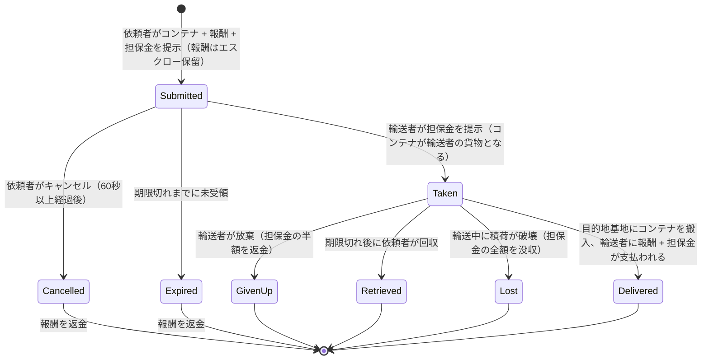

# 輸送（アイテムの移送）

**輸送アサインメント（Transport assignment）**は、報酬を受け取る**ボランティアの輸送者（キャリア）**によって、アイテムが入ったコンテナをある基地から別の基地へと移動させる仕組みです。これは二者間の市場となっており、**依頼者（オーナー）**が積荷を提示し、**輸送者（ボランティア）**がそれを受領して配送します。

> UIの位置については[クライアントUIの概要](/ja/features/ui/)（トップバーの **Assignments（アサインメント）** カテゴリ）を参照してください。以下のメカニクスはサーバーの仕様に基づいて確認されています。

## 二つの立場

- **依頼者（オーナー / Principal）** — 輸送案件を登録します：移動させるコンテナ、**出発地基地**から**目的地基地**への指定、**報酬**、**担保金**、そして**有効期間**を設定します。
- **輸送者（ボランティア / Carrier）** — アサインメントを受領し、コンテナを運搬して目的地へ配送します。

## 輸送の登録（依頼者）

以下の項目を指定して**輸送を登録（Submit）**します：
- 配送する**コンテナ**（容積ラッパー）、
- 配送完了時に支払う**報酬**、
- **担保金**（輸送者が預ける保証金）、
- **出発地基地**と**目的地基地**、
- アサインメントが有効である**期間**（日数）。

登録時、あなたのウォレットから**報酬が保留**（エスクロー）されます。

## 輸送の受領（輸送者）

- アサインメントを**受領（Take）** — 保証金として**担保金**を支払い、コンテナがあなたの運搬する貨物となります。

## 配送と回収

- **配送（Deliver）** — コンテナを目的地基地に運び込みます。配送完了時に**輸送者へ報酬 + 担保金が支払われ**、依頼者はアイテムを受け取ります。
- **回収（Retrieve）** — 依頼者（または該当するケースでは輸送者）がコンテナを基地へ回収します。回収時には**担保金が返還**され、依頼者へ**報酬が払い戻し**されます。

## キャンセル / 放棄

- **キャンセル（Cancel）** — アサインメントをキャンセルします。
- **放棄（Give up）** — 輸送者が任務を放棄します。放棄すると**担保金のペナルティ**が適用され、担保金の**半額**のみが返金されます（残りは没収） — ペナルティ定数は `TransportAssignment.cs` で 0.5 と規定されています。

## 確認・確認項目

- 輸送の**一覧（List）**、内容物の**一覧表示（List content）**、**コンテナ情報（Container info）**、**進行中かどうかの確認（Is it running?）**、および**輸送ログ（Transport log）**。

## 資金の流れ（概要）

**報酬**は依頼者が支払う金額であり、登録時にエスクロー（保留）され、配送完了時にのみ支払われます。
**担保金**は輸送者の保証金です：受領時に依頼者へ支払われ、貨物の輸送中は保留され、配送完了時に（報酬とともに）返還されます。

| イベント | 条件 | 依頼者 | 輸送者 | コンテナ |
|---|---|---|---|---|
| 登録 (Submit) | — | 報酬がエスクロー保留 | — | 輸送用保管庫へ移動 |
| 受領 (Take) | 未受領 | 担保金を受け取る | 担保金を支払う | 輸送者の貨物となる |
| 配送 (Deliver) | 目的地基地に到着 | アイテムを受領 | **報酬 + 担保金**が支払われる | 配送完了 |
| キャンセル (Cancel) | 未受領、登録から60秒以上経過 | 報酬が返金される | — | 出発地基地に戻る |
| 放棄 (Give up) | 受領済み | 報酬が返金される | 担保金の**半額**が返金（0.5のペナルティ） | 出発地基地に戻る |
| 期限切れ (Expire) | 未受領、有効期限超過 | 報酬が返金される | — | 出発地基地に戻る |
| 回収 (Retrieve) | 受領済み **かつ** 有効期限超過 | 報酬が返金される | — | 出発地基地に戻る（ドック中の場合は即時、それ以外は輸送者の次回ドック時） |
| 貨物破壊 (Cargo destroyed) | 輸送中 | 報酬返金 **+ 担保金全額獲得** | 担保金全額を没収 | 消失 |

## 実用上の注意点

- **手数料なし** — 移動する資金は報酬と担保金のみです。
- **報酬はエスクロー保留** — 依頼者は輸送が解決（完了または終了）するまでその資金を使用できません。
- **担保金は輸送者の保証金** — 担保金を預けることで積荷を受領できます。輸送中に貨物を失った場合、**全額**が没収されます。
- **放棄にはコストがかかる** — 輸送を途中で放棄すると、担保金の半分を失います。
- **期間の重要性（ただし未受領の間のみ）** — 登録時に設定した期限は、誰も受領していないアサインメントを自動終了させるためだけに機能します（サーバーは期限切れの未受領アサインメントを毎時クリーンアップします）。**受領済み**のアサインメントがそれ自体で期限切れになることはありません。依頼者側の脱出手段は**回収（Retrieve）**であり、これは期限が過ぎると利用可能になり、貨物（および報酬）を出発地基地へ引き戻します（輸送者がドック中の場合は即座に、それ以外の場合は輸送者が次回ドックした際に自動的に実行されます）。
- **受領前に内容物を確認する** — コンテナの中身とルートを事前に確認してください。

<!-- TODO: only the client UI remains (assignments screen layout).
     Money model confirmed: reward escrowed at submit (CashInOnSubmit), collateral paid
     by the volunteer on take (TakeCollateral -> PayCollateralToPrincipal), delivery pays
     volunteer reward+collateral (PayOutReward); cancel needs 60s after creation;
     expiry = submit time + client duration days (<=0 -> 1), cleaned hourly by
     MissionProcessor (_transportAssignmentInterval 1h), taken=0 only; retrieve requires
     expiry passed + taken, auto-completes on next dock; destroyed cargo refunds reward
     and forfeits full collateral to the owner.
     Developer notes: TransportAssignments/TransportAssignmentSubmit.cs;
     Services/MissionEngine/TransportAssignments/TransportAssignment.cs (reward/collateral
     escrow, PayOutReward = reward+collateral, PaybackCollateral, PaybackHalfCollateral
     = COLLATERAL_PENALTY on give-up, RetrieveToBasePublicContainer, expiry);
     TransportAssignmentTake/Deliver/Retrieve/Cancel/GiveUp/List/ListContent/
     ContainerInfo/Running/Log. -->