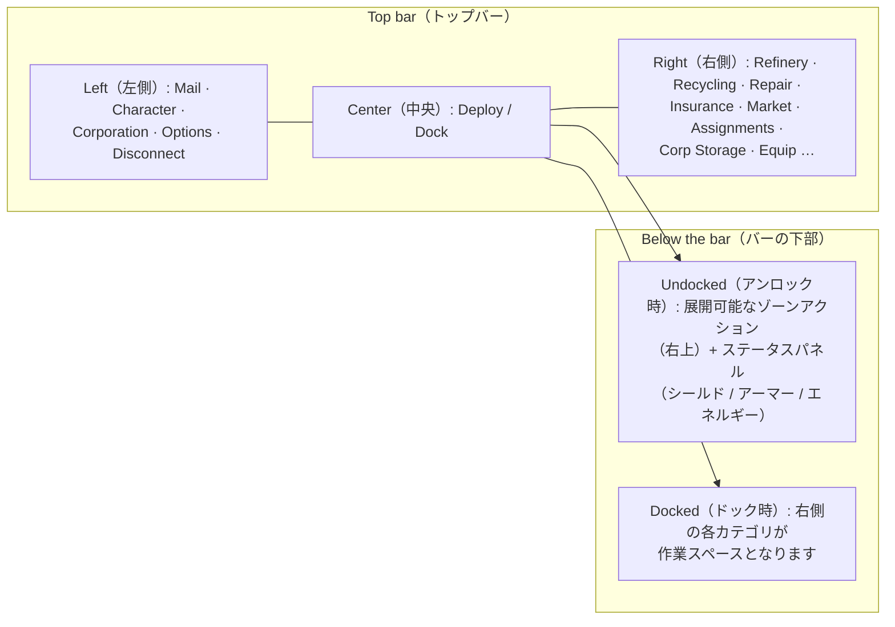

# クライアントUI概要

クライアントは **EVE Onlineスタイル** のインターフェースを採用しています。全画面の宇宙/ゾーンビュー上に、自由に **サイズ変更や移動** が可能で、いつでも **開閉できるフローティングウィンドウ** が配置されます。
配線や連携はシステムごとに異なります。詳細は後述のリンク先ページを参照してください。

> このレイアウトは、各種アクションがどこに配置されているかを説明するためにプロジェクトから提供された作業モデルです。実際の画面上の名称とは多少異なる場合がありますが、構造としてのリファレンスとなります。

## トップバー (The top bar)

画面上部に常時表示されるバーです。

| エリア | 内容 |
|---|---|
| **左側 (Left)** | メインボタン: **Mail** (メール)、**Character** (キャラクター)、**Corporation** (コーポレーション)、その他 **Options** (オプション)、および **Disconnect** (切断) |
| **中央 (Center)** | **Deploy / Dock** ボタン — ドック⇄アンロックの主要な切り替えボタン ([movement](/ja/features/movement/) を参照) |
| **右側 (Right)** | ボタン形式のアクションカテゴリ: **Refinery** (精製)、**Recycling** (リサイクル)、**Repair** (修理)、**Insurance** (保険)、**Market** (マーケット)、**Assignments** (輸送任務)、**Corp Storage** (コーポレーション倉庫)、**Equip** (装備)、… |

右側の各カテゴリボタンから、対応するシステムのウィンドウが開きます。

| ボタン | 開くウィンドウ / 機能 | Wikiページ |
|---|---|---|
| Refinery | 未加工の資源をコンポーネントに加工 | [production](/ja/features/production/) |
| Recycling | アイテムを基本素材に分解 | [production](/ja/features/production/) |
| Repair | 損傷したロボットやモジュールを修理 | [production](/ja/features/production/) |
| Insurance | 生産/ロボットの保険契約 | [production](/ja/features/production/) |
| Market | マーケットの注文および直接購入 | [market](/ja/features/market/) |
| Assignments | 輸送任務 (貨物輸送) | [transport](/ja/features/transport/) |
| Corp Storage | コーポレーションのハンガー/ストレージ | [groups](/ja/features/groups/) |
| Equip | アクティブなロボットへのモジュールおよび弾薬の装着 | [robots](/ja/features/robots/) |

## ドック状態 (Docked state)

**ドック中**は、右側のアクションカテゴリがメインの作業スペースとなります。基地から出ることなく、加工、取引、装備の換装、ストレージの管理を行えます。Deploy ボタンを押すと、ゾーンへアンロック (出港) します (アンロックの前提条件については [movement](/ja/features/movement/) を参照)。

## アンロック状態 (Undocked state)

**アンロック中** (ゾーン内でアクティブなロボットを操縦している状態):

- **右上**エリアに**展開式アクションボタン**が表示されます。これをクリックすると、追加のゾーンアクション一覧が下方向に展開されます (スキャン、採取/インタラクト操作、ゾーンツールなど — [gathering](/ja/features/gathering/) および [combat](/ja/features/combat/) に記載されているアクションです)。
- **メインステータスパネル**には、ロボットの状態 (**シールド、アーマー/船体、エネルギー**)、および関連する戦闘ステータスが表示されます。これは [combat](/ja/features/combat/) ページで言及されているデータと同じです (例: 「エネルギーシステム正常」のアンロック確認項目など)。
- 基地専用のカテゴリ (精製、マーケットなど) は、再びドックするまで利用できません。

## 共通ウィンドウ (Common windows)

ほとんどのシステムは、タイトルバー、閉じるボタン、サイズ変更可能な境界線、タブまたはリスト表示のコンテンツを備えた標準的なフローティングウィンドウで開きます。重複して利用可能なシステム (インベントリ/コンテナ、マーケット、生産ラインなど) は、同時に複数のウィンドウを開くことができます。

- **インベントリ / コンテナ (Inventory / containers)** — コンテナの内容一覧表示、アイテムの移動/スタック/梱包、名前の変更、破棄 — [items](/ja/features/items/) を参照。
- **キャラクターウィンドウ (Character window)** (左上のボタン) — プロフィール、エクステンション (研究)、設定、クレジット — [getting-started](/ja/features/getting-started/) および [research](/ja/features/research/) を参照。
- **コーポレーションウィンドウ (Corporation window)** (左上のボタン) — コーポレーション情報、ハンガー、ドキュメント、投票、告知 (掲示板) — [groups](/ja/features/groups/) を参照。
- **メールウィンドウ (Mail window)** (左上のボタン) — 個人メールおよび一斉送信メール — [social](/ja/features/social/) を参照。

## 本Wikiで使用される表記規則

- **「トップバー → X」** = トップバー上にある名称「X」のボタン。
- **「アンロックアクション」** = ゾーン滞在時に右上に表示される展開式リスト。
- **Deploy/Dock ボタン** = トップバー中央にある切り替えボタン。

<!-- Note: this page is the agreed UI model (project-provided). If the real client
     differs in button names or placement, update this page first — every other
     features/ page references the conventions defined here. -->