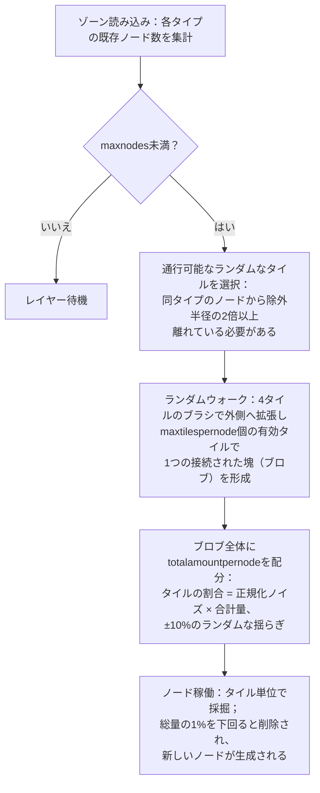

# ゾーンのリソース生成

このページでは、サーバーがゾーン内の資源をどのように補充・維持しているかを説明します。ゾーンがロードされている間、鉱石と植物のシステムは両方ともバックグラウンドで継続的に稼働しており、プレイヤーの操作がなくても自動的に進行（ティック）します。

## ゾーンのリソース設定

各ゾーンはデータベース上で2つの独立した設定リストを持っています：

- **鉱石設定**（`mineralconfigs`） — ゾーン内に存在する鉱石タイプごとに1行が割り当てられ、タイプごとに4つの調整パラメータが存在します：
  | カラム | 意味 |
  |---|---|
  | `maxnodes` | ゾーンが維持するこのタイプのノード数 |
  | `maxtilespernode` | 単一ノードがカバーできる最大タイル数 |
  | `totalamountpernode` | 新規ノードの総資源量（構成タイル全体に分散配置） |
  | `minthreshold` | タイルごとの最小充填比率（0〜1）。採掘後にこの値を下回ったタイルは消滅 |
- **植物設定**（`zones.fertility` + 植物ルールセット） — ゾーンの目標植物被覆率（パーセンテージ）と、そこで自生可能な植物種のリスト（各種の挙動はルールファイルで定義されており、[植物](/ja/content/plants/)に記載されています）。

鉱石設定を持たないゾーン（アリーナ、訓練ゾーン、要塞、一部のガンマゾーンなど）には、鉱石レイヤー自体が存在しません。

## 鉱床（鉱石ノード）

### ノードの配置方法

ゾーンがロードされると、各鉱石タイプのレイヤーは（`mineralnodes`テーブルに保存されている）既存ノード数をカウントし、`maxnodes`に達するまで新しいノードを生成します。新しいノードは**ランダムウォーク**によって配置されます：

1. 通行可能なランダムなタイルを1つ選択します。
2. 同タイプの最も近い既存ノードから十分離れている必要があります — 除外半径は`maxtilespernode`から算出され（`√(maxtilespernode/π) × 2`、開始地点はさらにその2倍以上離れている必要があります）、これによってノード同士が合体して1つの巨大な鉱床になってしまうのを防ぎます。
3. 開始タイルから、4タイルのブラシで外側へ無作為に拡張していき、最大`maxtilespernode`個の有効タイルを1つの連結した塊（ブロブ）として収集します。
4. ノードの総資源量（`totalamountpernode`）がブロブ全体に配分されます：各タイルの配分量はそのタイルの（正規化された）ノイズ値に合計量を掛けたものであり、±10%のランダムな揺らぎが加えられるため、同じ鉱石タイプであっても全く同じ形状・密度のノードは存在しません。

タイルがノードとして有効になるのは、ゾーンの内側にあり、孤島ではなく、PBSテラフォーミング保護されておらず、かつ通行可能な場合に限られます。希少な2つのタイプには、ドッキング基地やテレポート周辺に**立ち入り禁止エリア（キープアウトゾーン）**が設定されています：**エプリトン（epriton）**は最小距離を保ち、**フラックス鉱石（flux ore）**はその2倍の距離を保ちます。そのため、フラックス鉱石が基地のすぐ隣に出現することは決してありません。

### ノードの消費と消滅

- 採掘を行うと、タイル単位で資源が減少します。
- ノードの残量が**設定された総量の1%**を下回るとそのノードは削除され、ゾーン内のノード数を`maxnodes`に保つために新しいノードが生成されます（ステップ1へ戻る）。
- フラックス鉱石のノードはさらに**NPCスポーン（出現）**を引き起こします — 採掘中（または消滅時）のノードはNPCシステムがリッスンしているイベントを発行するため、フラックス鉱石の現場には敵が集まりやすくなります。

## 植物

### 植物のスキャン処理

ゾーンは**32×32タイル**の区画に分割されています。植物ハンドラーはこれらのタイルを順番に巡回し、1ティックごとに1つずつ処理します。ゾーン全体の**巡回（フルパス）には約8時間**かかるペースで調整されています（ゾーンごとに上書き可能）。各32×32の「キューブ」は固定パイプラインによって処理されます：

1. **検証（Validate）** — 無効な植物（不適合な地面、枯死、場違いな植物）を削除します。
2. **成長（Grow）** — 各植物の成長段階を進めます（`growRate`や結実については[採取とスキャン](/ja/features/gathering/)を参照）。
3. **スポーン（Spawn）** — キューブの植物密度が肥沃度の目標値を下回っている場所に新しい植物を追加します。
4. **壁の損耗（Damage walls）** — 植物の通行遮断高さが時間経過とともに減衰します。
5. **距離間隔による間引き（Kill by distance）** — 同種間の最小距離間隔（`killDistance`）を強制します。
6. **素材の再生（Renew material）** — わずかな量の果実素材が再生成されます。

### 新しい植物の選定方法

タイルに植物が芽吹くことができるのは、ゾーンファイルによってそのタイルに**スポーン潜在値（spawn potential）**が与えられている場合のみです（ゾーンの植物レイヤーに焼き込まれたタイルごとのバイト値。0はそのタイルには決して発芽しないことを意味します）。1ティックごとに、対象となる各タイルに対して次の処理が行われます：

- **ゾーン肥沃度のチェック**：キューブ内の通行遮断植物の被覆率がすでに地面タイルの`fertility%`を満たしている場合、その場所には何も新しくスポーンしません。
- **タイルごとの確率判定**：ランダムロールがタイルのスポーン潜在値を上回る必要があります。
- **植物種の選定**：
  - タイルの周囲に**隣接する植物がない**場合、許可されている各種の`fertility`を重みとした重み付きランダム抽選が行われます（プレイヤーが植えた種は自然スポーンから除外されます）。
  - 周囲に**植物がある**場合、コイントス（50/50の確率）になります：50%の確率で現在*優勢な（ruling）*隣接種（周囲で最も多い種）が選ばれ、残り50%の確率で各植物種の`(隣接数 × spreading)`で重み付けされた**拡散（spreading）**抽選が行われます — これにより、同種の植物が群生して広がっていく現象が生まれます。
- **上限と間隔制限**：`maxAmount`上限を持つ植物種はゾーン内に十分な数が存在するとスキップされ、同タイプの他の植物から`killDistance`以内にあるタイルもスキップされます。

### プレイヤーへの影響

- 植物の密度はゾーンの肥沃度によって制限されます — 肥沃度が20のゾーンで植物の被覆率が100%になることは決してありません。
- 群生するのが標準的です：拡散（spreading）メカニズムによって各植物種は自らのパッチを拡大していくため、ゾーン内はモザイク状の雑多な混在ではなく、種ごとの縄張り（テリトリー）を形成する傾向があります。
- `killDistance`が設定された種（特定の高価値植物など）は均等な間隔で配置されるため、1つ見つければ他の場所も予測しやすくなります。
- 新しいノードはランダムウォークが到達した場所に現れます — ゾーン上に固定された「鉱床ポイント」は存在しません。探査にはスキャンが必要です（[採取とスキャン](/ja/features/gathering/)を参照）。

<!-- Developer notes: TerrainsModule.cs (per-zone layer construction: OreLayer for
     Solid, LiquidLayer for Liquid, GravelLayer for TrainingZone; LoadMineralNodes
     top-up); MineralLayer.cs (LoadMineralNodes: delete <1% nodes, generate to
     maxnodes; FluxOre -> OreNpcSpawnMessage on decrease/expiry);
     Generators/MineralNodeGeneratorBase.cs (FindStartPosition keep-out + spacing,
     NormalizeNoise, CreateMineralNode jitter); RandomWalkMineralNodeGenerator.cs
     (flood-fill brush 4, 50k step cap); MineralNodeRepository.cs (mineralnodes table,
     compressed per-tile values); PlantHandler.cs (32x32 areas, 8h full pass,
     PlantsGrowthTimerOverrideMin, scanner modes); NatureCube.cs (ProcessAll pipeline,
     SpawnPlants fertility/spawn/killDistance logic, GetNewPlantRule 50/50 ruling vs
     spreading); PlantRuleExtensions.cs (fertility-weighted + spreading-weighted
     draws); PlantInfo.cs (per-tile spawn byte comes from the zone's plant layer
     file, never assigned by server code). -->
