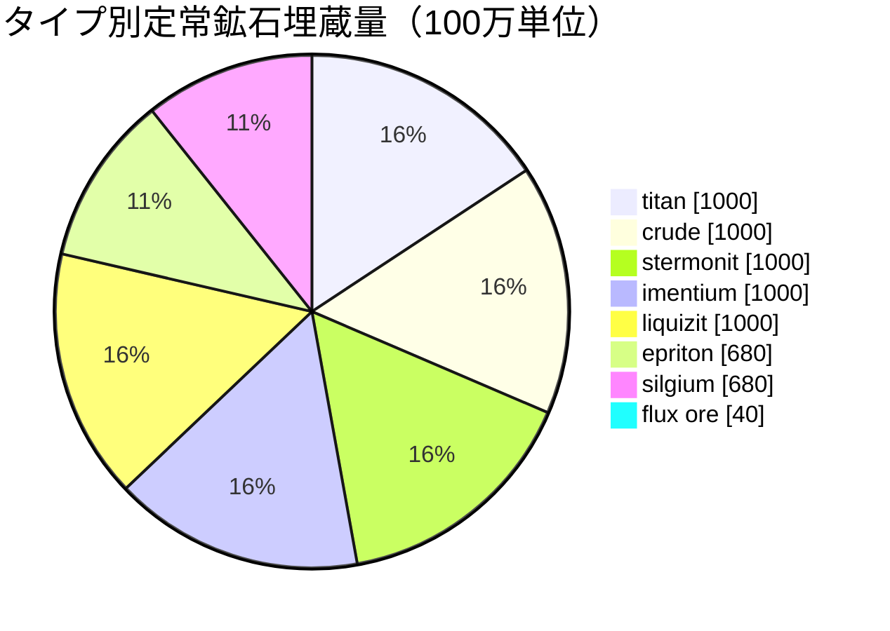

# Daoden (zone_ASI) — 実例

  <a href="/ja/zones/map/">
    
    <strong>ワールドマップ</strong> — テレポート接続を含む全ゾーンの配置関係。マップ全体を開く。
  </a>

このゾーンのテレポートコラムの位置（ドット、行先名付き — コラムが現在停止している場合は薄く表示）、他ゾーンから到着するテレポートの着地点（破線の円）、および出口ゲート（存在する場合は菱形）。位置はサーバーに記録されているタイル座標です。
破線はゾーン内ローカルテレポートコラムのペアを繋いでいます。

アルファ層の**開放型PvP**ゾーン — ゲーム内で最も豊かな鉱石設定を持ち、希少鉱石が存在する場所です。New Virginiaにあるすべての資源に加え、epriton、silgium、そしてNPCの襲撃を引き寄せるflux ore（フラックス鉱石）の採掘場が存在します。

| 項目 | 値 |
|---|---|
| ゾーンID | 2 |
| タイプ | PvP（開放） |
| 保護レベル | [ベータ](/ja/zones/protection/) — 開放型PvP、標準地形 |
| サイズ | 2048 × 2048 タイル |
| 肥沃度 | 20 |
| 植物ルールセット | 2 — 19種（高ティア収穫物を含む） |
| 鉱石タイプ | 8（titan、crude、stermonit、imentium、liquizit、epriton、silgium、flux ore） |
| 総鉱石ノード数 | 64（各タイプ8個） |

## 鉱石設定

| 素材 | ノード数 | 最大タイル数/ノード | ノードあたり総量 | 最小閾値 |
|---|---|---|---|---|
| [titan](/ja/content/ores/titan/) | 8 | 500 | 125,000,000 | 0.5 |
| [crude](/ja/content/ores/crude/) | 8 | 1257 | 125,000,000 | 0.5 |
| [stermonit](/ja/content/ores/stermonit/) | 8 | 500 | 125,000,000 | 0.5 |
| [imentium](/ja/content/ores/imentium/) | 8 | 500 | 125,000,000 | 0.5 |
| [liquizit](/ja/content/ores/liquizit/) | 8 | 500 | 125,000,000 | 0.5 |
| [epriton](/ja/content/ores/epriton/) | 8 | 500 | 85,000,000 | 0.5 |
| [silgium](/ja/content/ores/silgium/) | 8 | 500 | 85,000,000 | 0.5 |
| [fluxore](/ja/content/ores/fluxore/) | 8 | 300 | 5,000,000 | 0.5 |

特筆すべき点：

- **New Virginiaの8倍のノード数**ですが、各ノードは小さめです（1,000タイルに対して500タイル）：標準的な鉱石の拡張半径は34タイルから24タイルに減少します。鉱床がより薄く多数に分散しているため、ここではスキャンの重要性が高まります。
- **エプリトンとシルギウム（Epriton and silgium）**は総量が少なめです（1億2,500万に対して8,500万）— より価値が高く、希少な埋蔵量です。エプリトンはさらに**基地やテレポートからの最小距離**を維持するため、そのノードがスポーン地点に位置することは決してありません。
- **フラックス鉱石（Flux ore）は極端な例**：300タイル全体でノードあたりわずか500万（1タイルあたり約16,600 — 鉱床というよりごくわずかな量）、8ノード、そして基地からエプリトンの**2倍**の立ち入り禁止距離が設定されています。フラックスノードの採掘はNPCシステムにスポーンイベントを発行します — フラックス鉱石の採掘場は意図的に争奪戦が起きるよう設計されています（[イントルージョン＆NPCシステム](/ja/features/intrusion/)を参照）。
- 定常状態の埋蔵量：全体で約64億単位の素材。

## 植物構成

ルールセット2では19種が許可されています — 完全なアルファ構成：基本植物に加えて、**devrinol**、**wall**、**titanplant**、そして**高ティア収穫物**（高ティアelectroplant、高ティアiron tree、高ティアrustbush、高ティアslimeroot）。肥沃度は20のままであるため、密度はNew Virginiaと同じです — 変化するのは*どの*種が肥沃度抽選を勝ち取るかです。高ティア収穫物自身の`fertility`の重みによって、それらが草に勝って選ばれる頻度が決まります。

種ごとのルールは[植物](/ja/content/plants/)、鉱石ごとの産出量は[鉱石](/ja/content/ores/)を参照してください。

## プレイヤーへの影響

- フラックス鉱石経済を含む完全な鉱石ラインナップが利用可能ですが、開放型PvPであるため、採掘したものはすべて奪われる危険があります（基地間で物資を安全に移動する方法については[輸送](/ja/features/transport/)を参照）。
- フラックス鉱石ノードの周辺ではNPCの圧力（襲撃）が予想されます。スポナーはそれらのノードでの採掘イベントを監視しています。
- ここでの植物採取は高ティアの変種を対象としており、スターターゾーンの低ティア種よりも優れた果実（産出物）が得られます。

<!-- Developer notes: zones row id 2 (zonetype 2 = PvP, protected 0, fertility 20,
     plantruleset 2); mineralconfigs 8 rows (7 standard + fluxore 8/300/5M);
     MineralNodeGeneratorBase.KeepOutDist: Epriton = MINERAL_DISTANCE_FROM_BASE_MIN,
     FluxOre = 2x; MineralLayer.OnNodeDecrease/OnNodeExpired -> OreNpcSpawnMessage for
     FluxOre; plantrules rulesetid 2 = 19 files (4 harvestable, incl. devrinol and
     wall). -->
