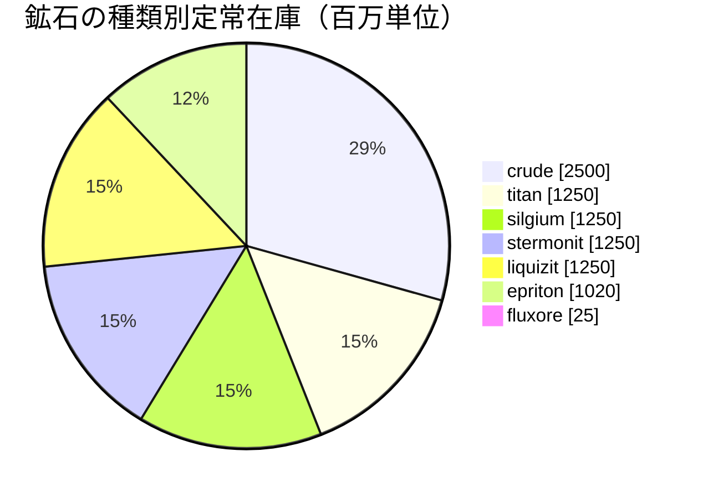

<!-- Generated by tools/generate from the live database (source: zones, mineralconfigs, plantrules, teleportdescriptions, strongholdexitconfig).
     Do not edit by hand; regenerate instead. -->
# Kentagura (zone_ASI_pvp)

  <a href="/ja/zones/map/">
    
    <strong>ワールドマップ</strong> — テレポート接続を含む、全ゾーンの中でのこのゾーンの位置。マップ全体を開く。
  </a>

このゾーンのテレポート柱の位置（行き先ラベル付きの点 — 停止中の柱は薄暗く表示）、他ゾーンからのテレポート着地点（破線の円）、および出口ゲート（菱形）を示します。位置はサーバーに記録されたタイル座標です。 破線はゾーン内ローカルテレポート柱のペアを結んでいます。

Daoden (ASI)のオープンPvP（Beta）島 — プレイヤーは自由に攻撃でき、ブロブが適用されます。 7種類の鉱石を維持しています。

| 項目 | 値 |
|---|---|
| ゾーンID | 9 |
| タイプ | PvP |
| 保護 | [Beta](/ja/zones/protection/) — オープンPvP、標準地形 |
| サイズ | 2048×2048 タイル |
| 肥沃度 | 20 |
| 植物種 | 17 (ルールセット 4) |
| 鉱石の種類 | 7 |
| 総鉱石ノード数 | 67 |
| 最大ドッキング基地数 | なし |

## 鉱石構成

このゾーンが維持するノード生成。鉱石ごとの産出量と生成式は[鉱石](/ja/content/ores/)にあります（このゾーンのセクションは下記にリンク）。

| 素材 | ノード | 最大タイル/ノード | ノードあたり合計 | 最小しきい値 |
|---|---|---|---|---|
| [titan](/ja/content/ores/titan/) | 10 | 500 | 125M | 0.5 |
| [crude](/ja/content/ores/crude/) | 10 | 500 | 250M | 0.5 |
| [stermonit](/ja/content/ores/stermonit/) | 10 | 500 | 125M | 0.5 |
| [liquizit](/ja/content/ores/liquizit/) | 10 | 500 | 125M | 0.5 |
| [epriton](/ja/content/ores/epriton/) | 12 | 350 | 85M | 0.5 |
| [silgium](/ja/content/ores/silgium/) | 10 | 500 | 125M | 0.5 |
| [fluxore](/ja/content/ores/fluxore/) | 5 | 300 | 5M | 0.5 |

[ゾーン一覧](/ja/zones/zone-index/) · [ワールドマップ](/ja/zones/map/#beta) · [保護レベル](/ja/zones/protection/)
