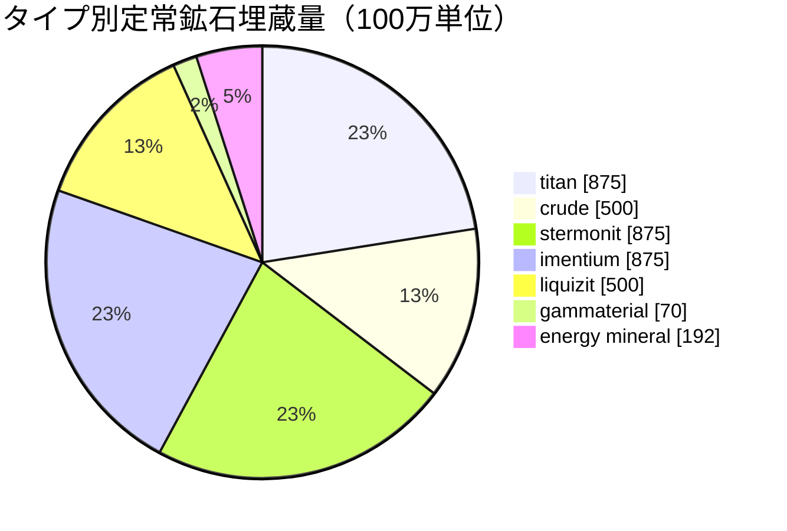

# zone_gamma_z106 — 実例

  <a href="/ja/zones/map/">
    
    <strong>ワールドマップ</strong> — テレポート接続を含む全ゾーンの配置関係。マップ全体を開く。
  </a>

このゾーンのテレポートコラムの位置（ドット、行先名付き — コラムが現在停止している場合は薄く表示）、他ゾーンから到着するテレポートの着地点（破線の円）、および出口ゲート（存在する場合は菱形）。位置はサーバーに記録されているタイル座標です。

高ティアの**開放型PvP**ゾーン：テラフォーミング可能、低い肥沃度、Tier-2植物変種、そしてより引き締められた鉱石経済。これはゾーンの「エンドゲーム」の姿であり、より少なく、より激しく争われる資源環境です。

| 項目 | 値 |
|---|---|
| ゾーンID | 106 |
| タイプ | PvP（開放） |
| 保護レベル | [ガンマ](/ja/zones/protection/) — 開放型PvP、テラフォーミング可能 |
| サイズ | 2048 × 2048 タイル |
| 肥沃度 | 15 |
| テラフォーミング | 可能（PBS技術限界2） |
| 植物ルールセット | 22 — 17種（「Gamma Plant Rules」、Tier-2構成） |
| 鉱石タイプ | 7（titan、crude、stermonit、imentium、liquizit、gammaterial、energy mineral） |
| 総鉱石ノード数 | 44 |

## 鉱石設定

| 素材 | ノード数 | 最大タイル数/ノード | ノードあたり総量 | 最小閾値 |
|---|---|---|---|---|
| [titan](/ja/content/ores/titan/) | 7 | 600 | 125,000,000 | 0.5 |
| [crude](/ja/content/ores/crude/) | 4 | 600 | 125,000,000 | 0.5 |
| [stermonit](/ja/content/ores/stermonit/) | 7 | 600 | 125,000,000 | 0.5 |
| [imentium](/ja/content/ores/imentium/) | 7 | 600 | 125,000,000 | 0.5 |
| [liquizit](/ja/content/ores/liquizit/) | 4 | 600 | 125,000,000 | 0.5 |
| [gammaterial](/ja/content/ores/gammaterial/) | 7 | 100 | 10,000,000 | 0.5 |
| [energymineral](/ja/content/ores/energymineral/) | 8 | 300 | 24,000,000 | 0.5 |

特筆すべき点：

- **アルファゾーンより少ないノード数**（Daodenの64個に対して44個）：crudeとliquizitは各わずか4ノードに減少します。ノードあたりの総量はアルファの標準鉱石と同じであるため、定常状態（全体で約39億単位）はより少なく、回復も遅くなります。
- **2種類のエキゾチック鉱石**：わずか100タイルのノードに生成される**gammaterial**（拡張半径10タイル — 小さく、発見しやすい、ノードあたり約140万）と、ノードあたり2,400万の**energy mineral**。
- epritonもflux oreもなし — 希少／経済的鉱石はアルファ層に留まります。

## 植物構成

ルールセット22では17種が許可されています：基本種に加えて、**Tier-2変種** — 自生収穫物としてのhigh iron tree t2およびhigh rustbush t2、そして**Tier-2播種植物**（high electroplant t2、high slimeroot t2）。播種植物は`playerSeeded`であり、自然にスポーンすることは**決してありません**。これらはプレイヤーの庭（農園）にのみ存在します（[採取とスキャン → 植物](/ja/features/gathering/)を参照）。

肥沃度は20ではなく**15**です：32×32キューブが保持できる通行遮断植物は最大で約15%であるため、植物の被覆率はアルファゾーンよりも目に見えてまばらになり、キューブが「飽和」するまでに肥沃度抽選で埋まる余地も少なくなります。

種ごとのルール（t2果実の産出量を含む）は[植物](/ja/content/plants/)、鉱石ごとの産出量は[鉱石](/ja/content/ores/)を参照してください。

## プレイヤーへの影響

- より引き締まり、回復が遅い経済：一般的な鉱石のノード数が少ないため、採掘圧力の影響がより早く現れます — 掘り尽くされたcrudeノードをゾーンが再補充するにはより長い時間がかかります。
- よりまばらな植生：15%の肥沃度では、開けた地面が標準であり、植物の茂みは例外となります。
- ここでの高価値な採取対象は、野生のTier-2 iron tree / rustbushと、播種されたTier-2 electroplantおよびslimerootのプレイヤー農園の運用です。
- テラフォーミング（PBS技術限界2）により、プレイヤー自身が地面そのものを再成形できます（[電力ベースステーション (PBS)](/ja/features/pbs/)を参照）。

<!-- Developer notes: zones row id 106 (zonetype 2 = PvP, protected 0, fertility 15,
     terraformable 1, pbsTechLimit 2, plantruleset 22); mineralconfigs 7 rows (crude
     and liquizit 4 nodes each); plantrules rulesetid 22 = 17 files, note "Gamma
     Plant Rules"; electroplant_seeded_t2.txt / slimeroot_seeded_t2.txt set
     playerSeeded=n1 (inherited via source= from electroplant_hi.txt /
     slimeroot_hi.txt) -> excluded from natural spawns in
     PlantRuleExtensions.GetWinnerPlantTypeBasedOnFertility. -->
