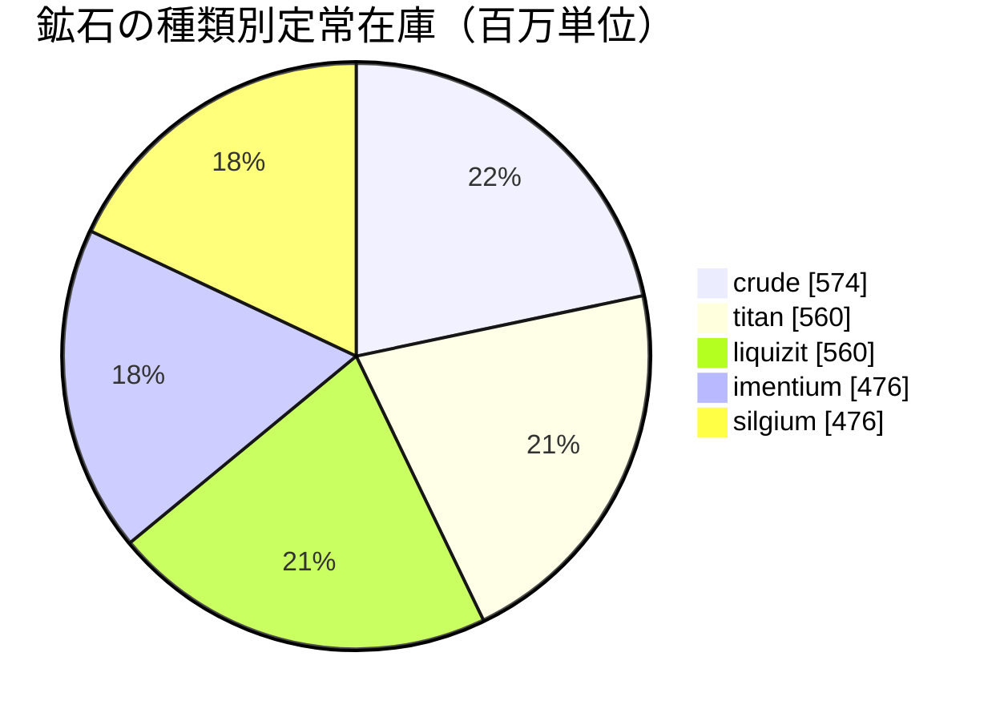

<!-- Generated by tools/generate from the live database (source: zones, mineralconfigs, plantrules, teleportdescriptions, strongholdexitconfig).
     Do not edit by hand; regenerate instead. -->
# Attalica (zone_ICS)

  <a href="/ja/zones/map/">
    
    <strong>ワールドマップ</strong> — テレポート接続を含む、全ゾーンの中でのこのゾーンの位置。マップ全体を開く。
  </a>

このゾーンのテレポート柱の位置（行き先ラベル付きの点 — 停止中の柱は薄暗く表示）、他ゾーンからのテレポート着地点（破線の円）、および出口ゲート（菱形）を示します。位置はサーバーに記録されたタイル座標です。 破線はゾーン内ローカルテレポート柱のペアを結んでいます。

Attalica (ICS)の保護（Alpha）ゾーン — プレイヤーの攻撃から安全で、Attalica (ICS)銀河の標準的な採集地です。 5種類の鉱石を維持しています。

| 項目 | 値 |
|---|---|
| ゾーンID | 1 |
| タイプ | PvE |
| 保護 | [Alpha](/ja/zones/protection/) — 保護区、PvP無効 |
| サイズ | 2048×2048 タイル |
| 肥沃度 | 20 |
| 植物種 | 15 (ルールセット 1) |
| 鉱石の種類 | 5 |
| 総鉱石ノード数 | 35 |
| 最大ドッキング基地数 | なし |

## 鉱石構成

このゾーンが維持するノード生成。鉱石ごとの産出量と生成式は[鉱石](/ja/content/ores/)にあります（このゾーンのセクションは下記にリンク）。

| 素材 | ノード | 最大タイル/ノード | ノードあたり合計 | 最小しきい値 |
|---|---|---|---|---|
| [titan](/ja/content/ores/titan/) | 7 | 625 | 80M | 0.5 |
| [crude](/ja/content/ores/crude/) | 7 | 1k | 82.125M | 0.5 |
| [imentium](/ja/content/ores/imentium/) | 7 | 625 | 68M | 0.5 |
| [liquizit](/ja/content/ores/liquizit/) | 7 | 625 | 80M | 0.5 |
| [silgium](/ja/content/ores/silgium/) | 7 | 625 | 68M | 0.5 |

[ゾーン一覧](/ja/zones/zone-index/) · [ワールドマップ](/ja/zones/map/#alpha) · [保護レベル](/ja/zones/protection/)
