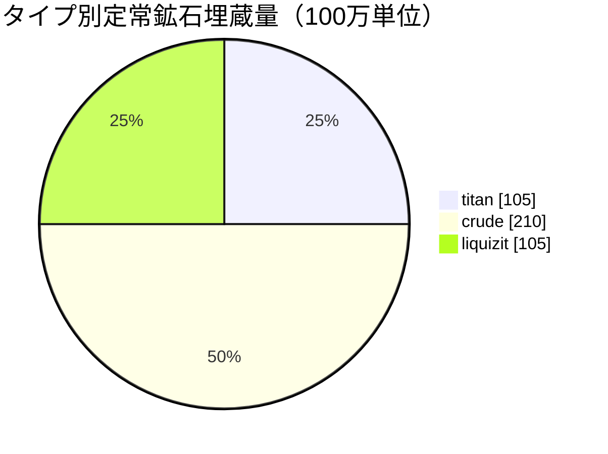

# New Virginia (zone_TM) — 実例

  <a href="/ja/zones/map/">
    
    <strong>ワールドマップ</strong> — テレポート接続を含む全ゾーンの配置関係。マップ全体を開く。
  </a>

このゾーンのテレポートコラムの位置（ドット、行先名付き — コラムが現在停止している場合は薄く表示）、他ゾーンから到着するテレポートの着地点（破線の円）、および出口ゲート（存在する場合は菱形）。位置はサーバーに記録されているタイル座標です。
破線はゾーン内ローカルテレポートコラムのペアを繋いでいます。

低ティアの**保護されたPvE**ゾーン — 新規キャラクターが集まる安全な場所です。その設定は最もシンプルな構成の一端を示しています：少数の鉱石タイプ、巨大なノード、そして基本的な植物の組み合わせです。

| 項目 | 値 |
|---|---|
| ゾーンID | 0 |
| タイプ | PvE（保護） |
| 保護レベル | [アルファ](/ja/zones/protection/) — 保護、PvP無効 |
| サイズ | 2048 × 2048 タイル |
| 肥沃度 | 20 |
| 植物ルールセット | 0 — 15種（基本的な「tm pve」構成） |
| 鉱石タイプ | 3（titan、crude、liquizit） |
| 総鉱石ノード数 | 21（各タイプ7個） |

## 鉱石設定

| 素材 | ノード数 | 最大タイル数/ノード | ノードあたり総量 | 最小閾値 |
|---|---|---|---|---|
| [titan](/ja/content/ores/titan/) | 7 | 1000 | 15,000,000 | 0.5 |
| [crude](/ja/content/ores/crude/) | 7 | 1257 | 30,000,000 | 0.5 |
| [liquizit](/ja/content/ores/liquizit/) | 7 | 1000 | 15,000,000 | 0.5 |

特筆すべき点：

- **巨大でまばらなノード** — 各1,000〜1,257タイル（拡張半径 `(int)√(tiles/π)×2` = 34〜40タイル）。各ノードは大きな塊（ブロブ）であり、ゾーン内に各タイプ7個しか存在しません。定常状態の埋蔵量は全体で約4億2,000万単位の素材です（titan 1億500万 + crude 2億1,000万 + liquizit 1億500万）。
- **希少鉱石なし** — epritonもflux oreもないため、基地周囲の立ち入り禁止エリアやNPCスポーンを誘発する鉱床はありません。
- `minthreshold` 0.5は、そのタイルのノイズ充填度が最大値の半分以上ある場合にのみ利用可能であることを意味します — 各ブロブの外縁部は薄くなります。

タイプ別の産出量（各鉱石1単位から精製される素材と、上記の数値を支えるノード生成式）については[鉱石](/ja/content/ores/)を参照してください。

## 植物構成

ルールセット0では15種が許可されています — 基本スターターセット：grass（a/b）、pine、bushes（a/b）、rango、copper tree、reed、nanowheat、低ティアのrustbush/slimeroot/electroplant、bonsai、低ティアのiron tree。壁（wall）、devrinol、高ティア収穫物は含まれません。

肥沃度20では、32×32キューブが保持できる通行遮断植物は最大で約20%です。2048×2048マップ全体では約838,000植物タイルが上限となります（水域や島部分は地面ではないため、実際にはこれより少なくなります）。植物種の選定は各ルールの`fertility`によって重み付けされるため、基本的な草や低木が大部分を占め、低ティア収穫物は希少なままとなります。

種ごとの詳細ルール（growRate、果実、耐久力）は[植物](/ja/content/plants/)を参照してください。

## プレイヤーへの影響

- 安全なスターター経済：巨大でスキャンしやすい塊として配置される3種類の一般的な鉱石。
- ここで採取できる収穫物は低ティアの変種です — 高価値の植物（高ティアのelectroplant/iron tree/rustbush/slimeroot）はより上位のゾーンに出現します。
- ゾーンが保護されているため、資源収集ループにおいてPvPリスクのみが存在しません（ゾーンへの進入については[移動](/ja/features/movement/)を参照）。

<!-- Developer notes: zones row id 0 (zonetype 1 = PvE, protected 1, fertility 20,
     plantruleset 0); mineralconfigs 3 rows (titan/crude/liquizit, 7 nodes each);
     plantrules rulesetid 0 = 15 files, note "tm pve". Node radius formula and
     threshold semantics: see generation.md. -->
