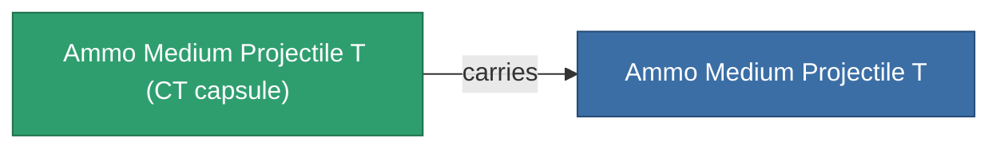

<!-- Generated by tools/generate from the live database (source: entitydefaults definition 5927, aggregatevalues via aggregatefields).
     Do not edit by hand; regenerate instead. -->

# Ammo Medium Projectile T

|  |  |
|---|---|
| 정의 | `def_ammo_medium_projectile_t` |
| 티어 | – |
| 내구도 | 100 |
| 용량 | 1 |
| 질량 | 0.2 |
| 카테고리 | Ammo / Projectiles |
| 비고 | toxic ammo med |

## 통계

| 필드 | 값 |
|---|---|
| damage_chemical | 12 |
| damage_explosive | 2 |
| damage_kinetic | 2 |
| damage_thermal | 2 |
| damage_toxic | 40 |

## 운송 캡슐

A transport capsule (CT) exists for this item — it is how the item moves between players and zones.

<!-- production:generated -->
## 생산

**구성 요소 5개로 생산** — 구성 요소를 조립하여 제작합니다 (전체 목록은 [레시피](/ko/content/recipes/) 참조):

**제작도:** [Ammo Medium Projectile T Cprg](/ko/content/items/ammo-medium-projectile-t-cprg/)

<svg class="prod-card-icon" aria-hidden="true"><use href="#mi-grid"/></svg><a class="prod-card-name" href="/ko/content/items/axicoline/">Axicoline</a>

필요: <b>200</b>

<svg class="prod-card-icon" aria-hidden="true"><use href="#mi-grid"/></svg><a class="prod-card-name" href="/ko/content/items/phlobotil/">Phlobotil</a>

필요: <b>200</b>

<svg class="prod-card-icon" aria-hidden="true"><use href="#mi-grid"/></svg><a class="prod-card-name" href="/ko/content/items/polynitrocol/">Polynitrocol</a>

필요: <b>200</b>

<svg class="prod-card-icon" aria-hidden="true"><use href="#mi-grid"/></svg><a class="prod-card-name" href="/ko/content/items/polynucleit/">Polynucleit</a>

필요: <b>200</b>

<svg class="prod-card-icon" aria-hidden="true"><use href="#mi-grid"/></svg><a class="prod-card-name" href="/ko/content/items/titanium/">Titanium</a>

필요: <b>200</b>

