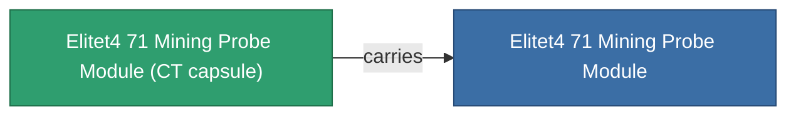

<!-- Generated by tools/generate from the live database (source: entitydefaults definition 6051, aggregatevalues via aggregatefields).
     Do not edit by hand; regenerate instead. -->

# Elitet4 71 Mining Probe Module

|  |  |
|---|---|
| 정의 | `def_elitet4_71_mining_probe_module` |
| 티어 | T4 (special) |
| 내구도 | 100 |
| 용량 | 0.5 |
| 질량 | 150 |
| 카테고리 | Modules / Enhancements |
| 비고 | elite module |

## 통계

| 필드 | 값 |
|---|---|
| core_usage | 81 |
| cpu_usage | 57 |
| cycle_time | 10k |
| mining_probe_accuracy | 0.7 |
| powergrid_usage | 50 |
| stealth_strength | 17.5 |

## 운송 캡슐

A transport capsule (CT) exists for this item — it is how the item moves between players and zones.

## 구매 장소

Fixed-price vendors that sell this item (see the [Item shop](/ko/content/shop/) for the full catalog).

| Vendor | Qty | Credits | UniCoin |
|---|---|---|---|
| Daoden outpost | ∞ | 500M | 25k |

<!-- production:generated -->
## 생산

**구성 요소 2개로 생산** — 구성 요소를 조립하여 제작합니다 (전체 목록은 [레시피](/ko/content/recipes/) 참조):

**제작도:** [Elitet4 71 Mining Probe Module Cprg](/content/items/elitet4-71-mining-probe-module-cprg/)

<svg class="prod-card-icon" aria-hidden="true"><use href="#mi-grid"/></svg><a class="prod-card-name" href="/ko/content/items/material-boss-z71/">Material Boss Z71</a>

필요: <b>400</b>

<svg class="prod-card-icon" aria-hidden="true"><use href="#mi-grid"/></svg><a class="prod-card-name" href="/ko/content/items/named3-mining-probe-module/">Eksplor-q3000 geoscanner</a>

필요: <b>1</b>

