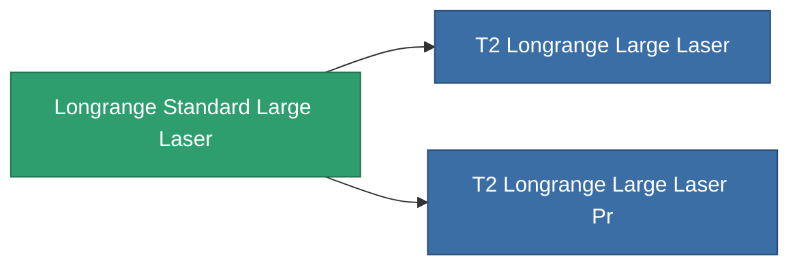

<!-- Generated by tools/generate from the live database (source: entitydefaults definition 1003, aggregatevalues via aggregatefields).
     Do not edit by hand; regenerate instead. -->

# Longrange Standard Large Laser

|  |  |
|---|---|
| 정의 | `def_longrange_standard_large_laser` |
| 티어 | T1 |
| 내구도 | 100 |
| 용량 | 1.5 |
| 질량 | 1300 |
| 카테고리 | Modules / Weapons |

## 통계

| 필드 | 값 |
|---|---|
| accuracy | 36 |
| core_usage | 14 |
| cpu_usage | 75 |
| cycle_time | 6k |
| damage_modifier | 1.5 |
| falloff | 25 |
| optimal_range | 44 |
| powergrid_usage | 402.5 |

<!-- production:generated -->
## 생산

**구성 요소 6개로 생산** — 구성 요소를 조립하여 제작합니다 (전체 목록은 [레시피](/ko/content/recipes/) 참조):

**제작도:** [Longrange Standard Large Laser Cprg](/ko/content/items/longrange-standard-large-laser-cprg/)

<svg class="prod-card-icon" aria-hidden="true"><use href="#mi-grid"/></svg><a class="prod-card-name" href="/ko/content/items/axicol/">Cryoperine</a>

필요: <b>75</b>

<svg class="prod-card-icon" aria-hidden="true"><use href="#mi-grid"/></svg><a class="prod-card-name" href="/ko/content/items/axicoline/">Axicoline</a>

필요: <b>150</b>

<svg class="prod-card-icon" aria-hidden="true"><use href="#mi-grid"/></svg><a class="prod-card-name" href="/ko/content/items/polynucleit/">Polynucleit</a>

필요: <b>150</b>

<svg class="prod-card-icon" aria-hidden="true"><use href="#mi-grid"/></svg><a class="prod-card-name" href="/ko/content/items/prilumium/">Prilumium</a>

필요: <b>75</b>

<svg class="prod-card-icon" aria-hidden="true"><use href="#mi-grid"/></svg><a class="prod-card-name" href="/ko/content/items/specimen-sap-item-flux/">Specimen Sap Item Flux</a>

필요: <b>10</b>

<svg class="prod-card-icon" aria-hidden="true"><use href="#mi-grid"/></svg><a class="prod-card-name" href="/ko/content/items/titanium/">Titanium</a>

필요: <b>150</b>

## 생산에 사용

**2개 아이템의 구성 요소** — 이를 생산에 사용하는 모든 것:

