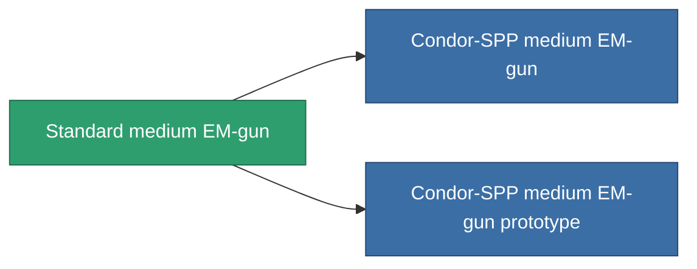

<!-- Generated by tools/generate from the live database (source: entitydefaults definition 1000, aggregatevalues via aggregatefields).
     Do not edit by hand; regenerate instead. -->

# Standard medium EM-gun

|  |  |
|---|---|
| 정의 | `def_longrange_standard_medium_railgun` |
| 티어 | T1 |
| 내구도 | 100 |
| 용량 | 1 |
| 질량 | 650 |
| 카테고리 | Modules / Weapons |

## 통계

| 필드 | 값 |
|---|---|
| accuracy | 14 |
| core_usage | 22 |
| cpu_usage | 40 |
| cycle_time | 10k |
| damage_modifier | 2 |
| falloff | 7.5 |
| least_optimal | 18 |
| optimal_range | 29 |
| powergrid_usage | 185 |

<!-- production:generated -->
## 생산

**구성 요소 5개로 생산 , 연구 레벨 4** — 구성 요소를 조립하여 제작합니다 (전체 목록은 [레시피](/ko/content/recipes/) 참조):

**제작도:** [Standard medium EM-gun CT](/ko/content/items/longrange-standard-medium-railgun-cprg/)

<svg class="prod-card-icon" aria-hidden="true"><use href="#mi-grid"/></svg><a class="prod-card-name" href="/ko/content/items/axicol/">Cryoperine</a>

필요: <b>50</b>

<svg class="prod-card-icon" aria-hidden="true"><use href="#mi-grid"/></svg><a class="prod-card-name" href="/ko/content/items/axicoline/">Axicoline</a>

필요: <b>100</b>

<svg class="prod-card-icon" aria-hidden="true"><use href="#mi-grid"/></svg><a class="prod-card-name" href="/ko/content/items/chollonin/">Chollonin</a>

필요: <b>50</b>

<svg class="prod-card-icon" aria-hidden="true"><use href="#mi-grid"/></svg><a class="prod-card-name" href="/ko/content/items/polynitrocol/">Polynitrocol</a>

필요: <b>100</b>

<svg class="prod-card-icon" aria-hidden="true"><use href="#mi-grid"/></svg><a class="prod-card-name" href="/ko/content/items/titanium/">Titanium</a>

필요: <b>100</b>

## 생산에 사용

**2개 아이템의 구성 요소** — 이를 생산에 사용하는 모든 것:

