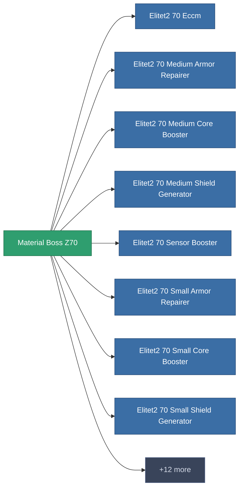

<!-- Generated by tools/generate from the live database (source: entitydefaults definition 5995, aggregatevalues via aggregatefields).
     Do not edit by hand; regenerate instead. -->

# Material Boss Z70

|  |  |
|---|---|
| 정의 | `def_material_boss_z70` |
| 티어 | – |
| 내구도 | 100 |
| 용량 | 0.01 |
| 질량 | 0.5 |
| 카테고리 | Materials |
| 비고 | elite module |

_통계 없음 — 이 아이템에는 집계 값이 없습니다._

<!-- production:generated -->
## 생산에 사용

**20개 아이템의 구성 요소** — 이를 이용해 생산할 수 있는 것의 예시 (전체 목록은 [레시피](/ko/content/recipes/) 참조).

