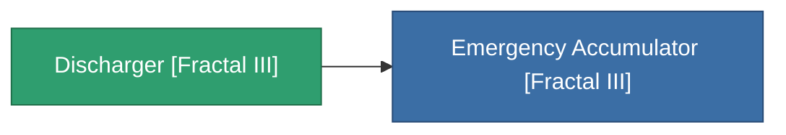

<!-- Generated by tools/generate from the live database (source: entitydefaults definition 4540, aggregatevalues via aggregatefields).
     Do not edit by hand; regenerate instead. -->

# Discharger [Fractal III]

|  |  |
|---|---|
| 정의 | `def_missionitem_asi_i_level00_exp3_03_t03` |
| 티어 | – |
| 내구도 | 100 |
| 용량 | 1 |
| 질량 | 50 |
| 카테고리 | Mission items |

_통계 없음 — 이 아이템에는 집계 값이 없습니다._

<!-- production:generated -->
## 생산에 사용

**1개 아이템의 구성 요소** — 이를 생산에 사용하는 모든 것:

