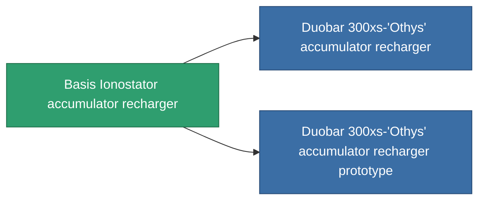

<!-- Generated by tools/generate from the live database (source: entitydefaults definition 762, aggregatevalues via aggregatefields).
     Do not edit by hand; regenerate instead. -->

# Basis Ionostator accumulator recharger

|  |  |
|---|---|
| 정의 | `def_named1_core_recharger` |
| 티어 | T2 |
| 내구도 | 100 |
| 용량 | 0.5 |
| 질량 | 100 |
| 카테고리 | Modules / Power |
| Tier line | [Standard accumulator recharger](/ko/content/items/standard-core-recharger/) (T1) → **Basis Ionostator accumulator recharger** (T2) → [Duobar 300xs-'Othys' accumulator recharger](/ko/content/items/named2-core-recharger/) (T3) → [Nyhna Filler accumulator recharger](/ko/content/items/named3-core-recharger/) (T4) |

## 통계

| 필드 | 값 |
|---|---|
| core_recharge_time_modifier | 0.9 |
| cpu_usage | 23 |
| powergrid_usage | 2 |

<!-- production:generated -->
## 생산

**구성 요소 4개로 생산 , 연구 레벨 4** — 구성 요소를 조립하여 제작합니다 (전체 목록은 [레시피](/ko/content/recipes/) 참조):

**제작도:** [Basis Ionostator accumulator recharger CT](/content/items/named1-core-recharger-cprg/)

<svg class="prod-card-icon" aria-hidden="true"><use href="#mi-grid"/></svg><a class="prod-card-name" href="/ko/content/items/axicol/">Cryoperine</a>

필요: <b>250</b>

<svg class="prod-card-icon" aria-hidden="true"><use href="#mi-crystal"/></svg><a class="prod-card-name" href="/ko/content/items/robotshard-common-basic/">Damaged common fragment</a>

필요: <b>30</b>

<svg class="prod-card-icon" aria-hidden="true"><use href="#mi-grid"/></svg><a class="prod-card-name" href="/ko/content/items/standard-core-recharger/">Standard accumulator recharger</a>

필요: <b>1</b>

<svg class="prod-card-icon" aria-hidden="true"><use href="#mi-grid"/></svg><a class="prod-card-name" href="/ko/content/items/titanium/">Titanium</a>

필요: <b>150</b>

## 생산에 사용

**2개 아이템의 구성 요소** — 이를 생산에 사용하는 모든 것:

