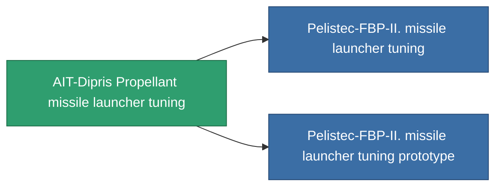

<!-- Generated by tools/generate from the live database (source: entitydefaults definition 927, aggregatevalues via aggregatefields).
     Do not edit by hand; regenerate instead. -->

# AIT-Dipris Propellant missile launcher tuning

|  |  |
|---|---|
| 정의 | `def_named1_damage_mod_missile` |
| 티어 | T2 |
| 내구도 | 100 |
| 용량 | 0.5 |
| 질량 | 90 |
| 카테고리 | Modules / Enhancements |
| Tier line | [Standard missile launcher tuning](/ko/content/items/standard-damage-mod-missile/) (T1) → **AIT-Dipris Propellant missile launcher tuning** (T2) → [Pelistec-FBP-II. missile launcher tuning](/ko/content/items/named2-damage-mod-missile/) (T3) → [Dozer-IMT missile launcher tuning](/ko/content/items/named3-damage-mod-missile/) (T4) |

## 통계

| 필드 | 값 |
|---|---|
| cpu_usage | 23 |
| damage_missile_modifier | 0.15 |
| powergrid_usage | 4 |

<!-- production:generated -->
## 생산

**구성 요소 8개로 생산 , 연구 레벨 4** — 구성 요소를 조립하여 제작합니다 (전체 목록은 [레시피](/ko/content/recipes/) 참조):

**제작도:** [AIT-Dipris Propellant missile launcher tuning CT](/content/items/named1-damage-mod-missile-cprg/)

<svg class="prod-card-icon" aria-hidden="true"><use href="#mi-grid"/></svg><a class="prod-card-name" href="/ko/content/items/axicol/">Cryoperine</a>

필요: <b>100</b>

<svg class="prod-card-icon" aria-hidden="true"><use href="#mi-grid"/></svg><a class="prod-card-name" href="/ko/content/items/axicoline/">Axicoline</a>

필요: <b>50</b>

<svg class="prod-card-icon" aria-hidden="true"><use href="#mi-grid"/></svg><a class="prod-card-name" href="/ko/content/items/phlobotil/">Phlobotil</a>

필요: <b>50</b>

<svg class="prod-card-icon" aria-hidden="true"><use href="#mi-crystal"/></svg><a class="prod-card-name" href="/ko/content/items/robotshard-common-basic/">Damaged common fragment</a>

필요: <b>15</b>

<svg class="prod-card-icon" aria-hidden="true"><use href="#mi-crystal"/></svg><a class="prod-card-name" href="/ko/content/items/robotshard-pelistal-basic/">Damaged pelistal fragment</a>

필요: <b>15</b>

<svg class="prod-card-icon" aria-hidden="true"><use href="#mi-star"/></svg><a class="prod-card-name" href="/ko/content/items/standard-damage-mod-missile/">Standard missile launcher tuning</a>

필요: <b>1</b>

<svg class="prod-card-icon" aria-hidden="true"><use href="#mi-grid"/></svg><a class="prod-card-name" href="/ko/content/items/titanium/">Titanium</a>

필요: <b>50</b>

<svg class="prod-card-icon" aria-hidden="true"><use href="#mi-grid"/></svg><a class="prod-card-name" href="/ko/content/items/vitricyl/">Vitricyl</a>

필요: <b>100</b>

## 생산에 사용

**2개 아이템의 구성 요소** — 이를 생산에 사용하는 모든 것:

