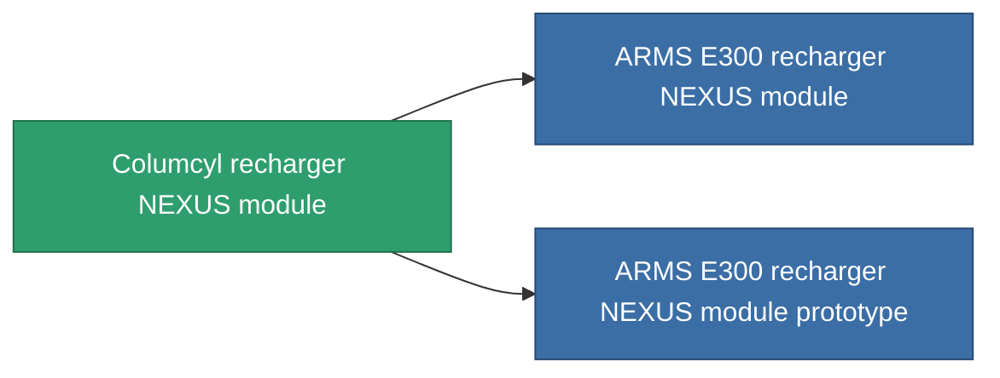

<!-- Generated by tools/generate from the live database (source: entitydefaults definition 2601, aggregatevalues via aggregatefields).
     Do not edit by hand; regenerate instead. -->

# Columcyl recharger NEXUS module

|  |  |
|---|---|
| 정의 | `def_named1_gang_assist_core_management_module` |
| 티어 | T2 |
| 내구도 | 100 |
| 용량 | 0.2 |
| 질량 | 50 |
| 카테고리 | Modules / Enhancements |
| Tier line | [Standard recharger NEXUS module](/ko/content/items/standard-gang-assist-core-management-module/) (T1) → **Columcyl recharger NEXUS module** (T2) → [ARMS E300 recharger NEXUS module](/ko/content/items/named2-gang-assist-core-management-module/) (T3) → [ARMS X500 recharger NEXUS module](/ko/content/items/named3-gang-assist-core-management-module/) (T4) |
| 비고 | core_recharge_time csokkent |

## 통계

| 필드 | 값 |
|---|---|
| core_usage | 31 |
| cpu_usage | 78 |
| cycle_time | 10k |
| default_effect_range | 100 |
| effect_core_recharge_time_modifier | 0.98 |
| powergrid_usage | 31 |

<!-- production:generated -->
## 생산

**구성 요소 7개로 생산 , 연구 레벨 5** — 구성 요소를 조립하여 제작합니다 (전체 목록은 [레시피](/ko/content/recipes/) 참조):

**제작도:** [Columcyl recharger NEXUS module CT](/ko/content/items/named1-gang-assist-core-management-module-cprg/)

<svg class="prod-card-icon" aria-hidden="true"><use href="#mi-grid"/></svg><a class="prod-card-name" href="/ko/content/items/axicol/">Cryoperine</a>

필요: <b>250</b>

<svg class="prod-card-icon" aria-hidden="true"><use href="#mi-grid"/></svg><a class="prod-card-name" href="/ko/content/items/isopropentol/">Isopropentol</a>

필요: <b>50</b>

<svg class="prod-card-icon" aria-hidden="true"><use href="#mi-grid"/></svg><a class="prod-card-name" href="/ko/content/items/plasteosine/">Plasteosine</a>

필요: <b>50</b>

<svg class="prod-card-icon" aria-hidden="true"><use href="#mi-crystal"/></svg><a class="prod-card-name" href="/ko/content/items/robotshard-common-basic/">Damaged common fragment</a>

필요: <b>30</b>

<svg class="prod-card-icon" aria-hidden="true"><use href="#mi-panel"/></svg><a class="prod-card-name" href="/ko/content/items/standard-gang-assist-core-management-module/">Standard recharger NEXUS module</a>

필요: <b>1</b>

<svg class="prod-card-icon" aria-hidden="true"><use href="#mi-grid"/></svg><a class="prod-card-name" href="/ko/content/items/titanium/">Titanium</a>

필요: <b>50</b>

<svg class="prod-card-icon" aria-hidden="true"><use href="#mi-grid"/></svg><a class="prod-card-name" href="/ko/content/items/vitricyl/">Vitricyl</a>

필요: <b>250</b>

## 생산에 사용

**2개 아이템의 구성 요소** — 이를 생산에 사용하는 모든 것:

